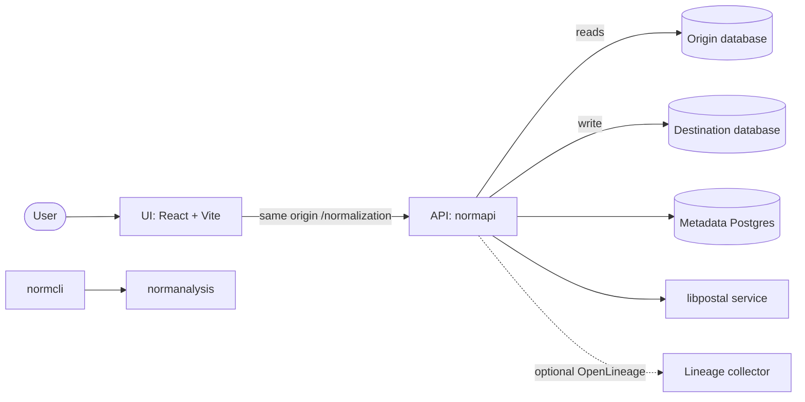
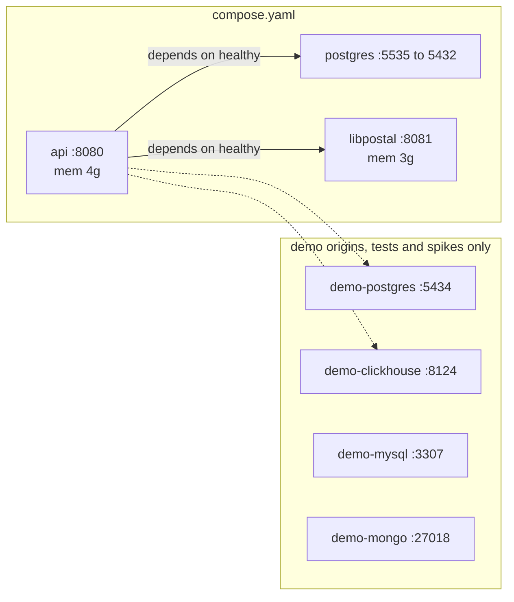
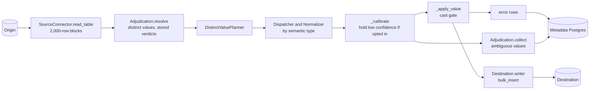
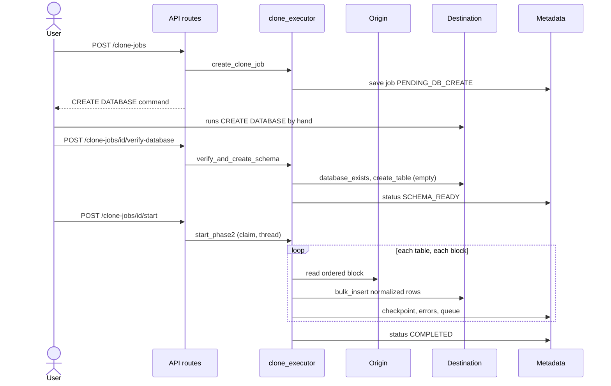
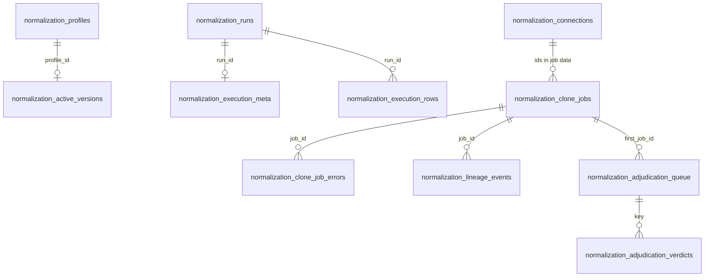

# Architecture

How the Normalization Engine fits together, runs, stores data and what it
guarantees. For setup and results see [README.md](README.md). For the code
see [TECHNICAL_IMPLEMENTATION.md](TECHNICAL_IMPLEMENTATION.md). Terms are
defined in [GLOSSARY.md](GLOSSARY.md).

## System context

<!-- verified: 9f27526 -->

The engine sits before data discovery and record linkage. It normalizes
values. It does not find schemas, keys or entities, and it does not match
records.

Caption: the API reads the origin, writes the destination, and keeps its own
state in a separate metadata database. `normcli` calls analysis code directly
and never the API.

Boundaries:

- Origin databases are Postgres or ClickHouse only. MySQL, Mongo and file
  connectors exist in `packages/normio/src/normio/connectors/` but the clone
  feature does not use them ([ADR-017](docs/adr/ADR-017-clone-normalize-engine-scope.md)).
- The lineage collector is optional. `packages/normapi/src/normapi/lineage.py::_forward`
  posts events only when `NORM_OPENLINEAGE_URL` is set. A missing collector
  never fails a job.
- The API serves the built UI at `/` on its own port, so there is no UI service in
  `compose.yaml` and no CORS ([ADR-023](docs/adr/ADR-023-ui-scope-and-technology.md)).
  The image builds `ui/` in a Node stage (`packages/normapi/Dockerfile`). `/docs` and
  `/redoc` are off; `/openapi.json` stays.

## Deployment

<!-- verified: 544cd37 -->

Caption: three services form the stack. The four demo databases exist for
integration tests and for trying a clone.

Volumes: `pg_data`, `libpostal_data`, `sidecar_data`. Source:
`compose.yaml`. The API image is `packages/normapi/Dockerfile` (Python 3.12,
port 8080, `/health` check).

Port 5535 is deliberate: other local stacks often hold 5433.

Ports bind addresses ([ADR-022](docs/adr/ADR-022-network-and-database-address-policy.md)): the API
binds `NORM_BIND_ADDR`, the host's private LAN address from `.env`. libpostal and every database
bind `127.0.0.1`. The API answers only callers inside loopback, RFC 1918 and `fc00::/7`, checks the
`Host` header, and refuses database hosts that resolve outside that set.

### Configuration

All settings are environment variables. The default is the value in code.
`compose` marks a different value set in `compose.yaml`.

| Variable | Default | Effect |
|---|---|---|
| `NORM_PG_DSN` | none (`compose`: the `postgres` service) | Metadata database. Required for clone jobs. |
| `NORM_SECRET_KEY` | none (`compose`: required, from `.env`) | Fernet key that encrypts saved connection passwords. Required to save a connection. |
| `NORM_BIND_ADDR` | none (`compose`: required, from `.env`) | Host address the API port is published on. Use the private LAN address. |
| `NORM_ALLOWED_HOSTS` | empty | Extra `Host` header names. `localhost`, `127.0.0.1` and `NORM_BIND_ADDR` are always allowed. |
| `NORM_ALLOWED_NETWORKS` | empty | Extra networks (CIDR) allowed as callers and database targets, for example `100.64.0.0/10`. A bad entry stops the API at start-up. |
| `NORM_LIBPOSTAL_URL` | `http://localhost:8081` (`compose`: `http://libpostal:8081`) | Address parsing service. |
| `NORM_CACHE_PATH` | `:memory:` (`compose`: `/data/sidecar/cache.duckdb`) | DuckDB file for the value cache. |
| `NORM_LIBPOSTAL_MODEL_SHA256` | unset | Hash of the libpostal model data. It feeds `env_id`. |
| `NORM_DICTIONARIES_DIR` | `data/dictionaries` (`compose`: `/app/data/dictionaries`) | Shipped dictionaries. |
| `NORM_CUSTOM_DICTIONARIES_DIR` | `data/custom-dictionaries` | User dictionaries. |
| `NORM_MAX_RUN_ROWS` | 40,000 | Row limit for one `POST /runs`. |
| `NORM_UI_DIR` | `ui/dist` in the repository | The built UI the API serves at `/` ([ADR-023](docs/adr/ADR-023-ui-scope-and-technology.md)). |
| `NORM_OPENLINEAGE_URL` | empty (do not forward) | Lineage collector URL. |
| `NORM_API_HOST`, `NORM_API_PORT` | `0.0.0.0`, 8080 | Used by `python -m normapi.main`. Inside the container only; the host publishes on `NORM_BIND_ADDR`. |
| `NORM_CLONE_WORKERS` | 3 (capped at CPU count) | Normalization worker processes, about 175 MB each. |
| `NORM_CLONE_HEARTBEAT_TIMEOUT_SECONDS` | 900 | When a RUNNING job reports `stale`. |
| `NORM_CLONE_AUTODETECT_MIN_CONFIDENCE` | 0.9 | Minimum detector confidence for a suggestion. |
| `NORM_CLONE_AUTODETECT_SAMPLE_ROWS` | 200 | Rows sampled per column for detection. |
| `NORM_CLONE_IDEMPOTENCY_SAMPLE` | 50 | Changed outputs re-normalized per chunk to check stability. 0 turns it off. |
| `NORM_CLONE_NULL_RATE_REPORT` | 0.05 | Share of values emptied before a column finding is recorded. |
| `NORM_CLONE_TYPE_MISMATCH_REPORT` | 0.5 | Share of INVALID values before a wrong-type finding is recorded. |
| `NORM_CLONE_ENTITY_MAP_MAX` | 2,000,000 | Cap on the entity-to-country map. |
| `NORM_SOURCE_READ_BATCH_ROWS`, `NORM_DESTINATION_INSERT_CHUNK_ROWS`, `NORM_PERSISTENCE_WRITE_CHUNK_ROWS`, `NORM_PERSISTENCE_PAGE_ROWS` | 2,000 each | Batch sizes. The first also sets the checkpoint size. |

Sources: `packages/normapi/src/normapi/app.py`,
`packages/normapi/src/normapi/clone_executor.py`,
`packages/normio/src/normio/connectors/_sql_base.py`, `compose.yaml`.
`.env.example` documents each one.

## Main data flow

<!-- verified: 9f27526 -->

Caption: each column block is reduced to its distinct values. A stored verdict
answers some. The rest go through the planner and a normalizer, and are written. Ambiguous values and failures go to the
metadata database.

Why this shape:

- Normalizing distinct values once makes cost depend on cardinality, not row
  count (ADR-016).
- The persistent cache is not used by a clone. On real clone data most
  columns are 80 to 97 percent unique, so the cache held one entry per row
  and saved about 3 percent of calls
  (`packages/normapi/src/normapi/clone_executor.py::_run_phase2`, comment).
  The in-memory `DistinctValuePlanner` memo covers low-cardinality columns.
- Normalization runs in a process pool, not threads, because it is CPU-bound
  Python. The pool uses `spawn` because the parent is a multi-threaded server
  (`packages/normapi/src/normapi/clone_executor.py::_make_pool`).

## Main workflow: clone and normalize

<!-- verified: 9f27526 -->

Caption: the app never runs `CREATE DATABASE`, so it never needs admin
rights. `GET /clone-jobs/id/plan` can be read before Phase 1.

Job statuses are `PENDING_DB_CREATE`, `SCHEMA_READY`, `RUNNING`, `COMPLETED`
and `FAILED` (`packages/normcore/src/normcore/enums.py::CloneJobStatus`). A
`SCHEMA_READY`, `RUNNING` or `FAILED` job can be started again
(`packages/normapi/src/normapi/pg_persistence.py::PgPersistence.claim_clone_job`).

## Data contract

<!-- verified: e65ebbe -->

### The normalized value

`packages/normcore/src/normcore/models.py::NormalizedValue` declares the shape
once. The JSON Schema and the Arrow schema derive from it
(`packages/normcore/src/normcore/contract.py`). A round-trip test fails if a
field is added to one and not the other
(`tests/unit/test_data_contract.py`).

| Field | Meaning |
|---|---|
| `original` | Raw input, kept byte for byte. |
| `original_kind` | Set when the original is a missing-value sentinel. |
| `repaired` | After encoding repair. Set only when the repair was applied. |
| `display` | Human-readable canonical form. |
| `comparison` | Key for equality and fuzzy matching. Deliberately lossy. |
| `search` | Key for lookup. |
| `ascii` | Optional transliteration. Never replaces the Unicode form. |
| `structured` | Parsed parts. The shape depends on the semantic type. |
| `validation_status` | Domain result, such as phone validity. |
| `normalization_status` | One of nine statuses (see below). |
| `confidence` | Stated confidence, 0 to 1. |
| `flags`, `warnings`, `errors` | Quality flags and messages. |
| `trace` | Step list with hashes and masks. |
| `lossiness` | `LOSSLESS`, `REVERSIBLE`, `PARTIALLY_REVERSIBLE` or `LOSSY`. |
| `profile_version`, `env_id` | Stamped by the dispatcher, never by a normalizer. |
| `semantic_type`, `context_hash` | The field type, and a hash the dispatcher checks. |

Statuses: `NORMALIZED`, `UNCHANGED`, `REPAIRED`, `PARSED`, `AMBIGUOUS`,
`INVALID`, `FAILED`, `PARTIAL`, `NEEDS_REVIEW`. `AMBIGUOUS` means the engine
refused to choose. `NEEDS_REVIEW` means a value was emitted and a person must
confirm it.

### Trace and storage forms

Each `TraceStep` records the step order, rule, operation, parameter hash, input
and output hashes, input and output masks, whether it changed or lost
information, and the library and version used
(`packages/normcore/src/normcore/trace.py::TraceStep`). The Arrow form stores
`structured` and `trace` as JSON text columns `structured_json` and
`trace_json`, which keeps Parquet columns simple and queryable through DuckDB
JSON functions (`packages/normcore/src/normcore/contract.py`).

### Per-type additions to `structured`

| Type | Keys | Rule |
|---|---|---|
| `TAX_ID` | `validation_status` `VALID`, `INVALID` or `UNKNOWN`; `verification`; `verification_reason` | The `python-stdnum` module is found per country. A number no offline validator can decide is `unverifiable` and `UNKNOWN`, never `VALID` or `INVALID`. |
| `CODE` | `verification` is `not_applicable` | Canonical form only. No check-digit verdict. |
| `URL` | `registrable_domain`, `public_suffix`, `is_private_suffix`, `registrable_domain_reason` | From the bundled Public Suffix List. Empty with a reason for IP addresses, `localhost` and bare suffixes. |
| `PHONE` | `rfc3966`; `comparison` | With an extension, `comparison` is the RFC 3966 URI, so numbers that differ only by extension do not compare equal. `search` is the extension-free E.164. |
| `PERSON_NAME` | `phonetic`, `phonetic_status`, `script` | Latin names get `double_metaphone` and `beider_morse` as lists of alternatives, beside four legacy keys. Cyrillic and Arabic names get `phonetic_status = "not_applicable"` and the same two keys. Other scripts get no key. |
| `DATE` | `<col>__from`, `<col>__to` in a typed destination | Bounds of the stated period, so `1990` covers 1990-01-01 to 1990-12-31. |

### Metadata tables

Caption: logical links only. The schema in
`packages/normapi/src/normapi/pg_persistence.py::_SCHEMA` declares no foreign
keys. Profiles, runs and clone jobs store their body as one text `data` column.

Rules that matter to a database administrator:

- The queue holds one row per ambiguous value and context, with an
  occurrence count. Verdict rows are append-only. The newest row for a key wins.
- Clone job errors are keyed by job, row index, table and field.
- A queue row holds the raw original. The API returns a masked preview, except
  `GET /adjudication/review` (ADR-023, R23): it returns the raw value, at most
  100,000 pending entries, most frequent first, and the full pending count in
  `X-Total-Count`.
- `normalization_connections.encrypted_password` is a Fernet token.

### Destination data

- A value that fails keeps its original in a text destination cell. The cell is
  never blank and never skipped (`ErrorPolicy.RETURN_ORIGINAL`). A full error
  report is available at `GET /clone-jobs/{id}/errors`.
- Typed columns exist for numeric, money, boolean and date bounds (ADR-020).
  A value a column cannot hold becomes NULL with an error row, never a failed
  insert. Dates stay text because they can be partial. Their bounds go to
  `<col>__from` and `<col>__to` date columns.
- Companion columns hold what the value alone cannot:

  | Column | Added for | Holds |
  |---|---|---|
  | `<col>_currency` | MONEY | the currency code |
  | `<col>_code` | COUNTRY, LANGUAGE, PHONE | the derived code |
  | `<col>_region` | PHONE | the region |
  | `<col>__from`, `<col>__to` | DATE, DATETIME, not on a key column | the first and last day of the period |
  | `<col>_normalized` | a configured key column | the normalized value; the key keeps the source value |

## Interfaces for other projects

<!-- verified: 9f27526 -->

| Interface | Where | Use |
|---|---|---|
| HTTP API | `packages/normapi/src/normapi/routes.py`, prefix `/normalization` | Profiles, runs, dictionaries, connections, clone jobs, adjudication. Interactive docs are served by FastAPI. |
| Health | `GET /health` | Container health check. |
| Lineage | `GET /normalization/clone-jobs/{id}/lineage` | OpenLineage events per job and table. |
| CLI | `packages/normcli/src/normcli/cli.py` | `gold generate`, `gold score`, `calibrate`, `check-traceability`, `mutation-score-gate`. |
| Python API | `packages/normcore/src/normcore/dispatch.py::Dispatcher.normalize` | One call per value. |

## Guarantees and what it never does

<!-- verified: 9f27526 -->

| Guarantee | How it holds |
|---|---|
| A normal clone never writes the origin. | `SourceConnector` has no write method. Demo origins have a database-level read-only user (`tests/integration/test_readonly_connectors.py`). The destination uses its own connection. |
| The origin is never written. | Every clone writes a separate copy. The schema refuses unknown fields and a destination equal to the origin (`packages/normapi/src/normapi/schemas.py::CloneJobCreateRequest`). |
| No guess on ambiguous input. | Normalizers return `AMBIGUOUS` and keep the original. `1,234` has no locale to settle it. |
| Precision is kept, not invented. | A year stays a year. Nothing fills in a month or day. |
| The original survives. | `original` is never overwritten. A failed value keeps its original in a text destination column. A typed column stores NULL and an error row. |
| Same input, same output. | `(original, semantic_type, context, profile_version, env_id)` fixes the output. A 1,000,000-row test through two separate processes gave identical Parquet files (`tests/integration/test_byte_identical_replay.py`). |
| A refusal has an exit. | A verdict settles the value in every later run with the same context and profile version. |
| A crashed job resumes. | Each block commits a checkpoint, a row offset at a block boundary. A Postgres table is read in primary-key order, else `ctid`, and skips committed blocks. An unfinished ClickHouse table restarts from empty because its read order is not stable ([REPORT §10 item 2](docs/benchmarks/REPORT.md)). |

The engine does not discover schemas or keys, extract entities, build
canonical datasets, or link records. A test fails if any package imports `splink`
(`tests/unit/test_no_splink.py`).

Known limits:

- A Postgres table without a primary key that is killed between a block's
  commit and its checkpoint writes that block twice
  ([REPORT §10 item 2](docs/benchmarks/REPORT.md)).
- Confidence does not separate well-formed wrong input. Calibration holds
  where errors resemble the calibration corpus and does not hold across
  error generators ([REPORT §11.8](docs/benchmarks/REPORT.md)). Abstention is
  therefore opt in per job.
- A non-built-in Postgres type (enum, citext, arrays of those) becomes `text`
  in the destination. Values are kept and the constraint is not.

## Security and personal data

<!-- verified: 544cd37 -->

| Topic | Rule | Code |
|---|---|---|
| Job errors, run values, access log | Source values are masked where they leave the API ([ADR-023](docs/adr/ADR-023-ui-scope-and-technology.md), R23). | `packages/normapi/src/normapi/routes.py::_masked_error` |
| Traces | Hold hashes and character-class masks, never raw values. `TraceStep` has no field for a raw value. | `packages/normcore/src/normcore/trace.py::TraceStep` |
| Keys | Cache and verdict keys use `blake3` of the value, not the value. | `packages/normexec/src/normexec/cache.py::make_cache_key` |
| Previews | The API returns a masked preview unless `pii_visibility` allows more. | `packages/normcore/src/normcore/pii.py::safe_preview` |
| Credentials | Saved passwords are encrypted with Fernet. They are decrypted in memory at connect time. | `packages/normapi/src/normapi/secrets.py` |
| Error rows and queue | Hold the raw original. Restrict database access to the metadata database. | `packages/normapi/src/normapi/pg_persistence.py::_SCHEMA` |
| Secret key | `compose.yaml` holds no key; it reads `NORM_SECRET_KEY` from the uncommitted `.env`. | `compose.yaml` |
| Callers and `Host` | Middleware refuses a peer outside loopback, RFC 1918 and `fc00::/7`, and a `Host` outside the allowlist. `X-Forwarded-For` is ignored. | `packages/normapi/src/normapi/app.py::LocalCallersOnly` |
| Database targets | A host must be a strict literal or resolve only to allowed addresses. The connection uses the checked address. Checked on save and on every use. | `packages/normapi/src/normapi/address_policy.py::resolve_and_check` |
| CORS | None. The API serves the UI on its own port, so no browser origin needs access. | `packages/normapi/src/normapi/app.py::create_app` |

The API has no authentication layer in the code. Put it behind your own
gateway.

## Performance and scaling

<!-- verified: 9f27526 -->

Memory is the binding limit, not CPU. The API container is capped at 4 GB.
Each normalization worker costs about 175 MB. Measured speed-up is
sublinear: 1.85 times at 4 workers
(`packages/normapi/src/normapi/clone_executor.py`, comment above
`_WORKER_COUNT`).

Measured end to end clones, each with source and destination row counts
equal, on ClickHouse 25.12 and Postgres
([REPORT §11.10](docs/benchmarks/REPORT.md)):

| Run | Engine | Rows | Phase 2 seconds |
|---|---|---|---|
| `uk_price_paid` | Postgres | 931,453 | 120.7 |
| `nyc_taxi` | ClickHouse | 2,964,624 | 51.3 |
| `gleif` | Postgres | 3,458,719 | 894.0 |
| tpch_sf1 (8 tables) | ClickHouse | 8,661,245 | 110.4 |
| tpch_sf10 (8 tables) | ClickHouse | 86,586,082 | 1,143.1 |

Throughput depends on the data. In one measured clone, normalization took
79.6 percent of wall-clock time (`packages/normapi/src/normapi/clone_executor.py`,
comment above `_WORKER_COUNT`). Measure your own source before you size a job.

## Quality measurement

<!-- verified: 9f27526 -->

| Tool | Question it answers | Command |
|---|---|---|
| Gold corpus | Is the answer right, abstained or confidently wrong? | `normcli gold generate`, `normcli gold score` |
| Calibration | Does stated confidence match accuracy, and where is the threshold? | `normcli calibrate --cost-ratio R` |
| Disguised-missing detector | Which values stand in for a missing value? | Run report in a clone job |
| Benchmarks | How does it behave on public data? | [REPORT](docs/benchmarks/REPORT.md) |

The scorer classes are `correct`, `correct-abstain`, `wrong-confident`,
`over-abstain` and `wrong-status`. The cost ratio has no default because the
right value depends on how costly a wrong value is for you
([ADR-019](docs/adr/ADR-019-confidence-calibration.md)).

## Libraries, standards and external data

<!-- verified: 9f27526 -->

Full list with licenses: [dependency inventory](docs/dependency-inventory.md).

| Need | Choice | Standard or data |
|---|---|---|
| Unicode, transliteration | PyICU, ftfy, anyascii | Unicode, CLDR |
| Phones | phonenumbers | E.164, RFC 3966 |
| Addresses | libpostal service | Pinned, checksummed model data |
| Dates | dateparser, Babel | CLDR, ISO 8601, EDTF |
| Countries, currencies | pycountry, Babel | ISO 3166, ISO 4217 |
| Identifiers | python-stdnum | National registries |
| Company names | cleanco | GLEIF ISO 20275 legal-form list (ADR-004) |
| Batch engine | Polars, DuckDB, Arrow | Parquet |
| API and storage | FastAPI, SQLAlchemy, psycopg | OpenLineage |

Rejected libraries and reasons are in [LESSONS.md](docs/LESSONS.md).

## Design decisions

<!-- verified: 9f27526 -->

All decisions are in [docs/adr/](docs/adr/). Start with:

- [ADR-013](docs/adr/ADR-013-normalization-storage.md) storage
- [ADR-014](docs/adr/ADR-014-normalization-versioning.md) versioning and `env_id`
- [ADR-016](docs/adr/ADR-016-performance-architecture.md) performance
- [ADR-017](docs/adr/ADR-017-clone-normalize-engine-scope.md) clone scope
- [ADR-018](docs/adr/ADR-018-abstention-and-adjudication.md) abstention and verdicts
- [ADR-019](docs/adr/ADR-019-confidence-calibration.md) calibration
- [ADR-020](docs/adr/ADR-020-typed-destination.md) typed destination
