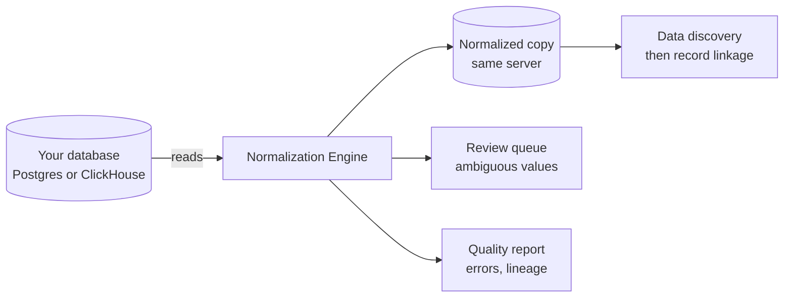

# Normalization Engine

The Normalization Engine cleans and standardizes the values in a database
(names, phones, dates, addresses, identifiers and more) without guessing. When
a value has two valid readings, it keeps the original and asks a person.

It sits before data discovery and record linkage. It does not find schemas,
keys or entities, and it does not match records.



Caption: a normal clone only reads the origin and writes a normalized copy
next to it. Every clone writes a separate copy; the origin is never written.

## Why it matters

<!-- verified: 9f27526 -->

- **No silent guesses.** `03/04/2024` is 3 April or 4 March. The engine keeps
  the original and queues the value. One answer from a person settles it in
  every later run.
- **Nothing is lost.** In a normal clone every original stays in the origin.
  A value that fails keeps its original in a text column, or becomes NULL in a
  typed column, and gets an error row.
- **Repeatable.** The same input and the same environment give the same
  output, byte for byte.

## Status

<!-- verified: 9f27526 -->

All milestones M0 to M8 are complete. Part 1 of the improvement report
(defects D1 to D12) is complete and measured on public data
([record](docs/archive/plans/defects/PART1_COMPLETE.md)). Round 2 of Part 1
(D13 to D15 and a new UI, U1) is researched and planned, not built
([report](docs/improvement-report.md#part-1-round-2-2026-10-25--found-after-d1-d12-were-closed)). Postgres and
ClickHouse are supported for the clone feature. MySQL, Mongo and file sources
exist as read-only connectors, and the clone feature does not use them
([ADR-017](docs/adr/ADR-017-clone-normalize-engine-scope.md)).

## Quickstart

<!-- verified: 9f27526 -->

You need [`uv`](https://docs.astral.sh/uv/), Docker and Node.

```bash
uv sync --all-extras
```

Fetch the address model data once (about 813 MB):

```bash
bash services/libpostal/_data_cache/download_data.sh
```

Create your settings file. Set `NORM_SECRET_KEY` (the file says how to generate one) and
`NORM_BIND_ADDR` (this host's private LAN address):

```bash
cp .env.example .env
```

Start the app:

```bash
docker compose up -d postgres libpostal api
```

```bash
curl -s http://$NORM_BIND_ADDR:8080/health
```

Start the UI:

```bash
cd ui && npm install && npm run dev
```

The compose file has no secret key; it reads `NORM_SECRET_KEY` from your `.env`.
To clone a real database, follow the
[end-to-end guide](docs/clone-e2e-guide.md).

## Worked example: measure accuracy

<!-- verified: 9f27526 -->

Generate a seeded corpus of dirty values with known truth, then score the
engine on it.

```bash
uv run python -m normcli gold generate --seed 0 --n 30 --out corpus.jsonl
```

```bash
uv run python -m normcli gold score corpus.jsonl
```

Result on 2026-10-20, commit `9f27526`:

```text
gold score: 180 cases from corpus.jsonl
  correct: 149
  correct-abstain: 31
  wrong-confident: 0
  over-abstain: 0
  wrong-status: 0
```

`wrong-confident` is the number to watch: a value the engine answered with
confidence and got wrong. Then calibrate. The cost ratio has no default,
because the right value depends on what a wrong answer costs you.

```bash
uv run python -m normcli calibrate corpus.jsonl --cost-ratio 20
```

## Results

<!-- verified: 9f27526 -->

Measured on public data. Full tables, environment and reproduction:
[`docs/benchmarks/REPORT.md`](docs/benchmarks/REPORT.md).

| Measure | Before | After | Source |
|---|---|---|---|
| Seeded gold corpus: correct, correct-abstain, wrong-confident, over-abstain, wrong-status | 142, 21, 11, 6, 0 | 149, 31, 0, 0, 0 | REPORT §11.2 |
| Norway register numbers valid (1,177,617 rows) | 0 | 1,177,617 | REPORT §11.7 |
| Bare website hosts answered as `https` without evidence | 34,853 | 0 (ambiguous, both schemes listed) | REPORT §11.2 |
| Refused dates in a column that proves M/D/Y (rayyan, 1,000 cells) | 320 | 0 | REPORT §11.13 |
| Refused numbers in a column that proves `.` (movies_1, 7,390 cells) | 5,494 | 0 | REPORT §11.13 |
| Benchmark clones completed, with equal source and destination row counts | not applicable | 16 of 16 | REPORT §11.10 |
| Largest clone | not applicable | 86,586,082 rows in 1,143.1 s (TPC-H SF10, ClickHouse) | REPORT §11.10 |
| Two people labelling 60 values: Cohen's kappa | not applicable | 0.830 | REPORT §11.12 |

## Limits

<!-- verified: 9f27526 -->

- Confidence does not separate well-formed wrong input. Across different error
  generators the calibration guarantee does not hold, so abstention is opt in
  per job ([REPORT §11.8](docs/benchmarks/REPORT.md)).
- Postgres and ClickHouse only, and the origin and destination must use the
  same engine.
- A clone needs disk space for a full copy of the origin. There is no mode that
  writes into the origin.
- The app never runs `CREATE DATABASE`. You run it once by hand.
- Column type autodetect is off by default. It once turned French company
  numbers into phone numbers ([REPORT](docs/benchmarks/REPORT.md) headline).
- The API has no authentication in the code. It answers only callers on the local network
  (loopback, private ranges) and refuses database hosts outside it
  ([ADR-022](docs/adr/ADR-022-network-and-database-address-policy.md)).
- Saved connection passwords need `NORM_SECRET_KEY`.

## License

<!-- verified: 9f27526 -->

No license file is in the repository. `pyproject.toml` declares the license
as `Proprietary`.

## Links

<!-- verified: 9f27526 -->

| Document | For |
|---|---|
| [ARCHITECTURE.md](ARCHITECTURE.md) | Deployment, data contract, guarantees, security |
| [TECHNICAL_IMPLEMENTATION.md](TECHNICAL_IMPLEMENTATION.md) | Code map, algorithms, tests, how to extend |
| [GLOSSARY.md](GLOSSARY.md) | One fixed term per concept |
| [docs/LESSONS.md](docs/LESSONS.md) | What was tried and did not work |
| [docs/adr/](docs/adr/) | Design decisions |
| [docs/improvement-report.md](docs/improvement-report.md) | Defects D1 to D15 and the UI (U1), research, the plan behind Part 1 |
| [docs/plans/ROUND2_IMPLEMENTATION_PLAN.md](docs/plans/ROUND2_IMPLEMENTATION_PLAN.md) | How round 2 (D13 to D15, U1) is built |
| [docs/normalization-tool-evaluation.md](docs/normalization-tool-evaluation.md) | Library evaluation and rejected candidates |
| [docs/dependency-inventory.md](docs/dependency-inventory.md) | Dependencies and licenses |
| [docs/clone-e2e-guide.md](docs/clone-e2e-guide.md) | Run a clone step by step |
| [docs/verification/](docs/verification/) | Signed milestone packs |
| [docs/traceability-matrix.md](docs/traceability-matrix.md) | Specification to code mapping |
| [AGENTS.md](AGENTS.md) | Rules for agents and contributors |
