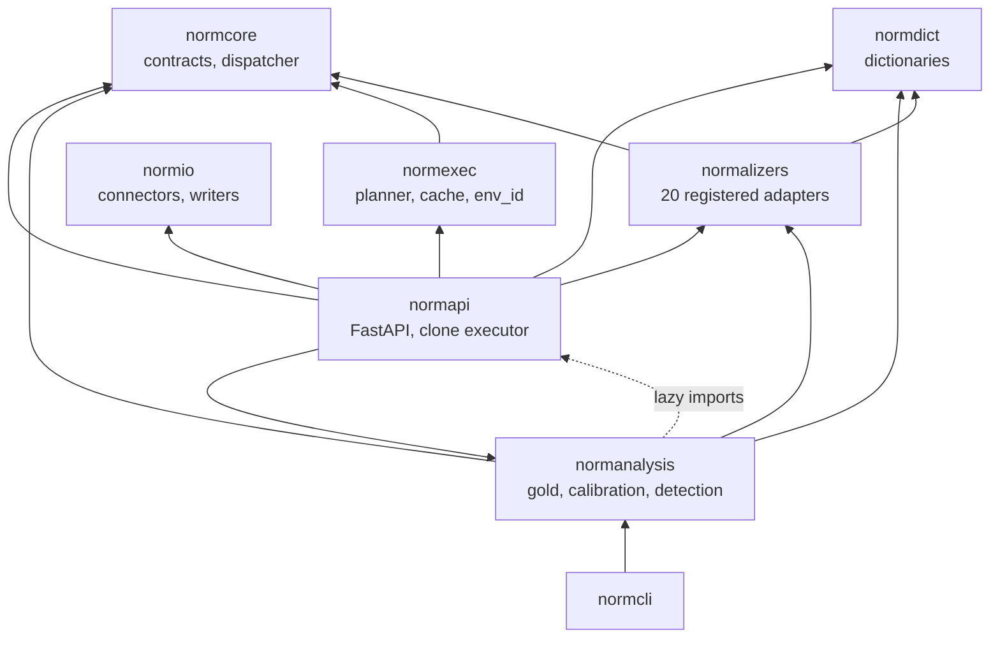
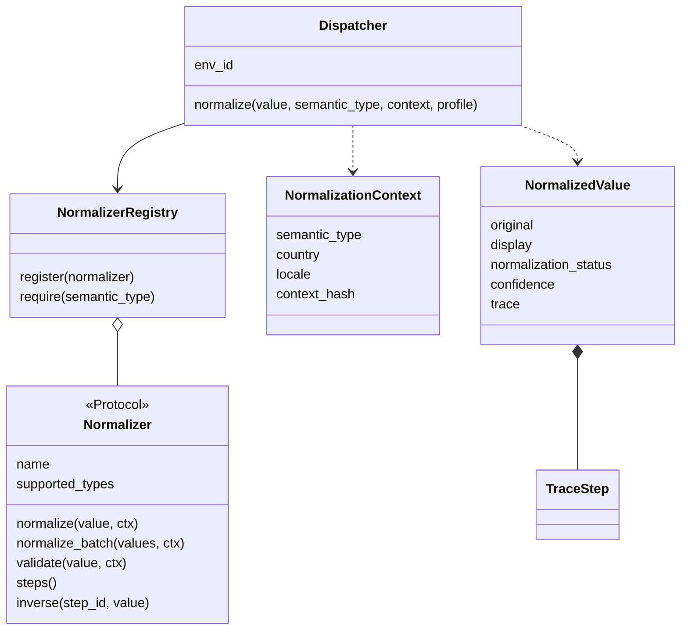
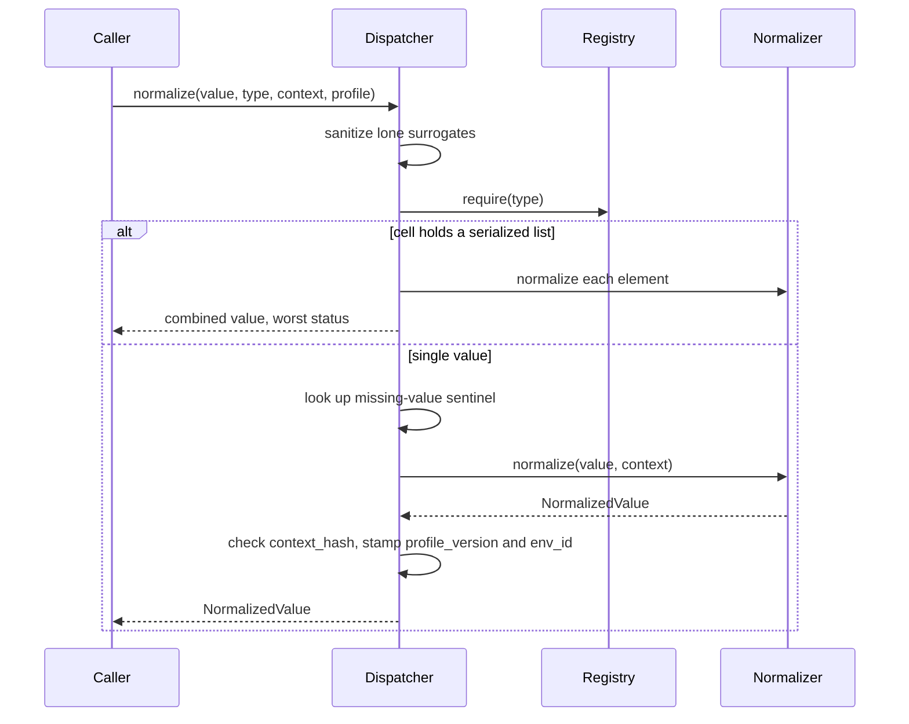
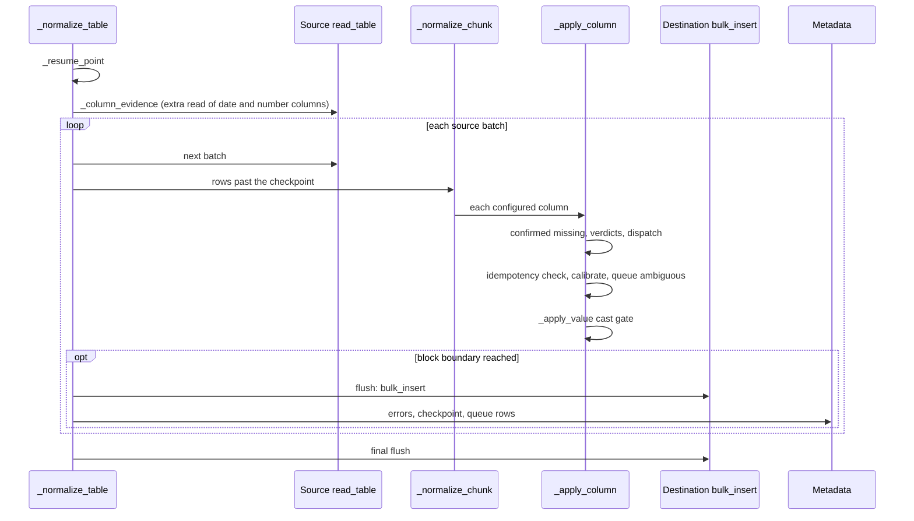
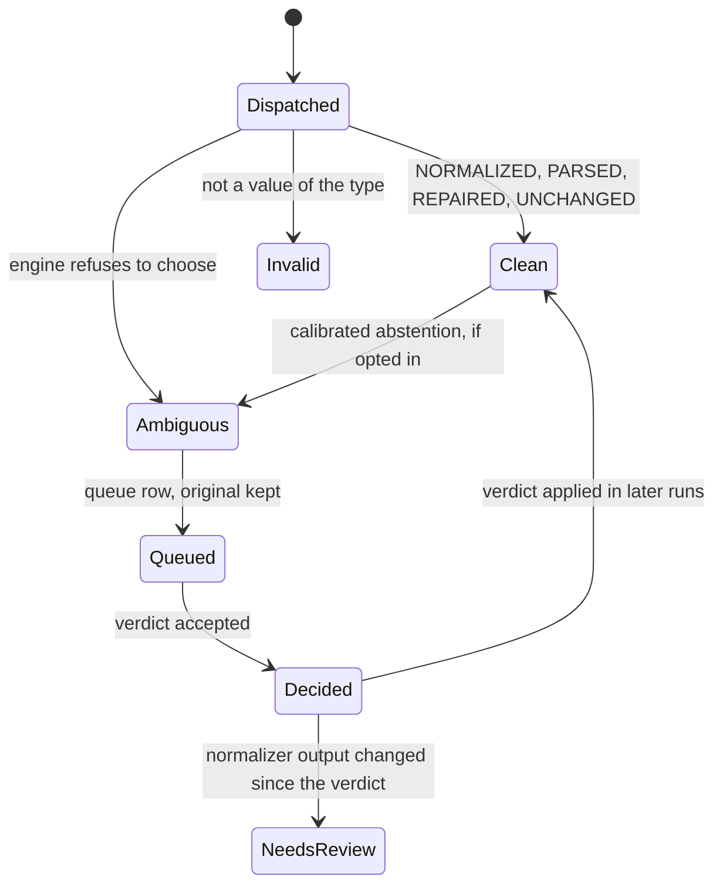
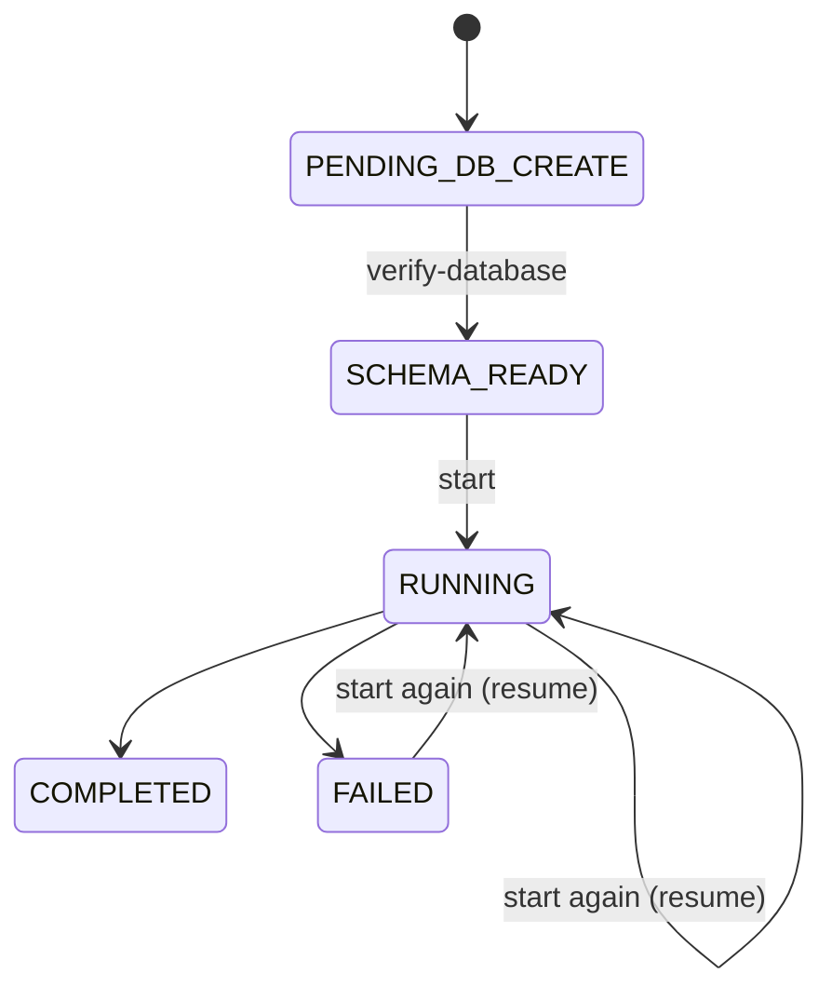
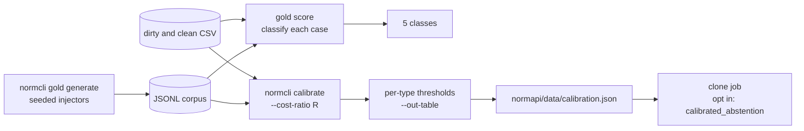
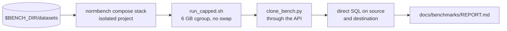

# Technical implementation

For developers of this project: where the code lives, how modules depend on
each other, the main algorithms and how to change the code safely. System
shape, deployment, data contract and guarantees are in
[ARCHITECTURE.md](ARCHITECTURE.md). Terms are in [GLOSSARY.md](GLOSSARY.md).

## Package map and dependencies

<!-- verified: 9f27526 -->



Caption: edges are real `import` lines in `packages/*/src`. `normio` imports no
other package. `normcore` imports none, so it can run anywhere.

Rules between modules:

- `normcore` has no project dependencies. It receives the missing-value
  sentinels from its caller because the dictionary lives in `normdict`
  (`packages/normcore/src/normcore/dispatch.py::Dispatcher.__init__`).
- `normanalysis` and `normapi` import each other. `normapi` imports at the top
  of the module. `normanalysis/gold.py` and `normanalysis/disguised_missing.py` import
  `normapi` inside a function to avoid a cycle
  (`packages/normanalysis/src/normanalysis/gold.py::_dispatcher`,
  `packages/normanalysis/src/normanalysis/disguised_missing.py::_defaults`).
- The Dispatcher is the only way to normalize. No `normalize_string` function
  exists.
- A normalizer must not stamp `profile_version` or `env_id`. The dispatcher
  does, and it raises `AssertionError` if a normalizer returns the wrong
  `context_hash`.

## Where the code lives

<!-- verified: 9f27526 -->

| Package | Key modules | Purpose |
|---|---|---|
| `packages/normcore/src/normcore` | `models.py`, `enums.py`, `dispatch.py`, `context.py`, `interfaces.py`, `rules.py`, `run.py`, `trace.py`, `pii.py`, `contract.py`, `multivalue.py`, `errors.py` | Types, the `Normalizer` protocol, the dispatcher, PII helpers, JSON and Arrow schemas. |
| `packages/normalizers/src/normalizers` | one module per domain, `text_ops.py`, `unicode_normalizer.py`, `_cldr_*.py`, `_bmpm.py` | The normalizer adapters and shared text helpers. |
| `packages/normdict/src/normdict` | `loader.py`, `custom_store.py`, `models.py` | Versioned dictionaries. |
| `packages/normexec/src/normexec` | `planner.py`, `cache.py`, `env_fingerprint.py` | Distinct-value execution, caches, `env_id`. |
| `packages/normio/src/normio` | `connector.py`, `connectors/*`, `sidecar_store.py`, `storage_types.py` | Origin readers, destination writers, sidecar store. |
| `packages/normanalysis/src/normanalysis` | `gold.py`, `calibration.py`, `type_detection.py`, `disguised_missing.py`, `profiling.py`, `impact.py`, `collisions.py`, `quality.py`, `handoff.py` | Measurement and diagnostics. |
| `packages/normapi/src/normapi` | `app.py`, `routes.py`, `clone_executor.py`, `adjudication.py`, `pg_persistence.py`, `store.py`, `lineage.py`, `secrets.py`, `schemas.py` | HTTP API, clone jobs, metadata storage. |
| `packages/normcli/src/normcli` | `cli.py`, `traceability.py`, `mutation_gate.py` | Command line. |
| `ui/src` | `pages/`, `api/`, `app/`, `lib/review*.ts` | React + Mantine UI, five screens (Connections, New clone, Jobs, Review, Quality), hash routes ([ADR-023](docs/adr/ADR-023-ui-scope-and-technology.md)). Review keys: `lib/reviewKeys.ts`. Only `GET /adjudication/review` returns raw values. |
| `services/libpostal` | `Dockerfile` | Address parsing sidecar. |
| `deploy` | `compose.yaml`, `.env.example` | The app machine: the released API image and its Postgres ([ADR-024](docs/adr/ADR-024-app-machine-and-private-releases.md), [docs/DEPLOY.md](docs/DEPLOY.md)). |
| `data/dictionaries` | `honorifics`, `legal-entity-suffixes`, `missing-values`, `name-suffixes` | Shipped dictionaries. |
| `scripts` | `refresh_graphs.py`, `cloud_setup.sh`, `cloud_environment_setup.sh`, `check_*.py`, `generate_*.py`, `license_policy.toml` | Repository tooling and generators. `check_release_version.py` holds a release tag to every package's version. `refresh_graphs.py::PINS` is the one home of the graph-tool versions. |
| `tests` | `unit`, `golden`, `property`, `integration`, `bench`, `defects` | Tests. |
| `docs/benchmarks` | `REPORT.md`, `scripts/`, `configs/` | Benchmark report and its scripts. |

Registered normalizers (`packages/normapi/src/normapi/app.py::build_normalizer_registry`):

| Normalizer | Semantic types |
|---|---|
| `PassthroughNormalizer` | `UNKNOWN` (registered first as the fallback) |
| `GenericTextNormalizer` | `FREE_TEXT` |
| `NameNormalizer` | `PERSON_NAME`, `GIVEN_NAME`, `FAMILY_NAME` |
| `CompanyNormalizer` | `COMPANY_NAME` |
| `PhoneNormalizer` | `PHONE` |
| `EmailNormalizer` | `EMAIL` |
| `AddressNormalizer` | `ADDRESS` |
| `PostcodeNormalizer` | `POSTCODE` |
| `DateNormalizer` | `DATE`, `DATETIME` |
| `CountryNormalizer`, `LanguageNormalizer`, `ScriptNormalizer` | `COUNTRY`, `LANGUAGE`, `SCRIPT` |
| `IdentifierNormalizer` | `IDENTIFIER`, `CODE`, `TAX_ID` |
| `UuidNormalizer` | `UUID` |
| `NumericNormalizer` | `NUMERIC` |
| `CurrencyNormalizer`, `MoneyNormalizer` | `CURRENCY`, `MONEY` |
| `UnitNormalizer` | `QUANTITY` |
| `BooleanNormalizer` | `BOOLEAN` |
| `URLNormalizer` | `URL` |

`UnicodeNormalizer` is a helper used by the address and text normalizers
(`packages/normalizers/src/normalizers/unicode_normalizer.py`). It is not
registered for a semantic type.

## Key types

<!-- verified: 9f27526 -->



Caption: the dispatcher asks the registry for the normalizer of a semantic
type and returns a `NormalizedValue`. Source: `packages/normcore/src/normcore/dispatch.py`.

## Workflows

<!-- verified: 9f27526 -->

### Normalize one value



Caption: the one entry point. A sentinel that is also a valid value of the
type returns `AMBIGUOUS` with both readings. A `NormalizerFailure` is mapped
by the context's `ErrorPolicy`. Source:
`packages/normcore/src/normcore/dispatch.py::Dispatcher.normalize`,
`Dispatcher._normalize_one`.

### Normalize one block in a clone



Caption: a block is flushed when its last offset ends a multiple of the block
size. The checkpoint and the queue counts commit together, so a re-run
chunk cannot count twice (ADR-018). Source:
`packages/normapi/src/normapi/clone_executor.py::_normalize_table`,
`_apply_column`.

### Value status life cycle



Caption: only `AMBIGUOUS` is queued. `INVALID` is not a question anyone can
answer. Source: `packages/normapi/src/normapi/adjudication.py`,
[ADR-018](docs/adr/ADR-018-abstention-and-adjudication.md). A verdict is
accepted only if its decided value re-normalizes to a clean status.

### Clone job status life cycle



Caption: `claim_clone_job` is one conditional `UPDATE`, so two concurrent starts
cannot both win. `is_stale` is advisory and never rewrites the status.
Source: `packages/normapi/src/normapi/pg_persistence.py::PgPersistence.claim_clone_job`.

### Measure accuracy and calibrate



Caption: the committed table is an input to a clone job only when the job opts
in. Source: `packages/normcli/src/normcli/cli.py::_run_calibrate`,
`packages/normanalysis/src/normanalysis/gold.py::score`,
`packages/normapi/src/normapi/clone_executor.py::_calibration_table`.

### Run a benchmark



Caption: a job status is never the verdict. Every pass or fail in the report
is re-checked by direct SQL or the service's own API. Sources:
`docs/benchmarks/scripts/run_capped.sh`,
`docs/benchmarks/scripts/clone_bench.py`, `$BENCH_DIR/README.md`.

Set `BENCH_DIR` before you run any benchmark script. Datasets, the compose
override and outputs stay outside the repository.

## Algorithms and techniques

<!-- verified: a80d9bf -->

| Module | Technique | Why |
|---|---|---|
| `normexec/planner.py::DistinctValuePlanner` | Normalize each distinct value once, then map back to rows. | Cost follows cardinality (ADR-016). |
| `normexec/cache.py::make_cache_key` | `blake3` over raw value, profile version, type, context hash and `env_id`. | The raw value never appears in a key, and any change to inputs misses the cache. |
| `normexec/env_fingerprint.py::compute_env_id` | Hash of package versions, own-source hashes, ICU and CLDR versions, libpostal model hash, dictionaries. | A normalizer edit invalidates cached results. |
| `normalizers/date.py` | Day and month order from CLDR per locale. Per country, the order all official languages agree on. A numeric value must read in the stated order. | A hand table of countries gave wrong dates ([REPORT §11.2](docs/benchmarks/REPORT.md)). |
| `normalizers/date.py`, `normalizers/numeric.py` | Column evidence: unambiguous values prove the order or decimal mark, which settles ambiguous ones. A verdict wins over the column. | 320 refused cells in one column became 0 ([REPORT §11.13](docs/benchmarks/REPORT.md)). |
| `normalizers/phone.py` | `phonenumbers`. Letters that the parser would drop give `AMBIGUOUS`. With an extension, `comparison` is the RFC 3966 URI. | Silent letter drops gave confident wrong numbers ([REPORT §10 item 4](docs/benchmarks/REPORT.md)). |
| `normalizers/identifier.py::tax_id_module_for` | Pick the `python-stdnum` module for the country from the package list of `python-stdnum`. A number that no offline validator can decide is `UNKNOWN`. | A hand table covered four countries (D7). |
| `normalizers/url.py::_registrable` | Registrable domain from the bundled Public Suffix List, offline. | Network access is off by construction. |
| `normalizers/language.py` | The stored code (`comparison`) is the contract; `display` is output only. A value that is both an ISO 639 code and another language's name (`Ga`, `Mon`) is `AMBIGUOUS` unless the row's country (CLDR `territory_languages`) or the column's own values (codes or names) settle it. A hyphen splits only a valid BCP 47 tag. | Feeding the English names back changed 440 of 7,910 languages ([D13](docs/improvement-report.md), ADR-010). |
| `normalizers/name.py` | Double Metaphone and Beider-Morse codes for Latin names. Cyrillic and Arabic names get the two language-aware keys only. | Soundex is Anglo-centric (D11). |
| `normcore/dispatch.py::Dispatcher._reads_as_a_value` | A normalizer that rejects a negative control string proves something by accepting a token. | `NA` is Namibia to one type and Nauru to another. |
| `normanalysis/type_detection.py::suggest_semantic_type` | Name match plus a sample check against the normalizer, using the same negative control. | A type that accepts anything is no evidence. |
| `normanalysis/calibration.py::chow_threshold` | Threshold from the cost ratio. | Cost of a wrong value over an abstention has no default. |
| `normanalysis/calibration.py::risk_controlled_threshold` | Exact binomial upper bound on the error rate among emitted values. | The bound holds when errors resemble the corpus. |
| `normanalysis/disguised_missing.py::detect_disguised_missing` | Report values the validator rejects, that recur, and that form a minority. | Candidates only. A person confirms before anything changes. |
| `normapi/clone_executor.py::_resume_point` | Re-stream and skip rows up to the checkpoint. ClickHouse restarts an unfinished table. | A ClickHouse read has no stable order ([REPORT §10 item 2](docs/benchmarks/REPORT.md)). |
| `normio/connectors/clickhouse.py` | Drain the server stream on a thread into zstd Arrow files, one per block. | The server drops a stream not read for 30 seconds. |

## Libraries and standards

<!-- verified: 9f27526 -->

Versions are the ranges in `pyproject.toml` and each package's `pyproject.toml`.
The license policy is `scripts/license_policy.toml`, enforced by
`scripts/check_licenses.py`. Details: [dependency inventory](docs/dependency-inventory.md).

| Area | Libraries | Standard |
|---|---|---|
| Models | `pydantic`, `blake3` | JSON Schema |
| Unicode | `PyICU`, `ftfy`, `charset-normalizer`, `anyascii`, `regex` | Unicode, CLDR |
| Names | `nameparser`, `jellyfish`, `phonetics` (`nameparser` is LGPL, dynamic import) | none |
| Company | curated `legal-entity-suffixes.common` dictionary; `cleanco` declared but not imported (env_id fingerprint input) | ISO 20275 (GLEIF) |
| Phone, email | `phonenumbers`, `email-validator` | E.164, RFC 3966 |
| Dates | `dateparser`, `python-dateutil` (env_id fingerprint input, not imported), `ciso8601`, `Babel` | ISO 8601, EDTF |
| Country, language | `pycountry`, `Babel`, `lingua-language-detector` | ISO 3166, BCP 47 |
| Identifiers | `python-stdnum` | national registries |
| Units | `Pint` | none |
| Address | `google-i18n-address`, `httpx`, the `libpostal` sidecar | none |
| Batch | `polars`, `duckdb`, `pyarrow` | Arrow, Parquet |
| API | `fastapi`, `uvicorn`, `sqlalchemy`, `psycopg` | OpenAPI |
| Connectors | `psycopg`, `pymysql`, `pymongo`, `clickhouse-connect`, `openpyxl` | none |
| Analysis | `rapidfuzz` (declared as env_id fingerprint input, not imported) | none |

Rejected libraries: `Unidecode`, `text-unidecode`, `wordfreq`, `abydos`, `deepparse`
([LESSONS.md](docs/LESSONS.md)).

## Tests and CI

<!-- verified: 544cd37 -->

| Marker | Where | Needs |
|---|---|---|
| `unit` | `tests/unit` (marked by directory in `tests/unit/conftest.py`) | nothing |
| `golden` | `tests/golden` | nothing |
| `property` | `tests/property` | hypothesis (hypothesis tests under `tests/unit` run as `unit`) |
| `contract` | declared, no test uses it. Schema tests run as `unit`. | nothing |
| `integration` | `tests/integration` | docker compose services |
| `e2e` | declared, no Python test uses it. UI specs are Playwright files in `ui/e2e`. | running stack |
| `bench` | `tests/bench` | nothing |

`tests/conftest.py` gives every Starlette `TestClient` a loopback peer and the `localhost` host,
because the app refuses the client's default peer (`testclient`) and host (`testserver`) under
[ADR-022](docs/adr/ADR-022-network-and-database-address-policy.md). The policy itself is never
replaced. Address rules live in `packages/normapi/src/normapi/address_policy.py`; the fixed
address table that guards them is `tests/unit/test_address_policy.py`.

`tests/defects` holds the scorer and the captured before-snapshots for the
defect fixes. The default test paths are in `pyproject.toml` under
`[tool.pytest.ini_options]`.

Run tests in batches with a memory cap:

```bash
systemd-run --user --scope -p MemoryMax=4G -p MemorySwapMax=0 \
  uv run pytest tests/unit/test_dispatch.py tests/unit/test_data_contract.py -q
```

Before you push, run the four `ci-fast` commands (see [AGENTS.md](AGENTS.md)).
The last measured CI set is in [REPORT §11.13](docs/benchmarks/REPORT.md) (3,227 passed).

| Workflow | Trigger | Purpose |
|---|---|---|
| `ci-fast.yml` | push, except `milestone/**` | ruff, format check, mypy, unit and fast golden tests. |
| `ci-full.yml` | pull request to `main`, and called by `gate.yml` | ruff, mypy, tests with a 90 percent coverage floor on `normcore` and `normalizers`, license allow-list, `pip-audit`, secret scan, PII-leak test. |
| `gate.yml` | manual, push to `milestone/**` | Milestone gate. |
| `docs.yml` | push (except `milestone/**`) and pull request that touch docs | Vale, markdownlint, lychee, Mermaid render. |
| `docs-note.yml` | push (except `milestone/**`), pull request | A source commit carries a `Docs:` line. |
| `stub-check.yml` | push (except `milestone/**`), pull request | No `TODO` or `FIXME` for missing behaviour. |
| `dep-check.yml` | push (except `milestone/**`), pull request | `deptry` on each workspace member and the root, plus the `[tool.mutmut].also_copy` paths exist. |
| `guards.yml` | push (except `milestone/**`), pull request | The guard scripts below, `gitleaks`, `actionlint`, `zizmor`. |
| `drift.yml` | manual only | Not scheduled: its pieces were never built. |
| `release.yml` | tag `vX.Y.Z` | Private release: API image to GHCR, Python packages on a GitHub Release. `.gitlab-ci.yml`'s release stage does the same on GitLab. |

### Guards

Cheap machine checks (K4), all run by `guards.yml` on every push and pull request. The
test configuration is strict (`xfail_strict`, `--strict-markers`, `--strict-config` in
`pyproject.toml`), and ruff runs the `PT` and `PGH` groups.

| Rule | Check | What fails |
|---|---|---|
| C5 | `scripts/check_c5_exceptions.py` | An added line with `noqa`, `type: ignore`, a skip or an `xfail` that lacks `C5: reason=...; approved=...; review=...`. |
| L1 | same script | A removed `test_*` function when no commit in the range has a line starting `C5:`. |
| L4 | `scripts/check_test_assertions.py` | A test whose code changed against the base and has no assertion. The check compares the function as an AST, so a comment or a bystander edit does not count. 29 older tests are listed in `docs/PONYTAIL_DEBT.md`. |
| M1 | `scripts/check_root_files.py` | A tracked root file that is not on the allow list in that script. |
| M2 | `scripts/check_gitignore_consistency.py` | A tracked file that `.gitignore` matches. |
| M4 | `scripts/run_deptry.sh` | A used package that the importing member does not declare, or a declared one that is never imported. `deptry` reads one `pyproject.toml` at a time, so it runs in each member and then in the root (tests and scripts). `DEP002` ignores carry C5 notes in the member's `[tool.deptry.per_rule_ignores]`. |
| B6 | `gitleaks git` | A secret in any commit. Two old findings are in `.gitleaksignore`. |
| CI files | `actionlint`, `zizmor` | A broken workflow or an unaccepted audit finding. The accepted ones are in `.github/zizmor.yml` with a review date. |

`scripts/install_tools.sh` installs the pinned `gitleaks` and `actionlint` binaries into
`.tools/` after a checksum check. `deptry`, `vulture` and `zizmor` come from the dev
extra. `vulture` is for prompt 3's audit only and never blocks.

Local run before a push (the base is `main`):

```bash
python3 scripts/check_c5_exceptions.py main && python3 scripts/check_test_assertions.py main && python3 scripts/check_root_files.py && python3 scripts/check_gitignore_consistency.py
```

```bash
scripts/run_deptry.sh && .tools/gitleaks git --no-banner . && .tools/actionlint && uv run zizmor .github/workflows
```

### Mutation testing and the red-team review

Both are by hand, not on every commit (user decision 2026-10-24).

Mutation testing uses `mutmut` on `normcore` and `normalizers`. The settings are in
`[tool.mutmut]`; the reasons for the flat `src/` bridge are in the comments there. The
steps are those of the `mutation-testing` job in `gate.yml`, which runs at milestone M8
with a 0.75 minimum score (`normcli mutation-score-gate`):

```bash
mkdir -p src && cp -r packages/normcore/src/normcore src/normcore && cp -r packages/normalizers/src/normalizers src/normalizers
```

```bash
uv run mutmut run; uv run mutmut results && uv run python -m normcli mutation-score-gate --min-score 0.75
```

Delete `src/` and `mutants/` afterwards (both are build output). Do not add them to `.gitignore`: hatchling reads it, and a root `/src/` rule hides every member's `src` from the wheel build. A surviving mutant in a
core module needs a written reason in a file next to the report. Not run in prompt 4.

The red-team review is a procedure, not a tool. After a change, a fresh agent on the
strongest model clones the branch into an empty folder, runs the commands in
[AGENTS.md](AGENTS.md) section 5 and the guard commands above, and checks each claim of the
author directly. It looks for inputs a fix special-cases and for tests that were weakened.
It reports and never fixes (I4).

Milestones M0 to M8 each passed a gate with three layers: automated CI,
liveness checks against the running stack, and a signed verification pack in
[docs/verification/](docs/verification/): [M0](docs/verification/M0-verification-pack.md), [M1](docs/verification/M1-verification-pack.md), [M2](docs/verification/M2-verification-pack.md), [M3](docs/verification/M3-verification-pack.md), [M4](docs/verification/M4-verification-pack.md), [M5](docs/verification/M5-verification-pack.md), [M6](docs/verification/M6-verification-pack.md), [M7](docs/verification/M7-verification-pack.md), [M8](docs/verification/M8-verification-pack.md), and the
[clone pack](docs/verification/clone-normalize-verification-pack.md). The
[traceability matrix](docs/traceability-matrix.md) maps each section of the
original specification to its code and tests.

Reproducibility is tested, not only claimed. Two separate OS processes
normalize 1,000,000 rows and the Parquet files are SHA-256 identical
(`tests/integration/test_byte_identical_replay.py`). The dispatcher enforces
two invariants: it stamps `profile_version` and `env_id` itself, and it checks
`context_hash` (`tests/unit/test_dispatch.py`).

A test checks that every command and pytest option a self-triggered workflow
names exists. Its ratchet of missing commands stands at zero
([REPORT §11.11](docs/benchmarks/REPORT.md)).

## How to extend

<!-- verified: 01e01ae -->

Add a normalizer for an existing semantic type:

1. Write a class in `packages/normalizers/src/normalizers/` that satisfies
   `normcore.interfaces.Normalizer`. Return `AMBIGUOUS` when two readings are
   valid. Keep the original. Do not stamp `profile_version` or `env_id`.
2. Register it in `build_normalizer_registry`. Later registrations win for the
   types they support.
3. Add unit tests and a golden corpus entry. For a digit-bearing type, extend
   the look-alike property in `tests/unit/test_confident_wrong.py`.
4. Check an `env_id` change: editing a normalizer changes `source_hashes`, so
   cached results and `env_id`-keyed comparisons change on purpose.

Add a semantic type: add the enum member in `normcore/enums.py`, a normalizer
that supports it, and a destination mapping in
`clone_executor.py::_destination_plan` if it needs a typed column.

Add reference data: prefer a standard (CLDR, ISO, GLEIF, python-stdnum) over a
hand table. Dictionaries go in `data/dictionaries` and load through
`normdict.loader.DictionaryLoader`.

Change a value's contract: edit `NormalizedValue`, the Arrow schema and both
converters together. `tests/unit/test_data_contract.py` fails if they drift.

Add or change an API route: run `uv run python scripts/generate_api_reference.py` and commit
the new [docs/API.md](docs/API.md) with the route. `tests/unit/test_api_reference.py` fails
when the file differs from the app's OpenAPI schema.

Release: set every `pyproject.toml` version, commit, and push a tag `vX.Y.Z` to `origin` (both
remotes). `release.yml` and the GitLab release stage publish it privately; the app machine then
runs it ([docs/DEPLOY.md](docs/DEPLOY.md)).

## Design decisions

<!-- verified: 9f27526 -->

Decisions are in [docs/adr/](docs/adr/). The user's decisions on this project
are recorded in the ADRs and in [REPORT](docs/benchmarks/REPORT.md) (for
example "Keep default on" for column evidence, 2026-10-18). Failed approaches
are in [LESSONS.md](docs/LESSONS.md).

## Repository and license

<!-- verified: 9f27526 -->

The package is `normalization-engine` 0.1.0, Python 3.12 or 3.13, built with
`uv` (`pyproject.toml`). `pyproject.toml` declares the license as
`Proprietary`. The repository has no license file.
