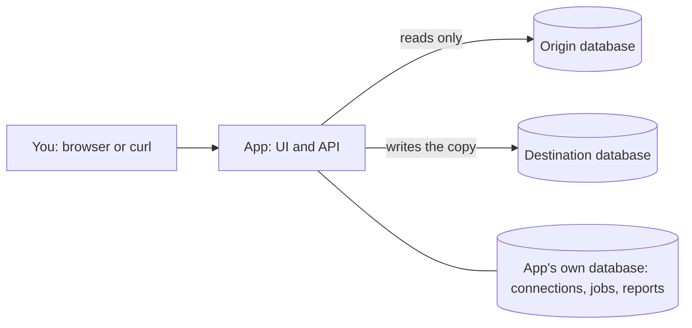

# User manual

For anyone who uses the app and has never seen it: a teammate who connects a database, starts a
normalization, checks it, looks at the result and takes the data out. It covers the screens (the
UI) and the HTTP API. Setting up the machine is another document: [DEPLOY.md](DEPLOY.md). How the
code works: [TECHNICAL_IMPLEMENTATION.md](../TECHNICAL_IMPLEMENTATION.md).

Text in `<angle brackets>` is yours to fill in. `<app address>` is the address of the app machine,
for example `10.10.9.50`; ask the person who runs it.

## 1. What the app does

<!-- verified: 0e7e43d -->

The app **copies** a database and cleans the copy. You give it an **origin** database and a new,
empty **destination** database. It copies every table you choose into the destination. For the
columns you name, it also normalizes the values: phone numbers, dates, e-mails, countries and so
on get one standard form. The rest of the columns are copied unchanged.

**The app never changes the origin.** It only reads it. It refuses a job whose destination is the
origin (`clone_executor.py::_require_separate_copy`). The result of a job is the destination
database, plus two reports inside the app: the **error report** and the **quality report**.



| Word | Meaning |
|---|---|
| Connection | A saved server address with a user name and password. It names a server, not a database. |
| Origin | The database you copy from. The app only reads it. |
| Destination | The new database that receives the copy. You create it empty, by hand. |
| Clone job (job) | One run: copy the origin into the destination and normalize the chosen columns. |
| Semantic type | What a column holds, for example `PHONE`. It decides which rules the app applies. |
| Passthrough | A column with no semantic type. It is copied unchanged. |
| Original | The value as it was in the origin. It is never overwritten there. |

The app never guesses. If a value has two valid readings (`12/05/1990` is 12 May or 5 December),
the app keeps the original and marks it `AMBIGUOUS`. A person can decide it on the Review screen.

## 2. Before you start

1. **Open the app.** In a browser, go to `http://<app address>:8080`. Use exactly that address.
   The app answers only to the address in its settings and to `localhost`; another name gives
   `400 Bad Request`. If you need another name, the person who runs the app adds it to
   `NORM_ALLOWED_HOSTS` ([DEPLOY.md](DEPLOY.md), "Daily work").
2. **Be on the private network.** The app refuses callers outside private addresses (127.x,
   10.x, 172.16-31.x, 192.168.x) with `403 Forbidden: caller outside the local network`. It
   connects to databases only on those addresses too, unless the person who runs it adds a range
   to `NORM_ALLOWED_NETWORKS`. There is no login: whoever can reach the port can use the app.
3. **Get two accounts from the database owner** (see the table), and the host and port of the
   server.

| Account | Used for | Needs |
|---|---|---|
| Origin account | Reading the origin | Read access only. Give it no more. |
| Destination account | Writing the copy | Permission to create tables and insert rows in the destination database. |

4. **Pick a name for the destination database.** It must not exist yet, and it must not be the
   origin. You create it by hand in step 3.4.

Supported servers: **Postgres** and **ClickHouse**, nothing else. The origin and the destination
may be different servers. Check: "Engine" on the Connections screen offers only these two.

## 3. The UI, step by step

<!-- verified: 0e7e43d -->

The top bar has five screens: **Connections**, **New clone**, **Jobs**, **Review**, **Quality**.

### 3.1 Add a connection (once per server)

1. Open **Connections**.
2. Fill in **Engine**, **Host**, **Port**, **Username**, **Password**.
3. Press **Test connection**. A green box says "Connection works. The server lists N
   database(s)." The **Save** button stays grey until the test passes with these exact values.
4. Press **Save**. The connection appears under **Saved connections**. The password is stored
   encrypted and is never shown again.

Add one connection for the origin account and one for the destination account. If both are the
same server and account, one is enough.

There is no "edit". To change a connection, press **Delete** on its row and add it again.

### 3.2 Choose what to copy

1. Open **New clone**. Step 1 is **Origin and destination**:
   - **Origin connection (read only)**, then **Origin database**: pick from the list.
   - **Origin schema** (Postgres only): it appears once you pick the database. It lists the
     schemas that hold tables; pick the one to copy. A job copies **one schema**: the tables
     arrive in the destination under their plain names, without the schema. To copy another
     schema, run another job with its own new destination database. ClickHouse has no schemas,
     so the field does not appear.
   - **Destination connection (can write)**, then **Destination database**: type the new name.
   - Press **Next**.
2. Step 2 is **Columns**. Every table of the chosen schema is copied; untick a table to skip it. Open a
   table to see its columns. For each column you want normalized, choose its semantic type from
   the list (`PHONE`, `EMAIL`, `DATE`, `COUNTRY`, ...); every type in the list is explained in
   [3.2.1](#321-the-type-list-explained). **Every column you leave empty is copied
   unchanged.** Press **Next**.
3. Step 3 is **Check your answers**. Read the table; **Change origin**, **Change destination**
   and **Change columns** take you back. Press **Start**.

**Start** creates the job and opens its page. **It has not copied anything yet.**

The UI does not ask for a country or a language. Without them the app stays careful: a national
phone number such as `(650) 253-0000` becomes `AMBIGUOUS`, because no country says how to read it.
If your data needs a country or a locale, set them with the API ([section 4.4](#44-settings-only-the-api-has)).

#### 3.2.1 The type list, explained

<!-- verified: 3113d88 -->

The drop-down in step 2 holds the list below, in its order, after **Copy unchanged** (the default:
no type, the column is copied as it is). These same names are what you put in `field_configs` and
`semantic_type` in the API. "Needs country/locale" means the type reads correctly only when the
job carries one — and the UI never sends one ([4.4](#44-settings-only-the-api-has)).

| Type | Choose it for | What the app does | Watch out |
|---|---|---|---|
| `ADDRESS` | A postal address line. | Parses with libpostal; validates the postcode against per-country rules when a country resolves from the address itself. | libpostal's statistical parser can mis-segment unusual formats. |
| `BOOLEAN` | Yes/no columns (`true`, `yes`, `Y`, `1`). | Matches a small explicit true/false dictionary. The destination column gets a real SQL boolean type. | No fuzzy matching on purpose: `maybe`, `unknown`, `N/A` are never coerced to true or false — they are reported as unknown values. |
| `CODE` | A generic code with no jurisdiction (status codes, category codes). | Canonicalization only: digit normalization and uppercase. | Nothing is validated — a code carries no jurisdiction, so the result honestly says "not checked". |
| `COMPANY_NAME` | A company or organization name. | Unicode normalization; for the comparison form only, strips legal-entity suffixes (`GmbH`, `Inc.`) against a curated list. The display form keeps the suffix. | The suffix list is a curated subset, not the full GLEIF list — an uncommon suffix may not be recognized. |
| `COUNTRY` | Country names or codes. | Resolves to ISO 3166-1 through codes and names, with a small alias table (`UK` → `GB`). Companion: `<column>_code`. | An alias-resolved value is flagged at reduced confidence — it is an approximation, not an exact code. |
| `CURRENCY` | A column of currencies themselves (`EUR`, `Euro`, `€`), not amounts. | Resolves ISO 4217 codes and names; the unambiguous symbols `€` `£` `¥` resolve directly. The display form is the ISO code. | A bare `$` needs a country on the job to say USD/CAD/AUD — without one it stays `AMBIGUOUS`. |
| `DATE` | Dates (no clock time). | ISO dates parse directly; anything else reads its field order (D/M/Y vs M/D/Y) from the job's country/locale. Companions: `<column>__from`, `<column>__to` (first/last day of the stated period). | `03/04/2024` with no country/locale is `AMBIGUOUS`, never guessed. |
| `DATETIME` | Timestamps. | As `DATE`, plus explicit timezone handling — a naive timestamp is never silently called UTC. Companions: `__from`/`__to`. | Non-Gregorian calendars (Jalali, Hijri, …) are not converted — a known gap, reported not mishandled. |
| `EMAIL` | E-mail addresses. | Validates and normalizes: domain lowercased, local-part case kept in the display form. | Syntax only. The app never checks whether the address can receive mail (no DNS lookup). |
| `FAMILY_NAME` | Last name only. | Same pipeline as `PERSON_NAME`, one component. | Multi-word family names (compound or particled surnames) are kept whole, never split. |
| `FREE_TEXT` | Any text with no more specific type: notes, descriptions, titles. | Repairs broken encodings, normalizes to NFC, trims, collapses repeated spaces, tidies punctuation; notices values like `N/A`. | It folds punctuation and spaces — lossy. It is the most general pipeline: if the content is actually structured (e-mails, dates), pick that type instead. |
| `GIVEN_NAME` | First name only. | Same pipeline as `PERSON_NAME`, one component. | One component cannot reveal a swapped name order — that check needs both halves. |
| `IDENTIFIER` | Codes that identify a record: order numbers, SKUs, account codes. | Normalizes Unicode digits without numeric casting (leading zeros always preserved) and uppercases. | `AB-001` and `AB001` are NOT equated — the separator variant is flagged for a human, since collapsing them could be wrong. |
| `LANGUAGE` | Language names or codes. | ISO 639 code lookup first, name lookup only if no code matches. Companion: `<column>_code`. | Names alone can collide with unrelated codes; that is why codes win. |
| `MONEY` | An amount **with** its currency in the cell: `$1,234.56`, `17.6 €`. | The destination column is a real number (so `SUM` works) and the currency is kept beside it in `<column>_currency` instead of being dropped. | A bare number with no currency is fine — a single-currency column is the common case, and the currency companion simply stays empty. A shared symbol (`$` with no country on the job) is `AMBIGUOUS`, not guessed: Review or a country decides. |
| `NUMERIC` | Plain numbers: counts, quantities without units, bare prices. | Parses with locale rules (Babel/CLDR) when a country/locale is known. The destination column gets a real SQL number type, so `SUM` works. | `1,234` with no locale context is `AMBIGUOUS` (a thousand and 234, or 1 point 234?). If the cell carries a unit, use `QUANTITY`; if it carries a currency, use `MONEY` — `NUMERIC` drops the symbol. |
| `PERSON_NAME` | A person's full name. | Unicode repair, then name parsing. Keeps an accent-preserved display form plus a folded comparison form. | A bare two-word name with no comma is genuinely ambiguous (given-family or family-given): the app reports `AMBIGUOUS` with both readings rather than guessing. |
| `PHONE` | Telephone numbers. | Parses with libphonenumber; the machine key is E.164 (`+165****0000`). Companion columns: `<column>_code` (E.164) and `<column>_region`. | A bare local number with no `+` and no country on the job stays `AMBIGUOUS` — the app will not guess a country. |
| `POSTCODE` | A postal/ZIP code on its own. | Collapses whitespace and checks the format against per-country rules. | Without a country on the job there is no format to check: the value is cleaned but stays `AMBIGUOUS`. |
| `QUANTITY` | A magnitude with a unit: `5 km`, `500 g`, `12 L`. | Parses with Pint; the canonical form is SI base units, so `5 km` and `5000 m` land as the same value and compare correctly. | Only `.` is accepted as decimal mark (`1,5 kg` is refused, not guessed). A bare number with no unit is kept honestly as "dimensionless", not rejected. |
| `SCRIPT` | Text where the writing system matters (Latin, Arabic, Cyrillic, …). | Detects the dominant Unicode script, with a language hint on short strings. Purely diagnostic. | It never transliterates. A mixed-script value reports only the dominant script; the minority characters are not called out separately. |
| `TAX_ID` | Tax numbers (VAT, EIN, national IDs with check digits). | As `IDENTIFIER`, plus per-country check-digit validation where a validator exists for the job's country. | The per-country validator list is small; an unregistered country skips the check instead of guessing a scheme. |
| `UNKNOWN` | When you do not know what a column holds. | Nothing: it is copied unchanged, like leaving the column empty. | If you notice later what it holds, set the real type before starting the job. |
| `URL` | Web addresses. | Lowercases scheme/host, strips a default port, encodes a non-ASCII host to punycode, tidies percent-encoding where RFC 3986 guarantees it is safe. | Query parameters are never stripped — not even tracking parameters. They are flagged; you decide. |
| `UUID` | UUID/GUID columns. | Re-emits in canonical lowercase-hyphenated form. | Anything not a syntactically valid UUID is `INVALID`, never repaired into one. |

Two pairs people mix up: **`NUMERIC` vs `QUANTITY`** — NUMERIC is "how much" as a pure number,
QUANTITY is "how much of what"; on a `5 km` column NUMERIC strips the unit and QUANTITY on a
unitless count keeps everything dimensionless. **`NUMERIC` vs `MONEY`** — NUMERIC parses
`$1,234.56` to `1234.56` and sets the `$` aside; you cannot sum a column whose currency was
discarded, so money that arrives with its symbol belongs in MONEY, not NUMERIC.

### 3.3 Create the destination database (by hand)

The app never creates a database itself. On the job page the state reads **pending db create**.
Create the empty destination database yourself, with an account that may create databases (ask
the database owner if yours may not). The command is the same on both engines; use the exact
name you typed in step 1:

```sql
CREATE DATABASE "<destination database>";
```

Postgres, from a terminal:

```bash
psql -h <host> -p <port> -U <user> -d postgres -c 'CREATE DATABASE "<destination database>";'
```

ClickHouse, from a terminal:

```bash
clickhouse-client --host <host> --user <user> --password --query 'CREATE DATABASE "<destination database>";'
```

The UI does not show this command; the API returns it as `create_database_sql` when it creates
the job ([section 4.3](#43-copy-a-database-with-the-api)).

### 3.4 Verify and start

1. On the job page, press **Verify database**. The app checks that the destination exists, then
   creates every table in it, empty. The state becomes **schema ready**. If the database is
   missing you get: `Destination database '...' does not exist yet`. Create it (3.3) and press
   again.
2. Press **Start clone**. The state becomes **running**. The app reads the origin table by table,
   normalizes, and writes. The page updates by itself: "N of M tables done, K rows, now
   `<table>`".
3. The end state is **completed** or **failed** (red box with the reason).

You can close the page and come back: **Jobs** lists every job with its state, the origin and
destination, tables done and rows.

**Stale.** An orange "stale: no progress recently, start it again to resume" means the job has
shown no progress for 15 minutes (`NORM_CLONE_HEARTBEAT_TIMEOUT_SECONDS`), for example because
the app restarted. A started job resumes where it stopped and skips rows already written. The UI has
no button for that; use the API: `POST /normalization/clone-jobs/<job id>/start` ([4.3](#43-copy-a-database-with-the-api)).
A **failed** job does have a **Resume clone** button — the same call restarts it from its last
committed chunk after you fix the cause. Starting a new job over a destination whose tables a
crashed run already created is fine when the structure matches this job's plan (the table is
reused, committed rows are not written twice); a structurally different table fails with a message
naming the difference — drop it in the destination or pick another database.

### 3.5 Check the job

Three places, in this order.

**Job page, "Errors (N)".** One row for every value the app could not turn into a clean result.
Columns: *Table and column*, *Row* (the row's position in the table), *Error* (what is wrong,
with the fix), *Masked preview* (the value, partly hidden: the app never shows a raw value in
this report). Fifty rows per page. Errors are findings, not a failed job: the job is still
`completed`, and the destination holds the original value in those cells.

**Quality screen.** Choose a job. For each table and each normalized column it shows:

| Column of the report | Meaning |
|---|---|
| Values | How many values the column held. |
| Outcome | The share of each result (see below). |
| Emptied | Values that normalization turned into empty (`NULL`). Look here first if a column looks hollow. |
| Second pass changed | The app normalizes a sample of values twice. A value that changes the second time means a rule that does not settle; `0 of N checked` is the good result. |
| Below threshold | Answers the app was not confident enough about. |
| Disguised-missing candidates | Values such as `N/A` or `-` that may mean "no value". The app never empties them on its own; you confirm them with `confirmed_missing` in the API ([4.3](#43-copy-a-database-with-the-api)). |

Results (`status`) of one value:

| Status | Meaning |
|---|---|
| `NORMALIZED` | Cleaned to the standard form. |
| `PARSED` | Read and re-written in the standard form (for example a phone number to international form). |
| `REPAIRED` | Fixed a defect (for example broken text encoding). |
| `UNCHANGED` | Already in standard form. |
| `AMBIGUOUS` | Two or more valid readings. The app refused to choose. The original is kept. |
| `INVALID` | Not valid for its type. The original is kept and the error report lists it. |
| `NEEDS_REVIEW` | A person's earlier decision was applied, and someone should confirm it. |

A column of 100 % `AMBIGUOUS` is not a failure: it usually means the job had no country or
locale (see 3.2).

**Review screen.** Lists values the app left `AMBIGUOUS`, one at a time, with the readings it
found. Pick the right reading, or **Other value** (type your own), or **Keep as is**. Keys:
`1`-`9` pick a reading, `o` other, `k` keep, `u` undo. A decision applies to the same value in
the same context in **later** clones; it does not change a destination that already exists.
A decision is sent after a short undo window; if you leave the page too early, the screen
tells you which decisions were not saved.

### 3.6 Look at the result

The result is the destination database. Open it with the database's own tools.

Postgres:

```bash
psql -h <host> -p <port> -U <user> -d "<destination database>"
```

```sql
\dt
SELECT count(*) FROM "<table>";
SELECT * FROM "<table>" LIMIT 20;
```

ClickHouse:

```bash
clickhouse-client --host <host> --user <user> --password --database "<destination database>" --query 'SHOW TABLES'
```

What you will see:

- The same table names and column names as the origin, plus companion columns. Compare
  `SELECT count(*)` of a table in both databases.
- A normalized column holds the standard form (`+1 650-253-0000`), not the original.
- Some types add **companion columns** beside the original column: `<column>_code` (country,
  language and phone: the machine key such as `DE` or `+16502530000`), `<column>_region` (phone),
  `<column>_currency` (money), `<column>__from` and `<column>__to` (first and last day of a date
  or datetime), `<column>_normalized` (key columns: the original stays, the normalized value goes
  here). The glossary calls them [companion columns](../GLOSSARY.md).
- Numbers, money and booleans have real SQL types, so `SUM` works. A value that cannot be turned
  into a number becomes `NULL`, with a row in the error report that keeps the original.
- Where the app was unsure (`AMBIGUOUS`, `INVALID`), the cell holds the original text.

### 3.7 Export the data

The app has **no export button and no download**, in the UI or the API. The data lives in the
destination database; take it out with that database's own tools.

Postgres, one table to a CSV file on your computer: connect as in 3.6, then

```sql
\copy "<table>" TO '<table>.csv' CSV HEADER
```

ClickHouse, one table to a CSV file:

```bash
clickhouse-client --host <host> --user <user> --password --query 'SELECT * FROM "<destination database>"."<table>" FORMAT CSVWithNames' > <table>.csv
```

Whole database, Postgres: `pg_dump -h <host> -p <port> -U <user> -Fc "<destination database>" > copy.dump`.
The reports can be saved too: [section 4.5](#45-save-the-reports-to-files). These commands use the
databases' standard options; they were not run against your servers.

## 4. The API

<!-- verified: 0e7e43d -->

Everything the UI does is an API call, and the API does more. Every route is listed in
[API.md](API.md) with every field; this section is the working order, with examples. The
examples use `curl` and `python3` for readable output.

```bash
export APP=http://<app address>:8080
```

- **Base path:** `/normalization`, for example `$APP/normalization/connections`. Health check:
  `$APP/health` answers `{"status":"ok"}`.
- **Format:** JSON in and out. Send `-H 'Content-Type: application/json'` with a body.
- **No login.** Access rules: [section 2](#2-before-you-start).
- **Errors:** the body is `{"detail": "..."}`. `404` no such job or connection. `409` the job is
  in the wrong state for this call (the detail names the state it needs). `422` a field is wrong
  or missing. `403` or `400` see section 2.

### 4.1 Connections

Add a connection (the password is never returned):

```bash
curl -s -X POST $APP/normalization/connections -H 'Content-Type: application/json' \
  -d '{"engine":"postgres","host":"<host>","port":5432,"username":"<user>","password":"<password>"}'
```

The answer holds `connection_id`. List them and remove one:

```bash
curl -s $APP/normalization/connections
```

```bash
curl -s -X DELETE $APP/normalization/connections/<connection id>
```

Find what the server holds (the UI's drop-down lists):

```bash
curl -s -X POST $APP/normalization/connections/<connection id>/databases
```

```bash
curl -s $APP/normalization/connections/<connection id>/databases/<database>/tables
```

```bash
curl -s "$APP/normalization/connections/<connection id>/databases/<database>/tables/<table>/columns"
```

Postgres tables outside `public`: ask `.../databases/<database>/schemas` and add
`?schema=<schema>` to the `tables` and `columns` calls.

### 4.2 Test a rule before you copy anything

These do not touch any database.

One value:

```bash
curl -s -X POST $APP/normalization/field-test -H 'Content-Type: application/json' \
  -d '{"field_name":"email","semantic_type":"EMAIL","value":" John.Doe@Example.COM "}'
```

The answer has `original`, `display` (the standard form), `comparison` (the form to match on),
`normalization_status`, and more. Here `display` is `John.Doe@example.com` and the status is
`NORMALIZED`. Many values at once: `POST /normalization/preview` with `"values":[...]` instead
of `"value"`. A phone number in international form:

```bash
curl -s -X POST $APP/normalization/preview -H 'Content-Type: application/json' \
  -d '{"field_name":"phone","semantic_type":"PHONE","values":["+1 650 253 0000","+1 650"]}'
```

gives `+1 650-253-0000` (`PARSED`, comparison `+16502530000`) and `+1 650` (`INVALID`). A national
number, `(650) 253-0000`, gives `AMBIGUOUS` here, because the test has no country.

Ask which type a column probably is (a suggestion; nothing is applied):

```bash
curl -s -X POST $APP/normalization/detect-type -H 'Content-Type: application/json' \
  -d '{"field_name":"email_address","sample_values":["a@b.com","c@d.org"]}'
```

### 4.3 Copy a database with the API

**1. Create the job.** Nothing is copied yet.

```bash
curl -s -X POST $APP/normalization/clone-jobs -H 'Content-Type: application/json' -d '{
  "source_connection_id": "<origin connection id>",
  "source_database": "<origin database>",
  "destination_connection_id": "<destination connection id>",
  "destination_database": "<new database name>",
  "field_configs": {"<table>": {"<phone column>": "PHONE", "<email column>": "EMAIL"}},
  "country": "US"
}'
```

The answer: `{"job_id": "...", "status": "PENDING_DB_CREATE", "create_database_sql": "CREATE DATABASE \"<new database name>\";"}`. Run that SQL on the destination server (3.3).

Fields (all but the first four are optional; an unknown field is refused with `422`):

| Field | Default | Effect |
|---|---|---|
| `source_connection_id`, `source_database`, `destination_connection_id`, `destination_database` | required | Where from and to. The destination must not be the origin. |
| `source_schema` | `public` | Postgres only: the schema the tables live in. The UI sets it from "Origin schema". Without it the app looks in `public` only, which may hold no table. |
| `tables` | all tables | A list of table names to copy. An empty list is refused. |
| `field_configs` | none | `{"<table>": {"<column>": "<TYPE>"}}`. A column that is missing or `null` is copied unchanged. Types: see [API.md](API.md#fieldsemantictype). |
| `autodetect_field_types` | `false` | `true` applies every confident type guess to columns you did not list. Your own entries always win. |
| `normalize_unconfigured_text` | `false` | `true` cleans every other text column as plain text. It is lossy (it folds punctuation and spaces), so it is off. |
| `country` | none | Two-letter code, for example `US`. Lets national phone numbers and postcodes resolve. |
| `locale` | none | For example `en-US`. Says whether `1,234` is a thousand and 234, and how dates read. |
| `cross_table_entity_key` | none | A column name that identifies the same entity in several tables, so one table's country can serve the others. |
| `typed_destination_columns` | `true` | Numbers, money and booleans get real SQL types. |
| `max_new_null_rate` | none | `0` to `1`. The job fails if normalization empties more than this share of a column. Unset: report and go on. |
| `confirmed_missing` | none | Exact values you confirmed mean "missing" per table and column. They become `NULL` and are listed in the error report. |
| `calibrated_abstention` | `false` | Answers below the type's calibrated threshold become `AMBIGUOUS` and go to Review. |

**2. Read the plan, and change it.** The plan shows, per column, the type that will be applied,
whether you or detection chose it, the destination type, and the companion column. It reads only.

```bash
curl -s $APP/normalization/clone-jobs/<job id>/plan
```

Change settings before anything is built; only the fields you send change, and `null` on a column
clears it back to "copied unchanged":

```bash
curl -s -X PATCH $APP/normalization/clone-jobs/<job id>/plan -H 'Content-Type: application/json' \
  -d '{"country":"DE","field_configs":{"<table>":{"<column>":"POSTCODE"}}}'
```

The plan can be amended only while the job is `PENDING_DB_CREATE`; after that the call answers `409`. The connections, the
databases and the table list cannot be changed: create a new job.

**3. Create the database by hand** (3.3), **then verify and start:**

```bash
curl -s -X POST $APP/normalization/clone-jobs/<job id>/verify-database
```

```bash
curl -s -X POST $APP/normalization/clone-jobs/<job id>/start
```

`start` returns at once; the copy runs in the background. It also resumes a stale `running` job
and a `failed` one: call it again.

**4. Watch it.** Repeat until `status` is `COMPLETED` or `FAILED`:

```bash
curl -s $APP/normalization/clone-jobs/<job id> | python3 -m json.tool
```

Look at `status`, `progress` (`tables_completed`, `rows_done`, `current_table`), `error` and
`stale`. States: `PENDING_DB_CREATE`, `SCHEMA_READY`, `RUNNING`, `COMPLETED`, `FAILED`. All jobs:
`GET /normalization/clone-jobs`.

### 4.4 Settings only the API has

`country`, `locale`, `autodetect_field_types`, `normalize_unconfigured_text`,
`cross_table_entity_key`, `max_new_null_rate`, `confirmed_missing`, `calibrated_abstention`,
the plan and the lineage are API-only; the UI sends none of them.
A UI job runs with every default of the table in 4.3. To use them, create the job with the API
(you can still watch it in the UI), or amend a UI-created job with `PATCH .../plan` before you
press **Verify database**.

### 4.5 Save the reports to files

Errors, 1000 rows per call at most, with the total in the `X-Total-Count` header:

```bash
curl -s -D - "$APP/normalization/clone-jobs/<job id>/errors?limit=1000&offset=0" -o errors-0.json | grep -i x-total-count
```

Next page: `offset=1000`, and so on until you have `X-Total-Count` rows. Each row has `field`
(`table.column`), `record_ref` (row position), `error` (the reason), `severity`, `safe_preview`
(masked value). The raw value is never returned.

Quality, per table and column:

```bash
curl -s $APP/normalization/clone-jobs/<job id>/quality -o quality.json
```

Lineage (which origin column produced which destination column), as OpenLineage events:

```bash
curl -s $APP/normalization/clone-jobs/<job id>/lineage -o lineage.json
```

### 4.6 The rest of the API

Not needed for a copy. One line each; the fields are in [API.md](API.md).

| Group | What it is for |
|---|---|
| `adjudication/queue`, `adjudication/review` | The Review screen's data: open ambiguous values and decisions (`POST .../queue/<key>/verdicts`). |
| `profiles`, `suggest-profile`, `fields`, `overview`, `impact` | Saved sets of field rules, with versions and rollback, for the run API. |
| `runs` | Normalize a list of values you send in the request, without a database, then read its values, errors, collisions and hand-off files. |
| `dictionaries` | Add, version and roll back your own lookup lists (for example company-name aliases). |
| `quality` | Counts of validation issues per type across the runs the API holds (not clone jobs; their report is `clone-jobs/<id>/quality`). |

## 5. When something goes wrong

<!-- verified: 0e7e43d -->

| You see | Cause | Fix |
|---|---|---|
| Page does not open, `400 Bad Request` | You used a name or address the app does not answer to. | Use `http://<app address>:8080` exactly, or ask for the name to be added (`NORM_ALLOWED_HOSTS`). |
| `403 Forbidden: caller outside the local network` | Your computer is outside the private ranges. | Use the company network or VPN. |
| "Test connection" is red | Wrong address, port, user or password, or the address is outside the allowed ranges. | Read the red message; it names the cause. For a range, ask for `NORM_ALLOWED_NETWORKS`. |
| `This clone job would write into its origin` | The destination is the origin. | Create a new job with a new destination database. |
| `Destination database '...' does not exist yet` | You have not run `CREATE DATABASE`. | Run it (3.3), press **Verify database** again. |
| `409` "is RUNNING, expected ..." | The call does not fit the job's state. | Read the state on the job page, call the step that matches. |
| Job `failed` with a red box | The box names the reason. | Fix that, then `POST .../start` again; it resumes. |
| Orange "stale" | No progress for 15 minutes. | `POST .../start`. If it stays stale, ask the person who runs the app to read `docker compose logs api`. |
| New clone lists no tables (Postgres) | The app is version 0.1.0, which looked only in the `public` schema. | Update the app to 0.1.1 or later. Until then, create the job with the API and `"source_schema": "<schema>"` (4.3). |
| A column is mostly `AMBIGUOUS` | No country or locale. | Create a new job with `country` and `locale` (4.4). |
| Quality "Emptied" is high | Values did not fit the chosen type; they became `NULL`. | Check the type; read those rows in Errors. |
| A saved connection stopped working after a move | The app's secret key changed. | Delete the connection and add it again. |

## 6. Limits you should know

- Postgres and ClickHouse only.
- A job copies one Postgres schema. Several schemas need several jobs.
- A job has no stop, delete or "start over" button or route. To redo a copy, create a new job
  with a new destination database; the old destination stays until you drop it with the
  database's own tools.
- The UI shows no export, no `CREATE DATABASE` command, and no country or locale. The API
  covers the latter two; the first is section 3.7.
- Connections have no edit.

Not checked by this manual's author: how long a clone of your databases takes; that the
destination account of your servers may create databases; ClickHouse commands and the `psql`
`\copy` export against your servers.
