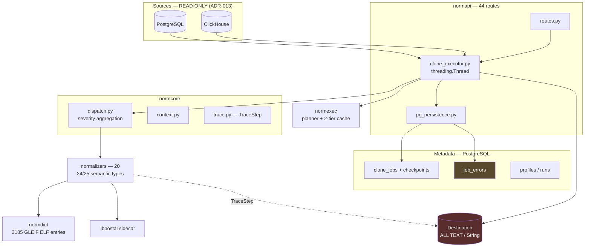
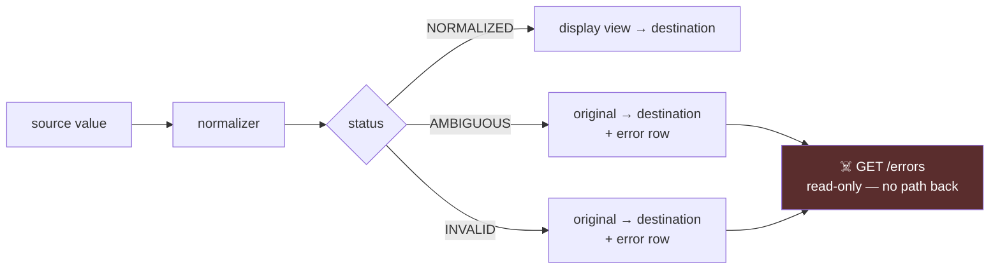
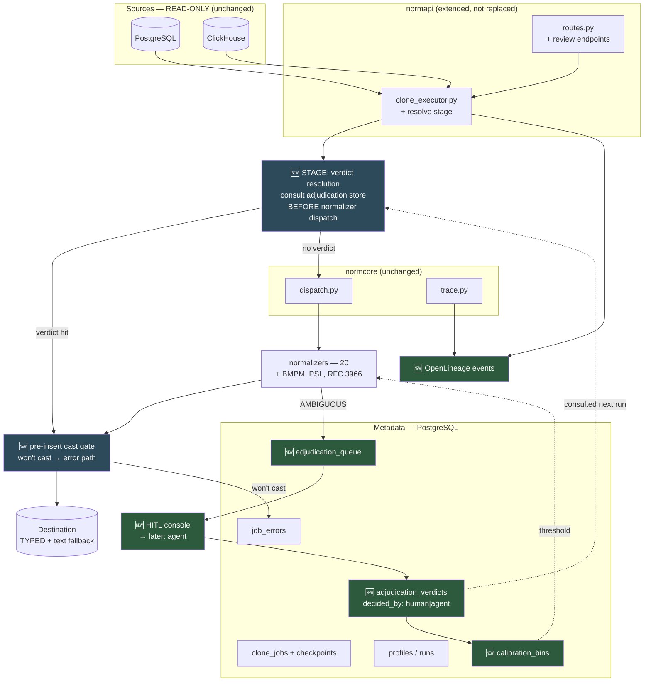
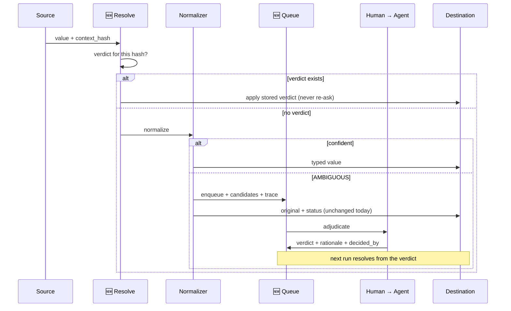
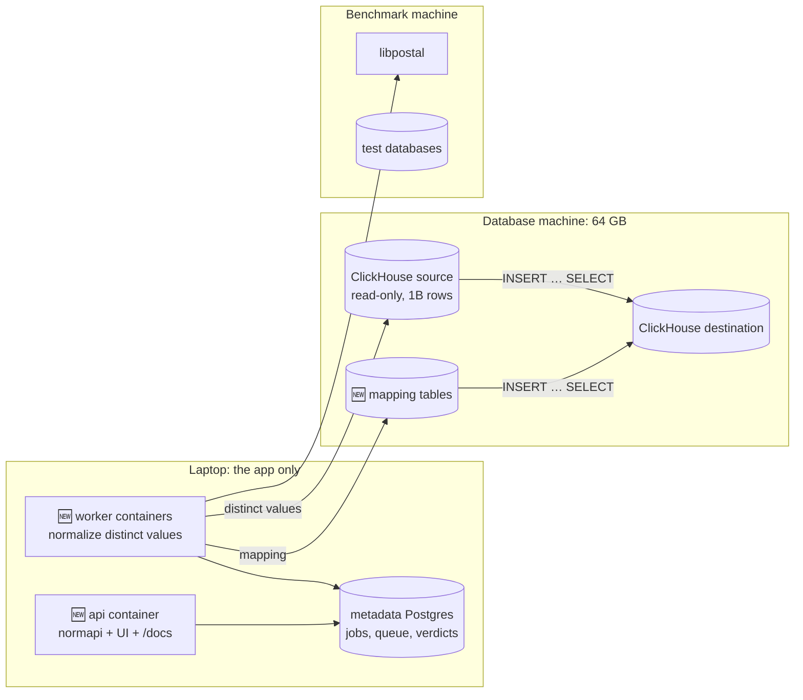
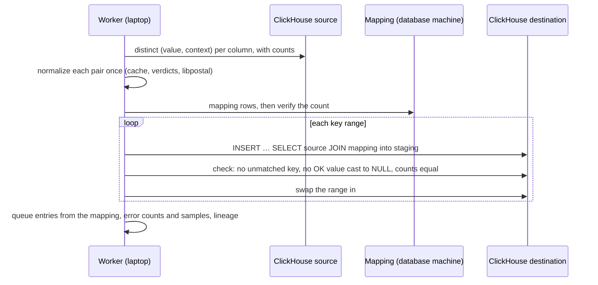

# Normalization Engine — Improvement Report

**Date:** 2026-09-30
**Author:** Hermes (code-graph audit + nine-track verified research sweep)
**Status:** Proposal — no code changed
**Implementation status (2026-10-06):** Part 1 D1-D12 implemented on branch `feat/defects-fixes` from
[`docs/archive/plans/DEFECTS_IMPLEMENTATION_PLAN.md`](archive/plans/DEFECTS_IMPLEMENTATION_PLAN.md); per-item verdicts in
[`archive/plans/defects/HANDOFF.md`](archive/plans/defects/HANDOFF.md), before/after numbers in
[`archive/plans/defects/PHASE4_REPORT.md`](archive/plans/defects/PHASE4_REPORT.md). Where this report and the code differed
(F1-F7: D5's cast gate already existed, D10's extension was kept in `display`, decision B's verdict key, the
`confidence=` counts, `ptype`'s availability), the plan's §8 "Pre-findings" records what the code says.
**Round 2 (2026-10-25):** D13-D15 and U1 added to Part 1, with their research in Part 2 and
four new resource files (Appendix G). Proposal only; no code changed.
**Round 2 status (2026-11-01):** D13, D14, D15 and U1 implemented and verified on branch
`feat/round2-fixes`; measured results, the memory diagnosis and the open owner items are in
[`plans/round2/FINAL_REPORT.md`](plans/round2/FINAL_REPORT.md). The D13 "Verified state" tables below
describe the state before this fix. Merged to `main` on 2026-11-07 (`ccc2fdf`).
**Round 3 (2026-11-07):** the items round 2 left open are added to Part 1 (D16-D24) or moved to
Part 3 by the rule in §0; Part 2 adds the research for a self-adapting engine and for the app as
services; Part 3 adds the round 3 target architecture (§3.8). Proposal only; no code changed.
**Round 3, benchmark findings (2026-11-08):** D25-D32 added to Part 1 from the owner's benchmark
run; the build prompts are in [`plans/round3/`](plans/round3/README.md). Proposal only.
**Round 3 status (2026-11-10):** D16-D32 built, verified and merged into `main` (`56578b8`);
results and open items are in [`plans/round3/FINAL_REPORT.md`](plans/round3/FINAL_REPORT.md).
**Scope confirmed with project owner** (Q&A round, 2026-09-30)

---

## Table of contents

- [0. Confirmed constraints](#0-confirmed-constraints)
- [0.1 Correction to the earlier audit](#01-correction-to-the-earlier-audit)
- [Part 1 — Defects and fixes to apply now](#part-1--defects-and-fixes-to-apply-now)
  - [Part 1, round 2 (2026-10-25)](#part-1-round-2-2026-10-25--found-after-d1-d12-were-closed)
  - [Part 1, round 3 (2026-11-07)](#part-1-round-3-2026-11-07--left-open-by-round-2)
  - [Part 1, round 4 (2026-11-10)](#part-1-round-4-2026-11-10--built-2026-11-14)
- [Part 2 — Research, cited](#part-2--research-cited)
- [Part 3 — Architecture](#part-3--architecture)
- [Part 4 — Appendices](#part-4--appendices)
- [Recommended sequence](#recommended-sequence)

---

## 0. Confirmed constraints

These answers define the scope of every recommendation below. Where a
recommendation depends on one, it is cited by question number.

| # | Question | Answer |
|---|----------|--------|
| Q1 | Schema normalization in scope? | **No — value normalization only.** Relational schema normalization (FD/UCC/IND discovery, 1NF→BCNF) is deferred to a **separate future project**. Recorded in agent memory. |
| Q2 | Product or infrastructure? | **Internal infrastructure**, one pipeline. But the data is **not** domain-specific and has **no fixed schema** — general schemas, batch, high usage volume. |
| Q3 | General or tuned to known sources? | **Arbitrary / unknown databases.** |
| Q4 | Ever distributed externally? | **Never.** Completely internal; not a published product, no revenue. |
| Q5 | Sidecars acceptable? | **Yes** (already true: `services/libpostal/`). |
| Q6 | Runtime network access? | *Deferred to owner* — asked which data needs periodic download; answered in [Appendix F](#f-periodic-data-refresh-answer-to-q6). |
| Q7 | Scale? | **>1B rows.** |
| Q8 | Dominant value domains? | *Deferred to agent* — prioritization by effect on result; **all 12 defects must be fixed**, sequenced. |
| Q9 | Languages / scripts? | **Multi-script** — Cyrillic, Arabic, CJK, Persian. |
| Q10 | Source databases? | **PostgreSQL + ClickHouse**, permanently. |
| Q11 | ER engine downstream? | **Not Splink.** Still being researched. |
| Q12 | Other consumers? | **ER/matching only** — but output **must carry appropriate types**. |
| Q13 | Audit traceability? | **Hard requirement.** |
| Q14 | What happens to `AMBIGUOUS`? | **HITL** — a human reviews and decides how it should be normalized. |
| Q15 | Human available? | **Human now (test + near term), agent later.** Design for the migration. |
| Q16 | Cost of wrong value vs. abstention? | **A wrong value is catastrophic** — abstain freely. |
| Q17 | Gold corpus? | **Small / partial.** |
| Q18 | How is correctness known today? | **Golden tests pass** (some). |
| Q19 | External benchmarks acceptable? | **Yes** — BART error injection, Raha datasets. |
| Q20 | Throughput requirement? | **Hard SLA.** |
| Q21 | Destination schema yours to change? | **Yes, fully.** |
| Q22 | LLM in the pipeline? | Per Q14 — decision happens at the review queue, never inline. |
| Q23 | Priority order | **Correctness depth → Auditability/provenance → Automation → Throughput.** |
| Q24 | Budget | **One person, ongoing.** |
| Q25 | Deliverable | **ADRs first, then a sequenced roadmap.** |

### Round 3 constraints (2026-11-07)

**Where an item goes.** Owner, 2026-11-07: "part 1 is now fixing that could happen without
changing architecture if somethin caused to change architecture goes to part 3 and when nothing
remain on part 1 we go for part 3". So Part 1 holds fixes inside today's architecture; an item
that needs an architecture change moves to Part 3; Part 3 starts only when Part 1 is empty.
Rounds 1 and 2 already worked this way (the D1 scope line in
[`DEFECTS_IMPLEMENTATION_PLAN.md`](archive/plans/DEFECTS_IMPLEMENTATION_PLAN.md)); round 3 writes
it down.

| # | Question | Answer (owner's words, 2026-11-07) |
|---|----------|--------|
| Q26 | Which machines? | "C1. a": three. The **laptop** (i5-13600K, 16 GB) runs only the app. The **database machine** (64 GB RAM, Core Ultra 9 285K, 2 TB) holds the real databases. The **benchmark machine** (remote) holds the test databases, libpostal and every other external service. |
| Q27 | Where do libpostal and the destination live? | "c2. a": libpostal on the benchmark machine. "c3. in real run (a)": the destination is on the database machine, in the same ClickHouse as the source. |
| Q28 | Scale and SLA (refines Q7, Q20) | 1 billion rows in total in one ClickHouse database ("K. clickhouse"), cloned and normalized in "less than 1 hour". "c4. a": keep the target, measure a 10M-row slice first, then set the realistic target from the numbers. |
| Q29 | Tests | "c5. a": tests that need a database or libpostal run against the benchmark machine. |
| Q30 | The app's own metadata Postgres | "d. a": on the laptop, in the app's compose stack. |
| Q31 | ClickHouse versions | Database machine: 26.4.2.10, read by the owner on 2026-11-08 (`diffbot` container, `SELECT version()`; "q31. this is for a"). Benchmark machine: 26.8.2.7, the image tag and client version of `zoominfo-ch` and `bench-ch`, read the same day. The two differ, so a format seen on one is checked on the other. |

---

## 0.1 Correction to the earlier audit

An earlier pass reported twelve gaps. **Every one was re-verified against
source before this report was written, and four were wrong.** They were
wrong in a specific, instructive way: the audit searched for the library it
expected to find, found nothing, and concluded "absent" — instead of
reading how the problem had actually been solved.

| Earlier claim | Verified reality | Evidence |
|---|---|---|
| "`company.py` does not consume GLEIF ELF at runtime" | **False.** `company.py:90` loads `legal-entity-suffixes.common`; the 2026.09 dictionary carries **3,185 entries**, `source` field reads *"GLEIF ISO 20275 Entity Legal Forms code list v1.6 (2026-02-19), ACTV entries only, merged with the M3 curated seed"* | `data/dictionaries/legal-entity-suffixes.common/2026.09.json` |
| "`country_codes.py` skips historic countries, no CLDR aliases" | **False.** It uses CLDR `territoryAlias` explicitly, and deliberately accepts **only single-successor** aliases — `SU` → 15 states is correctly refused rather than guessed | `country_codes.py:23-24, 81-86` |
| "No cross-field / multi-pass reconciliation" | **False.** `cross_table_entity_key` propagates a resolved country signal across tables into later rows' context | `clone_executor.py:1203, 1833, 2024` |
| "Destination collapses to TEXT (oversight)" | **Mischaracterized.** It is a documented decision with a written unblock condition | `postgres_destination.py:25-44` |

The audit also reported resumability as unclear. It exists: chunk-level
checkpoints persisted in `normalization_clone_jobs`, resume-by-skip from the
last committed offset (`clone_executor.py:1882-1888`).

**Consequence for the reader:** the engine is in materially better shape
than the first report implied, and every remaining claim in this document
carries a `file:line` so it can be checked independently rather than
trusted.

---

# Part 1 — Defects and fixes to apply now

Twelve defects, ordered by **effect on result** (Q8), weighted by the
priority order in Q23. Severity reflects impact under the confirmed
constraints — notably Q16 (a wrong value is catastrophic) and Q9
(multi-script data).

---

## D1 — `AMBIGUOUS` has no exit path 🔴 CRITICAL

**Verified state.** `AMBIGUOUS` is produced in at least three normalizers:
`phone.py:209`, `date.py:575`, `money.py:183`. `NEEDS_REVIEW` is declared at
`enums.py:23` and appears in the severity ordering at `dispatch.py:309` —
**and nowhere else in the codebase.** Errors are exposed read-only through
`GET /runs/{run_id}/errors` (`routes.py:399`) and
`GET /clone-jobs/{job_id}/errors` (`routes.py:1082`). There is no queue, no
decision record, and no mechanism by which a human verdict can re-enter the
pipeline.

**Why this is first.** Q16 says a wrong value is catastrophic and Q14 says a
human must decide. The engine already does the hard and correct thing — it
refuses to guess. Then the refusal evaporates: downstream, an abstention is
indistinguishable from a failure, and the human who was supposed to decide
has no interface through which to do so. Every other improvement is worth
less until the abstention path terminates somewhere useful.

**Fix.** A review-queue store plus a verdict path. A human supplies the
correct normalized value; the verdict is stored keyed by
`(context_hash, profile_version, env_id)` and consulted on subsequent runs,
so the same ambiguity is never asked twice. This is not a novel design:
Fellegi & Sunter's 1969 foundational record-linkage paper specifies exactly
three outcomes — link, non-link, and **clerical review** — and the third was
load-bearing, not an afterthought.

**Designing for Q15 (agent migration).** The verdict record must carry
`decided_by` (`human:alice` / `agent:v3`), `decided_at`, `rationale`, and
`confidence` **from the first version**. Swapping a human decider for an
agent then becomes a different value in a column rather than a schema
migration and a backfill.

---

## D2 — `confidence` is decorative 🔴 CRITICAL

**Verified state.** Across `packages/normalizers/src/normalizers/*.py` there
are 61 `confidence=` assignments. **28 are the literal `1.0`, 14 are the
literal `0.0`, 3 are the literal `0.5`.** The remainder are short
hand-written expressions such as `0.85 if via_non_iso_alias else 1.0`
(`country_codes.py`) and
`min(1.0 if idn_ok else 0.7, 0.8 if scheme_assumed else 1.0)` (`email.py`).
A search for `calibrat|isotonic|temperature_scal|conformal` across
`packages/` returns **zero hits**.

**Why.** Under Q16, the abstain-versus-emit threshold is the most
safety-critical parameter in the system — and it currently rests on numbers
a developer typed while writing each normalizer. The system cannot answer
the one question that matters: *when the engine reports 0.85, how often is
it actually right?* Until that has an answer, every threshold built on
`confidence` is arbitrary, and "abstain freely" cannot be tuned because
there is no dial with a known scale.

**Fix, in order.**

1. **Measure.** Bin predictions by stated confidence against the gold
   corpus and plot a reliability diagram. This alone will show whether the
   28 hard-coded `1.0`s are honest.
2. **Threshold.** Chow's rule converts the Q16 answer — the relative cost of
   a wrong value versus an abstention — into an actual optimal threshold.
   The cost ratio is a parameter to be stated, not a vibe to be felt.
3. **Guarantee.** Conformal prediction (MAPIE) upgrades the threshold to a
   distribution-free coverage guarantee: emit a candidate *set*, and abstain
   whenever the set holds more than one member.
4. **Report.** Risk–coverage curves, not accuracy. A system permitted to
   abstain is not honestly described by a single accuracy number.

**Blocked by D6** — calibration is impossible without labels.

---

## D3 — Provenance stops at the process boundary 🟠 HIGH

**Verified state.** Per-value provenance exists and is good: `TraceStep`
(`normcore/trace.py:18`) records each transformation. A search for
`openlineage|prov-o|prov_o|lineage` across `packages/` returns **zero
hits**.

**Why.** Q13 makes audit traceability a hard requirement. The engine can
currently answer *"how was this single value produced?"* but not *"which
source columns produced this destination column in run X?"* without
scanning rows. Those are different questions, and auditors ask the second
one.

**Fix.** Emit OpenLineage events at job boundaries. Its column-lineage facet
is precisely the missing question, Marquez provides a queryable lineage
graph with no bespoke work, and the format is an existing standard. There is
no reason to invent a provenance schema here.

---

## D4 — `type_detection` cannot see disguised missing data 🟠 HIGH

**Verified state.** `normanalysis/type_detection.py` combines keyword tables
with optional value-shape sniffing, and it is careful work: `_discriminates`
(`type_detection.py:290-291`) refuses to treat a validator's assent as
evidence unless that validator can demonstrably say *no*, and there are two
documented negative controls (`type_detection.py:58-68`) to stop a
permissive validator rubber-stamping a guess. The limitation is structural,
not sloppy — it classifies **columns**, never **cells**.

**Why.** Q3 (arbitrary schemas) and Q7 (>1B rows) together mean manual
per-column configuration cannot scale. A column that is 97% dates and 3%
`"N/A"`, `-999`, and `"unknown"` has, today, no way to say so: it is one
type for the whole column, and the disguised nulls are silently
mis-normalized or silently failed.

**Fix.** Add `ptype`, which models disguised missing data explicitly as a
first-class outcome and reports **which cells** are non-conforming. It
complements the existing keyword layer rather than replacing it — the
negative-control design is worth keeping — and `MissingKind` already exists
to receive the output.

---

## D5 — Destination columns are all TEXT 🟠 HIGH

**Verified state.** All 24 handled semantic types map to `TEXT`
(PostgreSQL) / `String` (ClickHouse). This is **decision #8**, documented in
`postgres_destination.py:25-44`, and the reasoning is sound: a value that
normalizes to `INVALID` (the comment's example is `"d1989-12-11"`) cannot be
inserted into a `DATE` column, and the failed insert kills the whole chunk
transaction. The comment also records its own unblock condition — *"revisit
only if the executor gains real pre-insert type validation/casting."*

**Why it must move now.** Q12 requires appropriate types on the output and
Q21 confirms the destination schema is yours to change. The existing
decision is not wrong; it says *do the casting work first*. That work is now
in scope.

**Fix.** A pre-insert cast gate. A value that will not cast is routed down
the same error path as a normalization failure — and, with D1 in place, into
the review queue — instead of being handed to the database to reject and
take the transaction down with it. Once no un-castable value can reach an
`INSERT`, typed columns become safe.

**Sequencing.** This unblocks only after D1. Typing the destination without
somewhere for un-castable values to go simply reintroduces the chunk-kill
bug that decision #8 was written to prevent.

---

## D6 — The gold corpus measures regression, not accuracy 🟠 HIGH

**Verified state.** 875 test functions in total; **46 of them golden**,
across 7 files in `tests/golden/`. They are hand-written assertions citing
`Source.txt` section numbers — for example, that in `10-12 Baker St.` the
house-number range must survive and must never become `1012`. These are
genuinely good regression tests. There are **no data corpus files**:
`find tests -name '*.json' -o -name '*.csv' -o -name '*.yaml'` returns
nothing.

**Why.** Q17 reports a small/partial corpus and Q18 reports that correctness
is known because golden tests pass. Golden tests prove behaviour did not
*change*. They cannot measure whether behaviour is *right*, they cannot
produce an accuracy number, and they cannot calibrate D2.

**Fix.**

- **BART** injects controlled errors into a copy of your own data with known
  ground truth — it *manufactures* the corpus that is missing, rather than
  requiring anyone to hand-label at >1B-row scale.
- **Raha's six datasets** provide an external regression suite (Q19 = yes).
- **Measure the corpus's own ambiguity rate** with Krippendorff's α or
  Cohen's κ. Where annotators genuinely disagree, `AMBIGUOUS` is the
  *correct* gold label, not a miss — and a corpus that does not know its own
  ambiguity rate will punish the engine for being right.

---

## D7 — The stdnum registry covers four countries 🟡 MEDIUM

**Verified state.** `_STDNUM_REGISTRY` (`identifier.py:68-73`) contains
exactly four entries: `US: us_ein`, `GB: gb_vat`, `DE: de_vat`,
`FR: fr_siren`. python-stdnum ships 100+ country/domain modules. The
in-code comment (`identifier.py:63-67`) is explicit and honest: *"A small,
real, working subset — not the full stdnum catalog — extend as new countries
are actually needed, per the same evidence-driven policy as
normalizers/country_codes.py's alias table."*

**Why medium rather than high.** The evidence-driven policy is defensible
and consistent with the rest of the codebase. But Q3 (arbitrary databases)
means "as actually needed" arrives unpredictably, and an unrecognized
country silently receives weaker validation rather than an explicit signal.

**Fix.** Generate the registry from python-stdnum's machine-readable formats
index rather than curating it by hand. Separately — and this is the larger
win — encode the tri-state outcome: `valid` / `invalid` / **`unverifiable`**.
A VIES outage does not make a VAT number invalid. Collapsing "we checked and
it is wrong" into the same state as "we could not check" is data corruption
under Q16.

---

## D8 — `TAX_ID` and `CODE` share one normalizer 🟡 MEDIUM

**Verified state.** `identifier.py:92-94` —
`supported_types = {IDENTIFIER, TAX_ID, CODE}`. All three semantic types
receive identical treatment: Unicode digit folding, uppercasing, separator
handling.

**Why.** A tax ID has a jurisdiction and a check digit and can be *verified*.
A generic code has neither and can only be *canonicalized*. Treating them
identically means either the tax ID is under-validated or the generic code
is over-constrained — and the current shared path does the former.

---

## D9 — `url.py` has no Public Suffix List 🟡 MEDIUM

**Verified state.** Imports are `urlsplit` / `urlunsplit` from
`urllib.parse`, plus `idna`. No `tldextract`, no `publicsuffix`, no
`urlcanon`.

**Why.** Without the PSL the registrable domain cannot be computed. It is
not "the last two labels" — `a.co.uk` and `a.uk` have different shapes, and
thousands of suffixes break the naive rule. Under Q11 (ER downstream,
engine undecided) the registrable domain is the single most useful URL
blocking key, and the `structured` view does not currently contain it.

---

## D10 — `phone.py` cannot round-trip extensions 🟡 MEDIUM

**Verified state.** `phonenumbers` is imported and E.164 is stored. No
RFC 3966, no `tel:` handling.

**Why.** E.164 has no representation for an extension. Any number carrying
one therefore loses it silently — a Q16-class defect, since the emitted
value is confidently wrong rather than flagged.

**Fix.** Adopt the RFC 3966 `tel:` URI as the canonical form. Read
libphonenumber's `FALSEHOODS.md` and `FAQ.md` before finalizing the column
design — notably, store E.164 **together with the region**, because E.164
alone is not sufficient to re-render or re-parse correctly.

---

## D11 — Phonetics are Anglo-centric 🟡 MEDIUM — *raised in priority by Q9*

**Verified state.** `jellyfish` is imported (Soundex, Metaphone, NYSIIS,
Jaro-Winkler). No Double Metaphone, no Beider-Morse.

**Why this moved up.** Q9 confirms multi-script data — Cyrillic, Arabic,
CJK, Persian. Soundex is an algorithm designed for Anglo-American surnames;
applied to transliterated Persian or Arabic names it produces something
close to noise, and it does so *confidently*. Beider-Morse exists
specifically for language-aware, multi-script name matching. Under Q9 this
is a top-tier correctness defect for this data, not a refinement.

**Licence constraint.** `abydos` has the broadest algorithm coverage but is
GPL-3.0. Q4 (internal-only) makes this legally moot, **but the project's own
`scripts/license_policy.toml` denies GPL and CI enforces it** — the gate
will reject it regardless. Use `phonetics` or `Metaphone` (both permissive),
or port the Beider-Morse rule files from Apache Commons Codec (Apache-2.0).

---

## D12 — `NEEDS_REVIEW` has no defined semantics 🟢 LOW

**Verified state.** Declared at `enums.py:23`; positioned in the severity
ordering between `PARTIAL` and `AMBIGUOUS` (`dispatch.py:309`). No
normalizer emits it.

**Fix.** Either give it a precise meaning under D1 — the natural one being
*"the engine produced a value but a human must confirm it,"* as distinct
from `AMBIGUOUS` meaning *"the engine refused to choose"* — or delete it. A
status that nothing can ever produce is a lie in the type system.

---

## Part 1, round 2 (2026-10-25) — found after D1-D12 were closed

D1-D12 are implemented and merged
([`archive/plans/defects/PART1_COMPLETE.md`](archive/plans/defects/PART1_COMPLETE.md)).
The items below were found later: D13 by the property tests that prompt 4 added, D14 by the
docs rewrite (prompt 2), D15 by the research for this round, and U1 at the owner's request.
**Implemented on branch `feat/round2-fixes`** (status line at the top; results in
[`plans/round2/FINAL_REPORT.md`](plans/round2/FINAL_REPORT.md)). The "not built" notes below
describe the state on 2026-10-25. The research is in Part 2, "Round 2"; the sources are in
the four `_raw-*` files that Appendix G lists under round 2.

The zizmor findings on the CI workflow files are not part of this report. They are CI
hygiene, not normalization, and the fix for each is already written in
`.github/zizmor.yml` (review date 2027-01-24). User decision 2026-10-25: "2. a".

### Owner decisions for round 2

Asked and answered on 2026-10-25. The owner's words are quoted; the meaning is in the
second column.

| # | Question | Answer |
|---|---|---|
| R1 | Where do the new items go? | "1. a": Part 1, round 2, numbered D13 on. |
| R2 | zizmor findings in the report? | "2. a": no, a small CI task before 2027-01-24. |
| R3 | LANGUAGE research depth? | "3. a": short track. |
| R4 | In-place mode? | "Q4: A": remove it; the origin is always read-only. |
| R5 | Who uses the UI? | "only me". |
| R6 | The UI's jobs | "yes this suggestion is perfect": connect a database, start a clone, watch progress, review the `AMBIGUOUS` queue, see the quality report. |
| R7 | What is wrong with the UI? | "looks, navigation, too many pages, wording, speed". Replace it, not patch it. |
| R8 | UI technology freedom | "8. a": open; the research compares; then "22. 1": React + Mantine, served by the API. |
| R9 | Network scope | "1: a and b, 2 not 3": only this machine and the private local network may reach the UI and API; the app refuses a database outside the local network; outbound internet is not in scope. "16. b": localhost and private addresses are both always allowed. |
| R10 | Other UI requirements | No login, no WCAG target, no dark mode. "it only should be on english". |
| R11 | What must a second pass keep stable (D13)? | "12. a": the language code; the name is display only. |
| R12 | A short value that is both a code and a name (D13) | "13. a, but note that it should understand and get help from other parts of row for example country country code phone code": `AMBIGUOUS` unless row or column evidence settles it. |
| R13 | Same second-pass test for other code types? | "14. yes". |
| R14 | VPN / CGNAT `100.64.0.0/10` | "18. a": not local by default; a deployer setting can add ranges. |
| R15 | A host name with several addresses | "19. a": every address must be private, and the app connects to the checked address. |
| R16 | The other published services | "20. a": libpostal and the database ports bind to `127.0.0.1` too. |
| R17 | Reverse proxy | "21. a": no proxy; the direct peer address is the caller. |
| R18 | Review screen | "24. a": keyboard first, buttons too, no reading pre-selected. |
| R19 | The other current pages | "25. a": drop them from the UI; their API routes stay. |
| R20 | Quality report | "26. a": a live page only. |
| R21 | Job progress | "27. a": a job list and one job's detail, both surviving a reload. |
| R22 | Queue size | "hundreds of distinct ambiguous values per run": a plain list; no server paging. |
| R23 | The raw value in review | "a": the review screen shows the raw value and its candidate readings; logs, traces and error reports stay masked. |
| R24 | Build order | "yes": D15, then D14, then D13, then U1 (Phase 5). |
| R25 | Screenshot audit of the current UI | "start stack later": the audit waits until the stack runs. |

---

## D13 — LANGUAGE answers change on a second pass, and some are confident and wrong 🟠 HIGH

**Verified state.** A pinned strict-xfail test shows the symptom:
`tests/property/test_idempotency_determinism.py::test_language_ga_script_input_converges_in_one_pass`.
Run directly on 2026-10-25:

| Input | Status | `display` | `comparison` | What is wrong |
|---|---|---|---|---|
| `กา` | NORMALIZED | `Ga` | `gaa` | nothing yet |
| `Ga` | NORMALIZED | `Irish` | `ga` | the second pass names another language |
| `Kuku-Yalanji` | NORMALIZED | `Kuku` | `ukv` | confident and wrong: cut at the hyphen |
| `Judeo-Arabic` | INVALID | `Judeo-Arabic` | — | a real language refused |
| `Mon` | NORMALIZED | `Mongolian` | `mn` | `Mon` is also the Mon language (`mnw`): a guess |
| `Dan` | NORMALIZED | `Danish` | `da` | `Dan` is also a language (`dnj`): a guess |

**Causes** (from the code):

1. `packages/normalizers/src/normalizers/language.py::_resolve_language` tries a 2-letter input
   as an ISO 639-1 code, and a 3-letter input as an ISO 639-2/3 code, before any name. That
   order was chosen on purpose, so that `En` means English and not the language named "En".
   It also means that a name which looks like a code is never read as a name.
2. `language.py::_split_language_tag` treats any value containing `-` or `_` as a BCP 47 tag
   and keeps only the first piece. 384 pycountry language names contain `-`.
3. `display` is pycountry's English name. 13 of those names are another language's 2-letter
   code (`Ga`, `En`, `Ko`, `Ha`, `Hu`, `Sa`, `Wa`, `Na`, `To`, `As`, `Ak`, `Ho`, `Ik`), and more
   are another language's 3-letter code (`Dan`, `Mon`, `Ron`, `Fas`, `Kur`, `Mal`).
4. The normalizer reads neither row evidence nor column evidence. The clone already finds a
   row's country from its country, phone or postcode column
   (`packages/normapi/src/normapi/clone_executor.py::_country_from_country`,
   `_country_from_phone`, `_country_from_postcode`), and seven normalizers use it. LANGUAGE
   does not.

**Measured** (a probe over all 7,910 pycountry languages, from their codes): feeding the
`comparison` code back changes 0. Feeding the `display` name back changes 440 (5.6%): 208
become a different language and 232 become INVALID through cause 2. The same probe found all
249 countries stable. CURRENCY, SCRIPT and the other code-based types were not probed.

**Why it matters.** Under Q16 a wrong value is catastrophic. `Kuku-Yalanji` → `Kuku` and
`Mon` → `Mongolian` are the same class of confident-wrong answer that round 1 (branch
`fix/confident-wrong`) removed elsewhere. The second-pass change is the smaller problem: per
R11 the stored code is what must be stable, and it already is.

**Fix** (owner decisions R11-R13; not built):

1. **The contract is the code.** `comparison` (the ISO 639 code) must be a fixed point:
   normalizing it again gives the same code. `display` is output only and is never parsed
   again. This is how FHIR `Coding`, ICU, Java `Locale`, `Intl.DisplayNames`, Babel and
   libphonenumber separate the two (Part 2, round 2, "Code versus display"). The pinned test
   moves to `comparison`; rule L1 means the owner approves that edit.
2. **A value that is both a code and a name is `AMBIGUOUS`**, unless evidence settles it:
   - the row's country, read from its country, phone or postcode column, and the languages
     CLDR lists for that territory (`Mon` in a Myanmar or Thailand row is `mnw`)
   - the column's own values, the way date order and decimal marks already work (ADR-008 and
     ADR-011 amendments): a column of 2-letter codes reads `Ga` as a code, and a column of
     names reads it as a name

   langcodes `find()` refuses to guess on the same kind of collision, which is the field
   precedent.
3. **A hyphen splits a value only when the pieces parse as a BCP 47 tag** (a valid language
   subtag followed by valid script, region or variant subtags). Otherwise the whole value is
   looked up as a name, so `Kuku-Yalanji` and `Judeo-Arabic` resolve.
4. **The same second-pass property test runs for every code-based type**: country, currency,
   script, unit (R13).

Not checked: whether any production path feeds a stored `display` back into the normalizer;
whether CLDR's English name for `gaa` is also `Ga`.

---

## D14 — In-place mode drops the original 🟠 HIGH

**Verified state.** `in_place` is an opt-in field on
`packages/normapi/src/normapi/schemas.py::CloneJobCreateRequest`, added in commit `b748f06`
(2026-09-24) to save disk space. The job writes each normalized table under a staging name and
swaps it in: two renames in one transaction on Postgres
(`packages/normio/src/normio/connectors/postgres_destination.py::PostgresDestination.swap_table`),
`EXCHANGE TABLES` on ClickHouse
(`packages/normio/src/normio/connectors/clickhouse_destination.py::ClickHouseDestination.swap_table`).
**Both then drop the original at once.** After that, an original value survives only where it
failed and went to the error report. The UI never sets `in_place`; only the API does.

**Why it matters.**

- Q16: a wrong value overwrites the only copy of the right one. Nothing can undo it.
- Q13: once the original is gone, nobody can show what a cell said before.
- The project's own documents disagree: `docs/clone-e2e-guide.md` and
  `docs/verification/clone-normalize-verification-pack.md` say the origin stays strictly
  read-only, and "Verified as already sound" below lists read-only sources as structural.
  In-place mode reaches the origin through a writer built from the source connection.

**Fix** (owner decision R4; not built). Remove in-place mode. The origin is always read-only,
and every clone writes a separate copy. What goes:

- the `in_place` field, its validator and the empty-destination case in
  `CloneJobCreateRequest`
- the `in_place` branches in `packages/normapi/src/normapi/clone_executor.py` and
  `packages/normapi/src/normapi/routes.py`, `staging_name`, and both `swap_table` methods
- the writable origin login in `tests/integration/fixtures/postgres-init/01-init.sql`, if
  nothing else uses it
- the in-place tests (`tests/unit/test_in_place_clone.py` and the in-place cases in
  `test_clone_pipeline.py`, `test_lineage_d3_acceptance.py`, `test_adjudication_acceptance.py`,
  `test_clone_routes.py`, `test_followups.py`, `test_followups_live.py`,
  `test_typed_destination_d5_acceptance.py` and `test_robustness.py`). Rule L1: removing a
  feature's tests with the feature needs a `C5:` line in the commit message with the owner's
  approval.
- the in-place text in README.md, ARCHITECTURE.md and GLOSSARY.md

The cost is disk space: a clone needs room for a full copy. That is the trade the owner chose.
How published tools treat a destructive rewrite is in Part 2, round 2, "In-place writes".

---

## D15 — The app answers any network, and connects to any address 🟠 HIGH

**Verified state** (code read on 2026-10-25):

- **Who can call the app.** `packages/normapi/src/normapi/main.py` listens on `NORM_API_HOST`,
  default `0.0.0.0`; the Dockerfile `CMD` uses `--host 0.0.0.0`. No code checks the caller's
  address or the `Host` header. CORS (`packages/normapi/src/normapi/app.py::create_app`) lists
  fixed localhost origins but allows every method and header; CORS does not stop a
  non-browser caller.
- **What compose publishes.** Every port in `compose.yaml` has no host address, so each binds
  every interface: api 8080, libpostal 8081, postgres 5535 and the demo databases 5434, 3307,
  27018 and 8124. Docker's documentation says published ports bypass a ufw `INPUT` rule.
- **Which databases it connects to.** `schemas.py::ConnectionCreateRequest.host` is a plain
  string. Nothing resolves or checks it, and `routes.py::_resolve_connection` accepts an
  inline host as well. Every use goes through two builders in `clone_executor.py`:
  `build_source_connector` and `build_destination_writer`.
- **A connection string built by hand.** The Postgres DSN is an f-string,
  `postgresql://{username}:{password}@{host}:{port}/{database}`, with no escaping. A host or
  password containing `@`, `/`, `,` or `?` changes which server and which options libpq uses.
- **A committed key.** `compose.yaml` commits a fixed `NORM_SECRET_KEY`, the key that
  encrypts saved connection passwords. gitleaks does not flag it. Rule B6 says secrets are
  never committed.

**Why it matters.** The app holds database passwords and can read and write databases. Today
anyone on any network that reaches the machine can call it. A web page in the owner's browser
can reach it through DNS rebinding: Ollama (CVE-2024-28224) and Vite (CVE-2025-24010) were
both attacked this way while they listened only locally.

**Fix** (owner decisions R9 and R14-R17; not built):

1. **Listen and publish locally.** Every port in compose binds `127.0.0.1` (R16). The API
   accepts callers from loopback and the private ranges: RFC 1918, IPv6 unique local
   `fc00::/7`, and the Docker bridge, which is RFC 1918 (R9). VPN and CGNAT `100.64.0.0/10`
   are refused unless a deployer setting adds them (R14). Docker Engine before 28.0 and 28.3.3
   leaked loopback-published ports to neighbouring hosts, so the stack needs a current
   engine.
2. **Check the caller in the app.** A small ASGI middleware refuses a peer address outside the
   allowed set. With no proxy (R17), `X-Forwarded-For` is ignored.
3. **Check the `Host` header** against an allowlist (Starlette `TrustedHostMiddleware`). This
   is the DNS-rebinding defence; a source-address check does not stop rebinding, because the
   browser's request comes from this machine.
4. **Check every database address.** Parse literal addresses strictly, refusing decimal,
   octal and hex forms and unwrapping `::ffff:`. Resolve a host name and require **every**
   address to be private (R15). Then connect to the checked address, so DNS cannot switch it
   between the check and the connection: libpq supports this with `hostaddr`. For
   clickhouse-connect no pinning option is documented, so that half needs a check of the
   installed version. Refuse unix-socket paths and multi-host strings. Check both when a
   connection is saved and each time it is used.
5. **Build the Postgres DSN with a parser** (psycopg `make_conninfo`), not an f-string.
6. **Remove the committed `NORM_SECRET_KEY`**; compose reads it from an uncommitted `.env`.
   Rule B6.
7. **Pin the Python minor version.** `ipaddress.is_private` changed in Python 3.13 and in
   backports. A test with a fixed table of addresses guards the classification.

Out of scope (R9): outbound internet. `NORM_OPENLINEAGE_URL` is an outbound address, so it
stays as it is.

---

## U1 — Replace the UI 🟠 HIGH

**Verified state** (code read on 2026-10-25). `ui/` is React 19, Vite, TanStack Query and
react-router, with no component library. It has 18 page files (2,426 lines) and 13 navigation
items, plus a three-way "normal / expert / admin" mode switch (`ui/src/app/Nav.tsx`). **No
page shows the review queue.** The API has it (`GET /adjudication/queue`, `GET
/adjudication/queue/{key}`, `POST /adjudication/queue/{key}/verdicts`, ADR-018), so the human
decision that Q14 requires can be made only by calling the API by hand. The owner's verdict
(R7): looks, navigation, too many pages, wording and speed are all wrong.

**Why it matters.** Q14 and Q15 make a person the decider for every `AMBIGUOUS` value. Round 1
built the queue and the verdict path (D1); without a screen, that path is not usable.

**Target** (owner decisions R5-R8, R10 and R18-R21; not built):

| Screen | What it does | Field precedent |
|---|---|---|
| Connections | Add a Postgres or ClickHouse server; **Test connection** before **Save**; D15's address check shows its error at the field | DBeaver, Metabase, Airbyte connection forms |
| New clone | Pick tables and columns, set semantic types, then a check-answers page before **Start** | GOV.UK check answers; Airbyte stream selection |
| Jobs | A job list filterable by state, and one job's detail with progress and errors; both survive a reload | Airflow, Dagster, Prefect run views |
| Review | One distinct ambiguous value at a time with its count and candidate readings; one key each for accept, other value, keep ambiguous and undo, plus buttons; no reading pre-selected | Argilla focus view, Prodigy keys, OpenRefine facets and clusters |
| Quality | A run's quality report as a live page | Great Expectations Data Docs, ydata-profiling |

Rules for the build:

- **Technology** (R8): React + Mantine (MIT; one published advisory; no telemetry found in a
  code search). The build is served by the API itself, so there is one port and no CORS. The
  existing API client, types and Playwright tests carry over.
- **Review distinct values, not rows.** The queue entry already carries `occurrences`. Raha
  and CrowdER report that a few labels on the right values go a long way. Order the queue by
  occurrences.
- **No pre-selected reading.** Studies found that people accept a suggestion more often
  whether it is right or wrong, and correct less when correcting costs more effort. So
  "other value" and "keep ambiguous" must cost one key, like "accept".
- **Offline.** No CDN, no web fonts, no telemetry. FastAPI's default `/docs` loads Swagger
  from a CDN; serve those assets locally.
- **Speed.** The NN/g response-time limits are the budget: 0.1 s for a key press in the review
  screen, 1 s for a page. Hundreds of distinct values per run (R22) fit one list; no server
  paging.
- **The raw value is shown in the review screen only** (R23). Today
  `AdjudicationQueueEntry.safe_preview` is a hash plus a character-class mask
  (`packages/normcore/src/normcore/pii.py::safe_preview`), from which a person cannot decide
  `03/04/2020`. The review route returns the raw value and its candidate readings; every
  other response, log, trace and error report stays masked. The verdict already records who
  decided and when. Not checked: whether the candidate readings in `detail` are masked today.
- **English only; no login, no WCAG target, no dark mode** (R10). Native HTML controls and
  Mantine's defaults still give a keyboard-usable base.
- **The other pages go** (R19): Overview, Profiles, Fields, Rules, Preview, Warnings,
  Collisions, Dictionaries, Settings and the mode switch. Their API routes stay.

**Still open:** a screenshot audit of the current UI, once the owner has started the stack
(R25).

---

## Part 1, round 3 (2026-11-07) — left open by round 2

Round 2 is merged. These are the items it left open, from
[`plans/round2/FINAL_REPORT.md`](plans/round2/FINAL_REPORT.md) §4, §6 and §7. The rule in §0
"Round 3 constraints" sorts them. Owner, 2026-11-07: "B. a", the split proposed that day.
All are built and merged (2026-11-10): [`plans/round3/FINAL_REPORT.md`](plans/round3/FINAL_REPORT.md).

**Moved to Part 3** because each changes the architecture (§3.8): the Docker API that cannot
reach the benchmark machine (§4.11) and `/docs` (§4.3). The API start-up memory (§5.6) was moved
there too, then moved back as D25 on 2026-11-08 (owner "p3. a"): its fix is a query change
inside today's architecture, and it froze the owner's PC twice. **`NORM_SECRET_KEY`** (§4.5):
checked 2026-11-08 by hash only. The key in this laptop's `.env` is not the leaked one, no saved
connection here decrypts with the leaked key, and no file or container on the benchmark machine
holds it. The finding stays in history; `.gitleaksignore` lists it with a C5 note (owner "k3. a").

### D16-D24 at a glance

| # | Problem (evidence) | Fix inside today's architecture | Test first (D3, L3) |
|---|---|---|---|
| **D16** 🟠 | **Raw values outside the review route** (R23). Job error text, `disguised_missing[].value`, `/preview`, `/field-test` and `/runs/{id}/values` carry raw values (FINAL_REPORT §4.2). | Owner, 2026-11-07, "R. a": a raw value appears only in the direct answer to the caller who sent it. So `/preview` and `/field-test` may echo their own input. Job errors, `/runs/{id}/values` and logs are masked. "d16. c": `disguised_missing[].value` stays raw, because D4 needs the placeholder itself. | One test per route and log path, asserting that a planted raw value never appears. |
| **D17** 🟠 | **`Host: localhost:80@evil.com` is accepted.** Measured 2026-11-07 on the installed Starlette 1.6.0: 200. | Reject a `Host` with userinfo (`@`), and anything but a host and optional port, before `TrustedHostMiddleware`. | Regression test with that header: 400. |
| **D18** 🟡 | **A bad `NORM_ALLOWED_NETWORKS` gives a 500 on every request** (§6). It fails closed, but the message comes too late and in the wrong place. | Parse at start-up; exit with a message naming the bad entry and the fix (J11). | Start-up test with a bad entry: exit and message. |
| **D19** 🟡 | **`PATCH /clone-jobs/{id}/plan` drops unknown keys** silently; `POST` forbids them (§6). | The same `extra="forbid"` on PATCH: 422. | PATCH with an unknown key: 422. |
| **D20** 🟡 | **LANGUAGE edge cases** (§6). Lower-case `mon`/`MON` read as the code `mn`, and `Kuku_Yalanji` with an underscore is INVALID (was `ukv`). The report never said which way either should go. | Owner, 2026-11-07: "d20a. a": lower-case `mon`/`MON` stays AMBIGUOUS like `Mon` (case does not reliably mean "code", Q16). "d20b. a": `_` is read as `-` only inside a valid locale tag (`en_US` → `en-US`, UTS #35); `Kuku_Yalanji` stays INVALID. | `mon` → AMBIGUOUS; `en_US` → `en-US`; `Kuku_Yalanji` → INVALID. |
| **D21** 🟡 | **D13 row evidence is incomplete** (R12). Within a row, only a COUNTRY column gives LANGUAGE its country. PHONE and POSTCODE give one only across tables (`clone_executor.py`, `provides_country`). R12 named "country country code phone code". | A phone in international form names its country by its calling code (E.164 country code). Use that as row evidence. A postcode alone does not name a country, so it stays cross-table only. | `Mon` with `+95…` in the same row → `mnw`; with a national-format phone → AMBIGUOUS. |
| **D22** 🟡 | **Two saved connections to one server** under different host names are not caught (HANDOFF D14 row). | At save and start, compare the checked addresses (D15 already resolves them), port and database of origin and destination. | Two names, one address: refused. |
| **D23** 🟡 | **New clone cannot pick tables.** Every table is cloned (FINAL_REPORT §7 "Gaps", item 1). | A table list on clone-job create, checked against the origin, and the UI's table picker. | Create with 1 of 3 tables: only that table is cloned. |
| **D24** 🟢 | **Tests and records.** See the list below. | — | — |

**D24, item by item:**

- `test_a_time_is_no_day_or_month` has failed since 2026-11-01, on `main` too, and looks
  calendar-sensitive. Diagnose first. If the test and the spec disagree, stop and ask (L1).
- `test_groups_cost_is_linear_in_pairs` fails under load (§4.6). Changing the test needs the
  owner's yes (L1).
- Live re-checks of every round 2 result marked "record": the benchmark machine is reachable
  again (SSH answered on 2026-11-07). Also a host name with several addresses, live.
- The ZoomInfo 100k count: 599,853 in FINAL_REPORT, 699,853 in HANDOFF. Re-measure.
- `docs/PONYTAIL_DEBT.md` lists 36 markers; the code has 50. Rewriting the ledger needs a yes.
- AGENTS.md §4: `$BENCH_DIR` points to a missing folder, and the memory example uses `ulimit -v`.
  `ulimit -v` limits address space, not memory, and did not protect the laptop on 2026-11-07
  ([`LESSONS.md`](LESSONS.md)). Replace it with `systemd-run --user --scope -p MemoryMax=…`.
- Two test changes without the `TEST-CHANGE:` form (`57d8cbc`, `bb162ca`): record them in the
  plan §2.9 table.
- 242 of the 258 saved connections on this laptop decrypt with neither the current key nor the
  leaked one (checked 2026-11-08; all `localhost`, created 2026-10-29, 11-01 and 11-07). The
  likely source is test and benchmark runs that generate a key per run; not checked. Deleting
  them needs the owner's yes for that list.

### D25-D32 — found by the benchmark run of 2026-11-08

The owner's benchmark run on `main` at `ccc2fdf` (final key `synthetic_traps_v1`, results on the
benchmark machine under `/home/benchmark/runs/normalization/`) reported nine findings; its own
list is `/home/benchmark/playbook/normalization/APP_FINDINGS_2026-11.md`. Each cause was
re-checked against the code on 2026-11-08 (rule I4); the research is in Part 2, "Benchmark
findings". The run's quality numbers: precision 0.9986, recall 0.9971, 0 lost values, and a
repeat run gave identical output (the run's report, not re-measured). Finding 9 (throughput
under concurrency) goes to Part 3 §3.8.

| # | Problem (checked 2026-11-08) | Fix (owner's answer) | Test first |
|---|---|---|---|
| **D25** 🔴 | **API start-up loads the whole review queue** (finding 1, FINAL_REPORT §5.6). `normapi/app.py::create_app` calls `adjudication.py::migrate_sources`, which reads `list_queue(limit=2**31)`. With 2.1M rows it grew to 6.7 GB and was OOM-killed twice. | FINAL_REPORT §5.6 option 1: a SQL pre-filter for the rows that need migrating, read with a server-side cursor. | Start-up with a large queue stays under a fixed memory cap; a test fails if a start-up path reads the whole queue. |
| **D26** 🟠 | **A parenthesised ClickHouse sort key breaks the clone** (finding 2). `clickhouse.py::get_table_engine_info` splits `sorting_key` with `_SORTING_KEY_PART`: `(id)` gives the column `(id)`, `(a, b)` gives `(a` and `b)` (reproduced). That 26.8 reports `(id)` comes from the run's log; not checked here (local server 24.9). | Split `sorting_key` by its syntax: one outer pair of parentheses, top-level commas, backquotes and nested parentheses respected. A bare column is copied; an expression is copied verbatim only if its columns keep their source type; otherwise the job fails with a message that says why. Never a silent `tuple()`: for Replacing, Summing and Collapsing tables the sort key is the dedupe key. | `(id)`, `(a, b)`, `` (`x,y`, b) ``, `toDate(ts)`, `tuple()`: each parsed as ClickHouse means it. |
| **D27** 🟠 | **Withdrawn codes with several successors are INVALID** (finding 3). `SU`, `CS`, `AN` → INVALID (reproduced). This breaks the AGENTS.md rule that `SU` "does not resolve to one of 15 successor states" only in the way it is reported. | "b3. a": AMBIGUOUS, with every successor as a reading, from CLDR `territory_aliases`. Never pick one. CLDR lists `CS` as only `RS`, `ME`, but ISO 3166-3 (pycountry `historic_countries`) has two `CS` entries: `CSHH` Czechoslovakia and `CSXX` Serbia and Montenegro. pycountry has no successor data (checked 2026-11-08), so no installed source names `CZ`, `SK` for `CSHH`. "b3b. a": `CS` is AMBIGUOUS with the readings `RS`, `ME` and the historic entity Czechoslovakia (`CSHH`), which a reviewer maps; no hand-made successor list. | `SU` → AMBIGUOUS with CLDR's 15 readings; `AN` → `CW`, `SX`, `BQ`; `CS` → AMBIGUOUS with `RS`, `ME`, `CSHH`; `DD` → `DE` as today. |
| **D28** 🟡 | **English names not recognised, and two names resolved too eagerly** (finding 4). `The Netherlands`, `Cocos Islands`, `Palestinian Territory`, `Bonaire, Saint Eustatius and Saba` → INVALID; `Korea` → INVALID; `Congo` → `CG` (reproduced). | "b4. a": add CLDR's `alt="short"` names (`Cocos Islands`, `Palestine`), and strip a leading "The" only when the rest is an exact, unambiguous name. No GeoNames table. "b4b. a": `Congo` → AMBIGUOUS (`CG`, `CD`). "b4c. a": `Korea` → AMBIGUOUS (`KR`, `KP`). `Palestinian Territory` and `Bonaire, Saint Eustatius and Saba` stay unrecognised: no authoritative source but GeoNames lists them. | Each name above with its expected status; `Netherlands` → `NL` unchanged. |
| **D29** 🟡 | **An INVALID currency leaves no error row** (finding 5). `XYZ` → INVALID with an empty error list (reproduced), so the clone writes no error row and the error report says nothing. | "b5. a": an error message with how to fix it, as `country.py::_unresolved` does. "b5b. a": `XTS` and `XXX` (ISO 4217's test and "no currency" codes) are INVALID with a message. | `XYZ`, `XTS`, `XXX` → INVALID with a message; a clone writes one error row each. |
| **D30** 🟡 | **`$5` with no country is answered** (finding 6): amount `5`, currency empty, NORMALIZED (reproduced). `$` is used by many currencies (AUD, CAD, MXN, NZD, SGD, USD in seven locales checked; 27 in CLDR per the research, not re-counted). | "b6. a": AMBIGUOUS, the amount kept, the currencies that use `$` as readings, so it reaches the review queue. A bare `5` with no symbol stays NORMALIZED. ADR-011 is amended. | `$5` → AMBIGUOUS with readings; `$5` with country US → `5 USD`; `5` → NORMALIZED. |
| **D31** 🟡 | **Autodetect leaves most typed columns untyped on small tables** (finding 7). The clone applies a type at confidence ≥ 0.9 (`clone_executor._AUTODETECT_MIN_CONFIDENCE`); LANGUAGE (0.85) and NUMERIC (0.6) have no sample validator (`type_detection._SAMPLE_VALIDATORS`), so they never reach it. One date column was typed DATETIME. | "b7. a": the source column's own type decides DATE versus DATETIME; a language-code validator, used only with a matching column name; the 0.9 line stays; NUMERIC and FREE_TEXT are never inferred from values alone (a wrong NUMERIC loses leading zeros). | A `date` source column → DATE; a `lang` column of valid tags → LANGUAGE; a column of `00123` values → not NUMERIC. |
| **D32** 🟢 | **Passthrough and key columns keep their source type** (finding 8), while ADR-020 says "key columns included, stays TEXT/String" (`postgres_destination.py::PostgresDestination.create_table`). | "b8. a": the code is right; ADR-020's sentence is limited to configured columns. "b8b. a": a configured column that is also a primary or sort key keeps the source value exactly; its normalized value goes to a companion column, so two keys can never collide (`A@B.com` and `a@b.com`). That companion is new; today's companions are `<col>_currency` (MONEY), `<col>_code` (COUNTRY, LANGUAGE, PHONE), `<col>_region` (PHONE) and `<col>__from`/`<col>__to` (DATE, DATETIME), all in `clone_executor._destination_plan` (checked 2026-11-08). Owner, 2026-11-08, approving C1-C6 "a": the new one is `<col>_normalized`; every existing companion stays (C1-C4); ARCHITECTURE.md's data contract lists all of them, and ADR-020's "Key columns get no companions" is corrected to the code, which skips only the date bounds for key columns (C6). Research: Part 2, "Companion columns". | A key column `email` with `A@B.com` and `a@b.com`: both rows kept, key unchanged, companion holds `a@b.com`. |

## Part 1, round 4 (2026-11-10) — built 2026-11-14

Owner, 2026-11-11: round 4 holds D33, the three small values (D34-D36), throughput (D37) and the
resume test (D38). Found by the round 3 benchmark run; D33 on the ClickHouse variant. The build prompt is
[`plans/round4/PROMPT_ROUND4.md`](plans/round4/PROMPT_ROUND4.md). The evidence is in the run's
progress notes, `/home/bayern/Projects/normalization-r3-run/r3-bench-p3.md`, task
"r3-bench-p3-ch" item 2, and in APP_FINDINGS #7 (see D25-D32 above).

| # | Problem (checked 2026-11-10) | Fix (options, not decided) | Test first |
|---|---|---|---|
| **D33** 🟡 | **Autodetect leaves small tables' text columns untyped** (APP_FINDINGS #7, after D31). `t_text.notes` gets no semantic type on Postgres, and `t_text_ch.notes` none on ClickHouse. The clone applies a suggestion only at confidence ≥ 0.9 (`clone_executor._AUTODETECT_MIN_CONFIDENCE`); FREE_TEXT is never inferred (`clone_executor._NEVER_INFERRED`); and the sample skips undecodable bytes (`clone_executor._source_text` returns None for them, so `_sample_column_values` drops them). An unconfigured column never reaches `_decode_column` / `_restore_undecodable`, so its non-UTF-8 bytes are copied with no error row. | Owner, 2026-11-14, "Approve all": (c). (a) cannot work: FREE_TEXT is outside `_REPORTED`, so no apply line reaches it. "b7. a" stands; every unconfigured text column gets the UTF-8 check and its error row. Also fixed: a ClickHouse block of text beside such bytes failed the insert. The key's FREE_TEXT rows go to the key batch. Built: `fix/d33-undecodable-passthrough`. | `t_text.notes` on both engines: the planned behaviour, once decided. The configured-column path is already tested: `tests/unit/test_clone_undecodable_bytes.py`. |
| **D34** 🟡 | **Two country names stay INVALID with no error row** (round 3 benchmark, base run): `Bonaire, Saint Eustatius and Saba` and `Palestinian Territory`; the key expects `BQ` and `PS` (`r3-bench-p2.md`). After D28, `Palestine` (CLDR short name) resolves. Cause not checked. | Owner, 2026-11-14: (a), no code. Both forms are GeoNames only ("b4. a"), and both already have an error row (`not_in_standard`). The key rows go to the key batch. | Both values: the answer the cause supports, and an error row whenever INVALID. |
| **D35** 🟡 | **`XYZ` gets the error class `unclassified`; the key expects `not_in_standard`** (base run, after D29). Cause not checked. | Owner, 2026-11-14: (a), no app code. The scorer's message table predates D29's message; the ground-truth agent adds it as `not_in_standard`. | `XYZ` in a CURRENCY column: class `not_in_standard`. |
| **D36** 🟡 | **Phone `020 7946 0958` is INVALID in the locale run; the key expects AMBIGUOUS.** The same before round 3. Cause not checked. | Owner, 2026-11-14: (a), no code. The run's job country is US; the number is not valid for US, valid for GB (libphonenumber 8.13.55). ADR-006 makes INVALID right; the key row goes to the key batch. | The value under the locale variant: the status the cause supports. |
| **D37** 🟡 | **HTTP throughput falls under concurrency** (APP_FINDINGS #9): `POST /preview` 355 req/s at 1 user, 78 at 4, 65 at 16, 208 at 64 (round 3, `b894461`); p99 1.25 s at 16. Not investigated. | Owner, 2026-11-14: (a). Cause: dateparser's `regex` calls collapse when threads run them at once. `/preview` and `/field-test` now normalize on one thread: 16 users 328-335 req/s (was 27.5). Built: `fix/d37-preview-throughput`. | A load test with a fixed request mix: throughput at 16 users not below 1 user's by more than the measured noise. |
| **D38** 🟡 | **Resume after a kill is never tested**: the benchmark's kill point (at the table switch) is never reached, because the dataset is too small (every run since round 2). | Owner, 2026-11-14: (a). A live test kills the job at a fixed insert mid-table and compares with an unbroken run; both engines pass. Resume needed no code change. Built: `fix/d38-resume-test`. | A clone killed mid-table resumes and ends with the same destination row hashes as an unbroken run. |

---

## Verified as already sound — do not touch

These were checked and found correct. They are listed so that later work
does not "fix" them.

- **Read-only source enforcement at the interface level** (ADR-013): the
  `SourceConnector` protocol has no write method at all. Read-only is
  structural, not a convention. **Round 2:** in-place mode bypasses this by building a writer
  from the source connection; see D14.
- **The seven-view value model** — original / repaired / display /
  comparison / search / ascii / structured, plus status, confidence, flags,
  trace, lossiness, `profile_version`, `env_id`, `semantic_type`,
  `context_hash`. This is richer than most commercial offerings surveyed.
- **EDTF is already wired in** — `date.py:34` imports both `edtf.natlang`
  and `edtf.parser`; `date.py:237-257` documents precision handling.
- **Chunk-level resumability** — checkpoints persisted, resume by skipping
  to the last committed offset (`clone_executor.py:1882-1888`).
- **The multi-script text stack** — `PyICU`, `ftfy`, `charset-normalizer`,
  `anyascii`, `regex`. Correct choices for Q9.
- **The licence policy gate** — `scripts/license_policy.toml` with a
  three-tier model (`allowed`, `allowed_unmodified_dynamic_only` for LGPL,
  `denied`), enforced by `scripts/check_licenses.py` in CI.
- **15 honest `ponytail:` markers**, each naming its own ceiling and upgrade
  path.
- **17 existing ADRs** — the decision history is already documented.

---

# Part 2 — Research, cited

The full sweep is 1,130 unique verified URLs across nine tracks in
[`docs/research/resources/`](research/resources/). Cited below are only the
sources that bear directly on a decision in this report.

## Abstention and calibration (D1, D2)

| Source | URL | Relevance |
|---|---|---|
| Chow (1970), *On Optimum Recognition Error and Reject Tradeoff* | `https://dl.acm.org/doi/10.1109/TIT.1970.1054406` (bot-walled to scripted clients) | The original abstention threshold; converts a cost ratio into an optimal reject rule |
| Hendrickx et al., *Machine Learning with a Reject Option: A Survey* | `https://arxiv.org/abs/2107.11277` | Current taxonomy of reject options |
| El-Yaniv & Wiener, *Foundations of the Theory of Noise-free Selective Classification* | `https://jmlr.org/papers/v11/el-yaniv10a.html` | Risk–coverage as the honest report format |
| Angelopoulos & Bates, *A Gentle Introduction to Conformal Prediction* | `https://arxiv.org/abs/2107.07511` | Distribution-free guarantees without retraining |
| MAPIE | `https://github.com/scikit-learn-contrib/MAPIE` | Practical conformal implementation |
| Guo et al., *On Calibration of Modern Neural Networks* | `https://arxiv.org/abs/1706.04599` | Why raw confidence scores need calibrating |
| Ovadia et al., *Can You Trust Your Model's Uncertainty?* | `https://arxiv.org/abs/1906.02530` | Calibration drifts under dataset shift — recalibrate **per source** |
| Fellegi & Sunter (1969) | `https://nhis.ipums.org/nhis/resources/Fellegi69.pdf` | Three outcomes: link / non-link / clerical review |

## Missing-data semantics (D1, D4, D12)

| Source | URL | Relevance |
|---|---|---|
| Codd, *Missing Information (Applicable and Inapplicable)* | `https://sigmodrecord.org/publications/sigmodRecord/8612/pdfs/16301.16303.pdf` | The canonical distinction `MissingKind` encodes |
| HL7 FHIR `dataAbsentReason` | `https://hl7.org/fhir/extensions/StructureDefinition-data-absent-reason.html` | A battle-tested vocabulary overlapping `MissingKind` — align rather than invent |
| Stata extended missing values | `https://www.stata.com/manuals/dmissingvalues.pdf` | 27 distinguishable missing codes in a production system |

## Human-in-the-loop and the agent migration (D1, Q15)

| Source | URL | Relevance |
|---|---|---|
| Label Studio | `https://github.com/HumanSignal/label-studio` | Ready-made adjudication UI |
| Argilla | `https://github.com/argilla-io/argilla` | Feedback collection, LLM-era workflows |
| modAL | `https://github.com/modAL-python/modAL` | Turns the abstention queue into an active-learning pool — abstained cases are the most informative to label |
| Mozannar & Sontag, *Learning to Defer to an Expert* | `https://arxiv.org/abs/2006.01862` | Formal theory for the human → agent transition in Q15 |

## Provenance and lineage (D3)

| Source | URL | Relevance |
|---|---|---|
| OpenLineage specification | `https://github.com/OpenLineage/OpenLineage/blob/main/spec/OpenLineage.md` | The event model to emit |
| Column-lineage facet | `https://openlineage.io/docs/spec/facets/dataset-facets/column_lineage_facet/` | Exactly the "which source columns produced this column" question |
| Marquez | `https://github.com/MarquezProject/marquez` | Reference OpenLineage store with a queryable graph |
| W3C PROV-O | `https://www.w3.org/TR/prov-o/` | Formal provenance ontology if the audit requirement hardens |
| Cheney et al., *Provenance in Databases: Why, How, and Where* | `https://homepages.inf.ed.ac.uk/jcheney/publications/provdbsurvey.pdf` | Vocabulary — `TraceStep` is why-provenance; D3 adds where-provenance |

## Column type detection (D4)

| Source | URL | Relevance |
|---|---|---|
| Ceritli et al., *ptype: Probabilistic Type Inference* | `https://arxiv.org/abs/1911.10081` | Models disguised missing data explicitly; flags non-conforming **cells** |
| ptype implementation | `https://github.com/alan-turing-institute/ptype` | Reference code |
| ptype-cat | `https://arxiv.org/abs/2111.11956` | Extension to categorical columns |
| Sato | `https://github.com/megagonlabs/sato` | Table-context semantic typing |
| Auto-Type (SIGMOD 2018) | *in `_raw-data-quality-er.md` §7* | Synthesizes type-detection logic by mining open-source validators |

## Typed storage (D5)

| Source | URL | Relevance |
|---|---|---|
| Arrow Columnar Format | `https://arrow.apache.org/docs/format/Columnar.html` | Validity bitmaps — how an abstained value coexists with a strongly-typed column |
| Open Data Contract Standard | `https://github.com/bitol-io/open-data-contract-standard` | Destination schema as a versioned contract |

## Evaluation and ground truth (D6)

| Source | URL | Relevance |
|---|---|---|
| **BART** error generator | `https://github.com/dbunibas/BART` | **Highest-leverage item in the entire sweep** — controlled error injection into your own data with known ground truth |
| Raha / Baran | `https://github.com/BigDaMa/raha` | Six benchmark datasets; external regression suite |
| Mahdavi & Abedjan, *Baran* (VLDB 2020) | `https://www.vldb.org/pvldb/vol13/p1948-mahdavi.pdf` | The most on-point paper for value-level correction |
| Christen & Hand, *A Review of the F-Measure* | `https://users.cecs.anu.edu.au/~Peter.Christen/publications/christen2023fmeasure.pdf` | Why F-measure misleads in linkage evaluation |
| Artstein & Poesio, *Inter-Coder Agreement* | `https://aclanthology.org/J08-4004/` | κ / α — measuring the corpus's own ambiguity rate |
| mutmut | `https://github.com/boxed/mutmut` | Proves the golden corpus actually detects rule changes |

## Identifiers (D7, D8)

| Source | URL | Relevance |
|---|---|---|
| python-stdnum formats index | `https://arthurdejong.org/python-stdnum/formats` | Machine-readable — generate the registry instead of curating |
| `stdnum.iso7064` | *within python-stdnum* | ISO/IEC 7064 check-digit algorithms |
| GLEIF ELF code list | `https://www.gleif.org/en/about-lei/code-lists/iso-20275-entity-legal-forms-code-list` | **Already consumed** — v1.6, 3,185 entries |
| EU VIES | `https://ec.europa.eu/taxation_customs/vies/` | Design for `MS_UNAVAILABLE` → `unverifiable`, never `invalid` |

## URL (D9)

| Source | URL | Relevance |
|---|---|---|
| WHATWG URL Standard | `https://url.spec.whatwg.org/` | Decide WHATWG vs RFC 3986 explicitly — they differ materially |
| Public Suffix List | `https://publicsuffix.org/list/` | MPL-2.0; required for registrable domain |
| tldextract | `https://github.com/john-kurkowski/tldextract` | Pin the PSL snapshot for reproducibility |

## Phone (D10)

| Source | URL | Relevance |
|---|---|---|
| RFC 3966 | `https://www.rfc-editor.org/rfc/rfc3966` | `tel:` URI — the canonical form that survives extensions |
| libphonenumber `FALSEHOODS.md` | `https://github.com/google/libphonenumber/blob/master/FALSEHOODS.md` | Read before designing the column |

## Names, multi-script (D11, Q9)

| Source | URL | Relevance |
|---|---|---|
| Beider-Morse Phonetic Matching | `https://stevemorse.org/phonetics/bmpm.htm` | Language-aware multi-script name matching |
| Apache Commons Codec `BeiderMorseEncoder` | `https://commons.apache.org/proper/commons-codec/` | Apache-2.0 rule files, portable |
| `phonetics` / `Metaphone` | `https://pypi.org/project/phonetics/` | Permissive Double Metaphone |
| **`abydos` — GPL-3.0** | `https://github.com/chrislit/abydos` | Widest coverage; **blocked by this project's own licence policy** |
| rigour / fingerprints (OpenSanctions) | `https://github.com/opensanctions/rigour` | MIT; best-in-class org-name fingerprint for blocking |
| OpenSanctions, *Name Matching in Sanctions Screening* | `https://www.opensanctions.org/articles/2025-06-24-name-matching/` | Practitioner account of multi-script name matching |
| Cohen, Ravikumar & Fienberg | `https://www.cs.cmu.edu/~wcohen/postscript/ijcai-ws-2003.pdf` | Empirical comparison of string metrics |
| iuliia | `https://github.com/nalgeon/iuliia` | 20 Russian→Latin transliteration schemes |
| uroman | `https://github.com/isi-nlp/uroman` | Apache-2.0 universal romanizer |

## Throughput — deferred under Q23

Arrow · Polars categoricals with `StringCache` · `pyahocorasick` ·
`marisa-trie` · BurntSushi FSTs · PyO3 · RE2. Full entries in
[`_raw-pipeline-engineering.md`](research/resources/_raw-pipeline-engineering.md)
§§ on performance. Deferred because Q23 ranks throughput last and the SLA
(Q20) has not yet been measured against.

## Deferred to the future schema project (Q1)

Desbordante · Papenbrock & Naumann, *Data-driven Schema Normalization*
(EDBT 2017) · HyFD · Pyro. Full entries in
[`_raw-schema-normal-forms.md`](research/resources/_raw-schema-normal-forms.md).

---

## Round 2 (2026-10-25)

Four tracks for D13-D15 and U1, in the four round-2 files of Appendix G. Every URL was
fetched in this round. Cited here are only the sources behind a decision.

### Code versus display (D13)

| Source | URL | Relevance |
|---|---|---|
| RFC 5646, *Tags for Identifying Languages* (BCP 47) | `https://www.rfc-editor.org/rfc/rfc5646` | A registry description is not a localized name; a name is never a subtag |
| UTS #35 Part 2, Locale Display Names | `https://www.unicode.org/reports/tr35/tr35-general.html` | Display names are for menus, and two distinct codes must not share one |
| W3C, *Choosing a Language Tag* | `https://www.w3.org/International/questions/qa-choosing-language-tags` | Look the name up, then use the code |
| SIL, ISO 639-3 `gaa` | `https://iso639-3.sil.org/code/gaa` | `gaa` is Ga and has no 639-1 code; `ga` is Irish |
| ICU user guide, Locale | `https://unicode-org.github.io/icu/userguide/locale/` | Identifiers are "not meant for display"; display is a separate call |
| MDN, `Intl.DisplayNames` | `https://developer.mozilla.org/en-US/docs/Web/JavaScript/Reference/Global_Objects/Intl/DisplayNames` | The platform maps code to name and offers no name-to-code call |
| langcodes | `https://github.com/rspeer/langcodes` | `find()` returns no match on an interlingual name collision: the `AMBIGUOUS` precedent |
| HL7 FHIR, `Coding` | `https://hl7.org/fhir/datatypes.html#Coding` | `system`, `code` and `display` are three fields; the code carries the meaning |
| libphonenumber FAQ | `https://github.com/google/libphonenumber/blob/master/FAQ.md` | Store the normalized form, format only for display |
| UAX #15, Normalization Forms | `https://unicode.org/reports/tr15/` | A canonical form is idempotent by specification |
| Hypothesis, *The Encode/Decode invariant* | `https://hypothesis.works/articles/encode-decode-invariant/` | Round-trip and fixed-point properties as tests |

### Local network only (D15)

| Source | URL | Relevance |
|---|---|---|
| Docker, Packet filtering and firewalls | `https://docs.docker.com/engine/network/packet-filtering-firewalls/` | Published ports bypass ufw's `INPUT` chain |
| Docker Compose, services `ports` | `https://docs.docker.com/reference/compose-file/services/` | `"127.0.0.1:8080:8080"` limits the interface |
| Docker Engine 28 release notes | `https://docs.docker.com/engine/release-notes/28/` | 28.0.0 and 28.3.3 fixed leaks of loopback-published ports |
| Python `ipaddress` | `https://docs.python.org/3/library/ipaddress.html` | `is_private` semantics, IPv4-mapped handling, the 3.13 changes |
| CPython issue 113171 | `https://github.com/python/cpython/issues/113171` | The private list was wrong both ways; results differ across patch versions |
| Starlette middleware | `https://starlette.dev/middleware/` | `TrustedHostMiddleware` refuses an unknown `Host` header |
| MCP specification, Transports | `https://modelcontextprotocol.io/specification/2025-06-18/basic/transports` | Local HTTP servers must validate `Origin` and should bind to 127.0.0.1 |
| NCC Group, Ollama DNS rebinding (CVE-2024-28224) | `https://www.nccgroup.com/research/technical-advisory-ollama-dns-rebinding-attack-cve-2024-28224/` | A local-only API attacked from a web page |
| Vite advisory GHSA-vg6x-rcgg-rjx6 (CVE-2025-24010) | `https://github.com/vitejs/vite/security/advisories/GHSA-vg6x-rcgg-rjx6` | The same attack on a dev server that listened only locally |
| OWASP, SSRF Prevention Cheat Sheet | `https://cheatsheetseries.owasp.org/cheatsheets/Server_Side_Request_Forgery_Prevention_Cheat_Sheet.html` | Allowlists over denylists; check the resolved IP and connect to it |
| PostgreSQL, libpq connection parameters | `https://www.postgresql.org/docs/current/libpq-connect.html` | `hostaddr` pins the IP; multi-host strings; a `/` host is a unix socket |
| psycopg 3, conninfo helpers | `https://www.psycopg.org/psycopg3/docs/api/conninfo.html` | `make_conninfo()` builds the string from parts |
| WHATWG URL Standard | `https://url.spec.whatwg.org/` | Decimal, octal and hex IPv4 forms all parse |
| OpenProject, SSRF protection | `https://www.openproject.org/docs/installation-and-operations/configuration/ssrf-protection/` | A host name resolving to a blocked address is blocked too; the allowlist lives in deployment config |

No published data tool found has an "only private database hosts" setting (Metabase,
Superset, Redash, Grafana). Tools that guard outbound connections block private targets
instead; their structure (deployer-set lists, a check on the resolved address) carries over.

### UI for one internal reviewer (U1)

| Source | URL | Relevance |
|---|---|---|
| Mantine | `https://mantine.dev/` | The chosen library: MIT, forms, progress, layout |
| Mantine `use-hotkeys` | `https://mantine.dev/hooks/use-hotkeys/` | Single-key review actions |
| TanStack Virtual | `https://tanstack.com/virtual/latest` | A long distinct-value list without rendering every row |
| FastAPI static files | `https://fastapi.tiangolo.com/tutorial/static-files/` | Serve the built UI from the API: one port, no CORS |
| FastAPI, self-hosting the docs UI assets | `https://fastapi.tiangolo.com/how-to/custom-docs-ui-assets/` | `/docs` loads from a CDN by default |
| Streamlit `config.toml` | `https://docs.streamlit.io/develop/api-reference/configuration/config.toml` | `gatherUsageStats` defaults to true (why Streamlit was not chosen) |
| Appsmith telemetry | `https://docs.appsmith.com/product/telemetry` | Pings even with telemetry off (why the builders were not chosen) |
| Argilla, annotate datasets | `https://docs.argilla.io/latest/how_to_guides/annotate/` | Focus view that auto-advances, bulk view, number-key shortcuts |
| Prodigy web application | `https://prodi.gy/docs/api-web-app` | One key each for accept, reject, ignore, undo |
| OpenRefine, facets | `https://openrefine.org/docs/manual/facets` | Distinct values with counts |
| OpenRefine, cluster and edit | `https://openrefine.org/docs/manual/cellediting` | One decision applied to many rows |
| Raha and Baran (CIDR 2021) | `https://vldb.org/cidrdb/2021/semi-supervised-data-cleaning-with-raha-and-baran.html` | A few labels on representative values go a long way |
| CrowdER | `https://arxiv.org/abs/1208.1927` | People review only the uncertain candidates |
| Bansal et al., CHI 2021 | `https://arxiv.org/abs/2006.14779` | Explanations raised acceptance of AI advice whether right or wrong |
| *Bias in the Loop* | `https://arxiv.org/abs/2509.08514` | People corrected less when correcting cost more effort |
| NN/g, Response Time Limits | `https://www.nngroup.com/articles/response-times-3-important-limits/` | The 0.1 s / 1 s / 10 s budget |
| NN/g, Progress Indicators | `https://www.nngroup.com/articles/progress-indicators/` | Spinner, percent done, "item 3 of 50" |
| GOV.UK, Check answers | `https://design-system.service.gov.uk/patterns/check-answers/` | Review a job's plan before **Start** |
| DBeaver, create connection | `https://dbeaver.com/docs/dbeaver/Create-Connection/` | Test the connection before saving it |
| Dagster webserver and UI | `https://dagster.io/docs/guides/operate/webserver` | A runs list by state, a run detail, logs |
| Use The Index, Luke: no offset | `https://use-the-index-luke.com/no-offset` | Keyset paging for a long queue |

No published, measured speed comparison of the UI frameworks was found, only vendor and blog
opinions.

### In-place writes (D14)

| Source | URL | Relevance |
|---|---|---|
| gh-ost command-line flags | `https://github.com/github/gh-ost/blob/master/doc/command-line-flags.md` | Keeps the old table unless `--ok-to-drop-table` is given |
| Percona pt-online-schema-change | `https://docs.percona.com/percona-toolkit/pt-online-schema-change.html` | Drops by default, offers `--no-drop-old-table`, and warns that a failure after the drop is permanent |
| pgroll | `https://github.com/xataio/pgroll` | Old and new versions side by side; the old one goes only on an explicit `complete` |
| dbt materializations | `https://docs.getdbt.com/docs/build/materializations` | Swap-then-drop is used for derived models, never on the source |
| OpenRefine, starting a project | `https://openrefine.org/docs/manual/starting` | "won't modify your original data source"; it works on a copy |
| OpenRefine, history and undo | `https://openrefine.org/docs/manual/running` | Every change is an undoable step in a saved history |
| Google Cloud Dataprep, recipes | `https://cloud.google.com/dataprep/docs/concepts/recipes` | A recipe runs on the source data "without modifying the source" |
| Databricks, medallion architecture | `https://learn.microsoft.com/en-us/azure/databricks/lakehouse/medallion` | The raw layer keeps the source's original state for reprocessing and audit |
| ClickHouse, UNDROP | `https://clickhouse.com/docs/sql-reference/statements/undrop` | A dropped table is restorable only for `database_atomic_delay_before_drop_table_sec` (8 minutes by default) |
| ClickHouse, EXCHANGE | `https://clickhouse.com/docs/sql-reference/statements/exchange` | Atomic per pair; several pairs can half-apply |
| FDA, Data Integrity and Compliance With Drug CGMP (2018) | `https://www.fda.gov/media/119267/download` | Records must be "original or a true copy", with a trail that reconstructs changes |
| W3C PROV-O | `https://www.w3.org/TR/prov-o/` | `wasDerivedFrom` links a result to its source entity |

The tools that rewrite tables in place (gh-ost, pt-online-schema-change, pg_repack) change
structure, not values, and still keep or offer to keep the old table. The data-cleaning tools
(OpenRefine, Dataprep, dbt) never write back to the source.

## Round 3 (2026-11-07)

The research was done by subagents on 2026-11-07. Entries marked **not checked** in the raw files
were not verified. The claims below that decide anything were re-checked directly on the laptop
or on PyPI that day; the "Checked" column says how.

### Using limited resources (Q20, Q28)

Owner, 2026-11-07: "i want to write something that automatically adapt it self with resource
limitation", and "should we use spark? kafka?". Sources:
[`_raw-resource-adaptive-processing.md`](research/resources/_raw-resource-adaptive-processing.md).

| Option | Finding | Verdict for this project | Checked |
|---|---|---|---|
| Spark (local mode) | Adds a JVM. Python UDFs still run per value, with Arrow only for the transfer (§1.1). | No. The cost is the Python normalizers and libpostal, not shuffle. ADR-016's rejection stands. | doc summary |
| Kafka, Redpanda | An event log for continuous consumers. Nothing for a bounded, one-shot table read (§1.2). Redpanda is BSL. | No for batch. Only if incremental runs are built later (owner "n. a"). | doc summary |
| Ray, Dask | A scheduler process each. Ray's memory monitor kills at 95 % by default (§1.3). Dask's worker ladder (spill 60/70 %, pause 80 %, kill 95 %) is a good model (§1.4). | No runtime. Copy Dask's ladder. | doc summary |
| Polars 2.x, DuckDB 2.0 | Both spill to disk. Polars 2.0's default spill budget (64 GB) is larger than the laptop's free disk (§1.5, §1.6). | Set explicit memory, thread and spill limits. The repo pins Polars 1.43.2 and DuckDB 1.5.5; an upgrade is a separate decision. | PyPI: Polars 2.0.0 on 2026-10-06, DuckDB 2.0.0 on 2026-10-21 |
| cgroup v2 `memory.high` / `memory.max`, PSI | `memory.high` throttles without killing; `memory.max` is the last defence; `/proc/pressure/memory` measures stall time (§2.1, §2.2). | The signals for the governor (§3.8). | Laptop: cgroup2fs, PSI readable, user units have the memory controller |
| AIMD (Chiu and Jain, 1989) | Additive increase and multiplicative decrease converges to a fair, stable share (§2.5). No mature Python library exists; `adaptive-concurrency` 0.1.1 is alpha (§2.6). | A small loop of our own. | doc summary |
| Distinct values on the source | ClickHouse `GROUP BY` with per-query limits (`max_memory_usage`, `max_execution_time`) sends only distinct values (§3.1). | Yes (owner "h. b"); see "In-database apply" below. | doc summary |
| §5.6 start-up memory | A SQL pre-filter plus a server-side cursor is enough (§5.1, FINAL_REPORT §5.6 option 1). | Part of §3.8. | FINAL_REPORT measurement |

The laptop had about 6 GB free while the research ran, not 16. So the budget must be read at
run time, never set once.

### The app as services (Q24, Q26)

Owner, 2026-11-07: "make it as services and api and docker container. how we should use all
functionality of app through api. all possible configurations". Sources:
[`_raw-service-api.md`](research/resources/_raw-service-api.md), which also holds the full gap
list between today's 48 routes and the UI.

| Topic | Finding | Use here | Checked |
|---|---|---|---|
| Errors | RFC 9457 `application/problem+json` (entry 1). AMBIGUOUS and INVALID are results, not errors. | Every error in that form, with a `code` extension and the fix (J11). | spec |
| Long jobs | Google AIP-151: `202`, an operation resource with `done`, `metadata.progress` and `error` (entry 2). | Clone jobs and batch jobs share one job resource. | spec |
| Retries | IETF Idempotency-Key, draft 08, not an RFC (entry 3). | On job-starting POSTs; keys kept 24 h (owner "V. a"). | spec |
| Batch precedent | The OpenRefine reconciliation API keys a batch by caller ids (entry 4). | `/v1/normalize` takes caller keys. | not checked (the spec page returned only its title) |
| Job queue | procrastinate 3.10.0 (MIT): abort, retries (entry 17). Postgres `SKIP LOCKED` (entry 20). Temporal, Hatchet and DBOS add a server or a rewrite (entries 21, 22, 27). | Owner "o. a": our own job table, which already claims jobs and sends heartbeats. No library. | PyPI: procrastinate 3.10.0 on 2026-09-23 |
| Client and CLI | openapi-python-client had a high advisory on 2026-08-30: a malicious schema generates code (entry 29). Typer (entry 32). Schemathesis contract tests (entry 33). | Generate only from our own schema, pinned. Each tool needs a yes (owner "V. a"). | advisory: GitHub metadata |
| Host header | Newer Starlette rejects `@` in `Host` (entry 37). | D17. | not checked upstream; installed 1.6.0 accepts it (measured) |
| Auth | The API can read and write databases with stored credentials (entry 42). | Owner "P. b": no auth, local network only (ADR-022). | — |
| Streaming (see the next table for the batch path) | Debezium, Kafka, NATS (entries 47-51). Postgres logical decoding needs a replication slot on the source, which keeps WAL there (entry 47): a write-side effect on a source that must stay read-only. | Future only (owner "5. a"). | doc summary |

### ClickHouse builds the destination itself (Q28)

Owner, 2026-11-07, "h. b": the app normalizes only the distinct values, sends back a mapping,
and ClickHouse writes the destination with `INSERT … SELECT`, so the rows never leave the
database machine. Sources: [`_raw-in-database-apply.md`](research/resources/_raw-in-database-apply.md).

| Topic | Finding | Use here | Checked |
|---|---|---|---|
| Applying the mapping | Hash join: about 96 B per row of the right table at 100M rows; `parallel_hash` about 2x faster at 2x the memory; `grace_hash` spills (entry 1). A hashed dictionary: about 134 B per key at 1M keys (§1). | Try a `COMPLEX_KEY_HASHED` dictionary first, then `parallel_hash`, with `grace_hash` as the fallback. The per-key figures come from narrow examples and must be measured at our value widths. | blog numbers, not re-measured |
| Write speed | About 4M rows/s on one 59-core cloud node, `INSERT SELECT` from object storage, no join (entry 8). About 506k rows/s for 105 columns, from a 2017 talk (entry 9). | The 1-hour target (278k rows/s) is far below both, but neither figure includes a join, wide rows or this machine. | not measured here |
| Cast gate (ADR-020) | ClickHouse truncates extra fraction digits silently: `12.34565` → `12.3456`, no error row (F-CH-TRUNC). | The typed value comes from `storage_types.coerce` in the app and travels in the mapping. SQL does only a lossless `accurateCastOrNull` and a per-range check that no OK value became NULL. | yes: `docs/benchmarks/REPORT.md`, D5 row |
| Resume | A plain MergeTree deduplicates inserts only when `non_replicated_deduplication_window` is above 0 (§5). | Per-range staging, a count check, then an atomic partition swap. Do not rely on dedup tokens. | doc summary |
| Read-only source | `readonly` is a per-user setting, not per database (entry 15). | Grants: SELECT on the source, write only on the destination; a test proves that an INSERT into the source fails. | not checked in the docs |
| Lineage | No ClickHouse emitter for OpenLineage exists (entry 21). | The app emits the events, as today (`normapi/lineage.py`). | doc summary |
| Executable UDFs, chDB (§8) | Python normalizers called by the database server itself. | Not chosen: libpostal and Python would run in the database machine's process tree, which Q26 does not allow. | search snippet only |

**What decides the hour.** The write side looks feasible on published figures. The deciding
unknown is the number of distinct (value, context) pairs that the laptop must normalize. At
an example speed of 10,000 pairs per second (the distinct-only speed is not measured), 36M
pairs take an hour and 3.6M take 6 minutes (arithmetic,
the research file's "Feasibility" table). If free text, IDs or addresses make the pairs close to
the row count, no ClickHouse setting saves the hour. Measuring this ratio on real data is the
first step of §3.8.

### Benchmark findings (2026-11-08)

For D25-D32 and §3.8's throughput item. Sources:
[`_raw-country-currency-findings.md`](research/resources/_raw-country-currency-findings.md)
(findings 3-6),
[`_raw-clone-detect-throughput-findings.md`](research/resources/_raw-clone-detect-throughput-findings.md)
(findings 2, 7, 8, 9) and
[`_raw-companion-columns.md`](research/resources/_raw-companion-columns.md) (the owner's
question of 2026-11-08: why companion columns at all).

| Finding | What the sources say | Checked |
|---|---|---|
| Sort key (D26) | The docs call `sorting_key` "the sorting key expression"; the server writes it from the parsed key, so it is an expression, not a column list, and it does not show `DESC`. PostHog dropped a regex parse of it as fragile. | docs page; the version format change not found in any changelog |
| Withdrawn codes (D27) | UTS #35 picks one of several replacements by the locale's likely language, else the first. A bare country cell has no language, so taking the first would turn `SU` into `RU`. | babel `territory_aliases` and pycountry, run 2026-11-08 |
| Country names (D28) | All four benchmark names come from GeoNames `countryInfo.txt`. CLDR `en.xml` has `Cocos Islands` and `Palestine` as `alt="short"`, which babel does not expose. ISO writes a trailing "(the)", not a leading "The"; no standard strips it. | CLDR and GeoNames pages; app run 2026-11-08 |
| Currency (D29) | Great Expectations and Soda report a value outside a code list as a failed row. | doc summaries |
| `$5` (D30) | FHIR Money and price-parser allow an amount without a currency, so today's answer is defensible; but only AMBIGUOUS reaches the review queue (ADR-018). | doc summaries; babel symbols, run 2026-11-08 |
| Autodetect (D31) | Sherlock, Sato, DoDuo and Pythagoras all find numeric columns hard. Frictionless infers from 100 rows with a 0.9 match share. Google DLP and Presidio show weak results to a person and do not apply them. | doc summaries |
| Key types (D32) | ADR-017 and the `create_table` docstring justify native types by the same-engine scope. | repo read |
| Companion columns (D32) | ISO 20022 and FHIR Money define an amount as value plus currency; the Postgres wiki ("Don't Do This") says `numeric` plus a currency column, not the `money` type; Kimball keeps both columns. Splink and Senzing take separate columns with standard codes. FHIR, EDTF and Wikidata keep a partial date as stated. ClickHouse ReplacingMergeTree merges rows whose sort key becomes equal. libphonenumber derives the region from E.164 alone (`+1 416…` → CA, checked), but SQL cannot. | doc summaries; libphonenumber run 2026-11-08 |
| Throughput (§3.8) | anyio's 40-token thread limit is not reached at 16 users. One uvicorn process, no `--workers` (checked in `packages/normapi/Dockerfile`). No lock in the normalizers or dispatcher (checked). | repo read |

---

# Part 3 — Architecture

## 3.1 Current architecture (verified)

**Red** — everything collapses to TEXT (D5). **Amber** — errors are
read-only; no verdict can return (D1).

## 3.2 Current value flow — where abstention dies

## 3.3 Target architecture — two additions, not a rewrite

There are **exactly two structural changes**: one new storage area
(adjudication) and one new pipeline stage (verdict resolution). Every
existing component keeps its current shape and responsibilities.

## 3.4 The abstention lifecycle — the core new behaviour

**Key property.** On the first run, the destination write path for an
ambiguous value is *unchanged*. Nothing regresses, nothing breaks. The queue
is purely additive; the benefit arrives on the second run and compounds
thereafter.

## 3.5 Storage additions

Three tables in the **existing** metadata PostgreSQL database, alongside
`normalization_clone_jobs` — same store, same transactional semantics, no
new infrastructure to operate (Q24: one person).

| Store | Holds | Keyed by | Why it is separate |
|---|---|---|---|
| `adjudication_queue` | Pending ambiguous values, candidate normalizations, trace | `context_hash` | A work list that drains to empty. Deduplicating by hash means one million identical ambiguous values become **one** question. |
| `adjudication_verdicts` | Human/agent decisions; permanent | `(context_hash, profile_version, env_id)` | The permanent record. Keying on profile and environment means a rule change correctly invalidates stale verdicts instead of silently reapplying them. |
| `calibration_bins` | Predicted confidence vs observed correctness, per source | `(semantic_type, source_id, bin)` | Ovadia et al.: calibration drifts per source. A single global number would be measurably wrong. |

**Sizing under Q7 (>1B rows).** The queue is bounded by the number of
*distinct ambiguous contexts*, not by row count. That distinction is what
makes the design tractable rather than absurd: repeated dirty values —
which dominate real data — collapse to a single queue entry.

## 3.6 Decision register

For each decision: the reason, the architectural impact, and the
alternative deliberately deferred to keep the system simple.

| # | Decision | Reason | Architectural impact | Alternative deferred, and why |
|---|---|---|---|---|
| **A** | Adjudication store lives in the existing metadata PostgreSQL | Shares a transaction with checkpoint writes; zero new infrastructure (Q24: one operator) | Three new tables | A dedicated review service — no benefit at this team size, and a second thing to run |
| **B** | Verdicts keyed on `context_hash` + `profile_version` + `env_id` | Collapses >1B rows into distinct contexts; a rule change auto-invalidates affected verdicts | Reuses the hash that already exists | Per-row verdicts — does not scale and cannot be invalidated coherently |
| **C** | Resolve stage runs *before* normalizer dispatch | A human verdict is authoritative; re-normalizing a settled value risks overriding it | One new stage, no changes to `normcore` | Post-hoc patching of results — loses trace coherence and makes provenance lie |
| **D** | `decided_by` recorded from the first version | Q15 states agents come later; this makes the swap a column value, not a migration | One column | Adding it later — needs a migration plus a backfill of unattributable history |
| **E** | Calibration bucketed per `(semantic_type, source)` | Ovadia et al.: calibration drifts per feed | One table | A single global scalar — demonstrably wrong under dataset shift |
| **F** | OpenLineage rather than a bespoke provenance format | Q13 is a hard requirement; Marquez gives a queryable graph free | An emitter at the job boundary | A custom lineage schema — reinvention with no consumers |
| **G** | Typed destination columns only *after* the cast gate exists | Honours the unblock condition already written into decision #8 | Gate sits before every insert | Typing the destination immediately — reintroduces the chunk-kill bug decision #8 prevents |
| **H** | BART to manufacture the gold corpus | Q17 reports a partial corpus; BART generates ground truth from your own data | Test-side only; no production code | Hand-labelling at >1B-row scale — not possible for one person |
| **I** | Permissive phonetics libraries only | The project's own `license_policy.toml` denies GPL and CI enforces it | Library selection only | `abydos` — broadest coverage, but the CI gate rejects it |
| **J** | `ptype` alongside, not replacing, keyword detection | The existing negative controls (`_discriminates`) are good work worth keeping | An optional analysis stage | Full replacement — discards a working, well-reasoned component |
| **K** | No LLM on the hot path | Q22 defers to Q14: decisions happen at the review queue, by human or agent, never inline | None | An inline LLM normalizer — breaks every guarantee the engine provides |

## 3.7 Explicitly deferred

Each of these is a conscious "not now," recorded so the reasoning is not
relitigated:

- **Relational schema normalization** (Q1) — a separate future project.
- **Throughput work** — Polars, PyO3, FSTs (Q23 ranks throughput last;
  revisit once the SLA in Q20 is measured and actually missed).
  **Round 3:** Q28 now sets the SLA (1 billion rows in under 1 hour), so throughput is
  in scope through §3.8. PyO3 and FSTs stay deferred until a measurement points to them.
- **ER-engine-specific output columns** — blocked on Q11.
- **Distributed execution** — ADR-016 chose single-node deliberately.
  **Round 3:** still deferred; owner "m. a" (no Spark, Kafka or Ray, Part 2 "Round 3").
- **A real task queue** replacing `threading.Thread` — marked in
  `clone_executor.py:902`. **Round 3:** planned as the existing job table, extended (owner
  "o. a", §3.8).
- **Pushdown filter on resume** — marked in `clone_executor.py:1885`;
  currently resume skips rows client-side. **Round 3:** the in-database apply resumes per
  key range instead (§3.8).

## 3.8 Round 3 target (2026-11-07) — services and a self-adapting engine

Part 3 of rounds 1 and 2, checked against the code on 2026-11-07:

- **Built:** the adjudication queue and verdicts, the resolve stage, `decided_by`, the
  OpenLineage events (`normapi/lineage.py`) and the review UI (U1).
- **Not built:** per-source `calibration_bins`, the agent decider, conformal sets wired into
  dispatch, a Marquez deployment. They stay as written in §3.3-§3.6.

This section is the next architecture step. By the rule in §0 it starts only when D16-D32 are
done. The research is in Part 2, "Round 3"; the owner's answers of 2026-11-07 are quoted by
letter.

### Where each part runs (Q26, Q27, Q30)

Tests that need a database or libpostal use the benchmark machine (Q29). The laptop's compose
file has no libpostal and no source database. That also removes the Docker network problem of
FINAL_REPORT §4.11, provided the api and worker containers can reach both machines' LAN
addresses (ADR-022's allowed set).

### One clone, step by step (owner "h. b", "j. a", "n. a")

The constraints that must hold (all from the research file's "Design constraints"):

- **Mapping key.** The key is (column, raw value, context key), where the context key is the same
  input that `context_hash` uses today, the row's country included
  (`clone_executor.py::_group_by_country`). There is one implementation of that rule (F5).
- **No silent default.** An unmatched key fails the range, never falls back to a default value.
  A source that changes during the run is caught this way.
- **Cast gate (ADR-020).** The typed value comes from `storage_types.coerce` in the app, because
  ClickHouse truncates silently (F-CH-TRUNC).
- **Read-only source by grants.** SELECT on the source; DDL and INSERT only on the destination.
- **Resume.** Resume per (table, key range), with source and destination counts compared by
  direct SQL (D1).
- **Errors.** Exact counts and samples, not a row per bad cell (answer 3 below).
- **Country from another table.** ClickHouse joins in SQL from the app's rules (answer 2).
- **Pieces.** Each key range is swapped in whole; partitions follow the source (answer 5).

H-b needs the source and the destination on the same ClickHouse server (Q27). Any other pair
keeps today's path, rows through the app, and the governor below applies to both.

### The resource governor (owner "F. a", "G. a", "I. a")

**The outer limit, which the app cannot exceed even with a bug:**

- compose memory limits per container;
- a committed `systemd-run` unit for a run outside Docker;
- a ClickHouse settings profile for the app's user on the database machine (`max_threads`,
  `max_memory_usage`, spill thresholds).

**The inner loop:**

- It reads the container's `memory.current`, `memory.events` and PSI every few seconds.
- Additive increase, multiplicative decrease, on the worker count and on the batch size in
  bytes. One step up after a calm period; halve on pressure; pause new batches at 80 % of the
  budget (the Dask ladder); never below one worker.
- The budget is the smaller of 8 GB and 60 % of the memory free at that moment (owner "f2. a").
- Disk (owner "l. a"): the laptop's spill and cache use at most 10 GB, and a run refuses to
  start with less free; ClickHouse spill on the database machine is capped at 200 GB.
- The same loop backs off when source queries or libpostal calls slow down, under a hard
  maximum of parallel queries set by the owner.
- Queues between stages are bounded in bytes.
- DuckDB and Polars get explicit memory, thread and spill limits.

**Unbounded reads.** No code path may load an unbounded number of rows. The start-up case is
D25 in Part 1 (moved back on 2026-11-08).

**Throughput under concurrency** (benchmark finding 9): `POST /preview` gave 340 requests/s at 1
user and 74 at 16 users (p99 1.0 s). The API container runs one uvicorn process
(`packages/normapi/Dockerfile`, no `--workers`), and `/preview` is a plain `def` route, so its
work runs in one process's thread pool. That is a likely cause, not measured: the research
says a drop of 4.6x is more than the GIL alone predicts. Owner, 2026-11-08, "b9. a": profile
first with py-spy under 16 users, then decide the number of server processes, here in Part 3
because it changes the container setup.

### The app as a service (owner "6. a", "P. b", "Q. a", "R. a", "S. a", "T. a", "U. a", "V. a")

- **Every route under `/v1`.** The UI changes in the same step. Errors are RFC 9457 problem
  details. No auth: local network only (ADR-022).
- **`POST /v1/normalize`** for one value or a batch:
  - It takes a semantic type, options, an optional `profile_id` and version, and caller keys.
  - It returns the normalized value, `AMBIGUOUS` or `INVALID`, per key.
  - It writes to the review queue only with `enqueue=true`.
  - It may echo the raw value back to its own caller, and nowhere else.
- **One job resource for clone and batch jobs.** A POST answers `202` with an operation that
  has `done`, progress and `error`. Status is by polling, and job-starting POSTs take
  idempotency keys for 24 hours. A batch job reads a source table and column, or inline JSON up
  to a size limit. No file uploads.
- **Workers claim jobs from the existing job table**, with heartbeats. Cancel and retry are
  added there. No queue library (owner "o. a").
- **Configuration through the API:**
  - A read-only `GET /v1/config`, with no secrets, so a caller can see the active settings.
  - Per-job overrides for worker and batch limits, within the governor's outer limit.
  - The gap list in [`_raw-service-api.md`](research/resources/_raw-service-api.md) names
    every UI action and setting that still has no route: cancel, connection update, plan
    editing, paging and others.
- **`/docs`** is served by the app itself from pinned Swagger UI files, with no CDN (moved from
  Part 1). Owner, 2026-11-07, "s2. a": this "S. a" replaces the same day's earlier "2. a" (`/docs`
  ruled out, FINAL_REPORT §7), and ADR-023 is amended when it is built.
- **A generated Python client, a Typer CLI and Schemathesis contract tests.** Each needs the
  owner's yes and a pinned version when it is built.

### First step: measure (owner "c4. a")

Before any build, on the benchmark machine with a 10M-row, about 20-column table, one change at
a time, memory capped. The research file's "What to measure first" has the full plan:

1. A plain `INSERT … SELECT` copy, which gives this machine's write ceiling.
2. `uniq(value)` and `uniq((value, context))` per normalized column. This number decides
   whether the hour is reachable.
3. Distinct extraction by `GROUP BY` and its alternatives: time, memory, spill.
4. Mapping apply for 1 column, then for N columns: rows/s and bytes per key at our widths.
5. The cast gate in SQL against `coerce` on the same values.
6. A kill in the middle of a range, then resume, with no duplicate rows.
7. The normalizer speed on distinct values only, on the laptop, with libpostal on the
   benchmark machine.
8. The load on the source, seen as another user's query latency.
9. Equivalence: the H-b output equals today's output, value by value.

The realistic target for 1 billion rows is set from these numbers (Q28).

### Owner answers for §3.8 (2026-11-07 and 2026-11-08)

The nine questions from the research file's last section, asked with options and examples.
The owner's words are quoted.

| # | Question | Answer |
|---|---|---|
| 1 | May the distinct ratio be read on real data? | "1. a": one read-only `uniq((value, context))` query per column on the database machine, under a settings-profile limit. |
| 2 | Country from another table (`_build_entity_country_map`), when ClickHouse writes the destination | "q2. a": ClickHouse joins the tables in SQL, from rules the app writes out of its one rule definition (F5). |
| 3 | Error records at 1B rows | "q3. a": exact counts per (column, status), up to 100 sample rows, and one review-queue entry per distinct bad value. No row per bad cell. |
| 4 | ClickHouse users | "4. a. yes": one app user with grants (SELECT on the source, write on the destination only); an admin exists to create its settings profile. |
| 5 | Destination partitions, for an all-or-nothing swap of each piece | "q5. c": copy the source's partitioning when it has one; add range partitions only when it has none. |
| 6 | Does the source change during a run? | "6. a": it is frozen. The unmatched-key check stays as the guard. |
| 7 | Workers on the database machine | "q7. c": decided after the 10M-row measurement, from its numbers. Until then Q26 holds. |
| 8 | ClickHouse version | Q31 in §0. |
| 9 | Drop the country from a type's key | "q9. a": only for a type whose code never reads the country; declared per type, and a test runs it with every country and checks the output is identical. |

### Decision register, round 3

| # | Decision | Reason | Alternative deferred, and why |
|---|---|---|---|
| **L** | One machine for the app, plus a governor | The cost is the Python normalizers; a cluster runtime adds memory and does not touch it | Spark, Ray, Kafka: no gain for a bounded batch (owner "m. a") |
| **M** | ClickHouse writes the destination from a mapping (H-b) | The 1B rows never cross the network; the laptop handles only distinct pairs | Rows through the app: measured at 9-90k rows/s, which is 3-28 h for 1B rows |
| **N** | The typed value travels in the mapping | ClickHouse truncates silently; the cast gate stays in one place | Casting in SQL: a second cast rule that disagrees with `coerce` |
| **O** | Our own job table, not a queue library | It already claims jobs and has heartbeats; nothing new to run | procrastinate: a new dependency for what exists (owner "o. a") |
| **P** | `/v1` with problem details and one job resource | One shape for every caller; the UI is the only caller today | Unversioned routes: every later change breaks callers |
| **Q** | Measure before building | The hour depends on a ratio nobody has measured | Building H-b first: weeks of work that the ratio may not repay |

---

# Part 4 — Appendices

## A. Verification method

Every claim in Part 1 carries a `file:line` obtained by direct read. Four
claims from the earlier audit were disproven by this process and are
corrected in [§0.1](#01-correction-to-the-earlier-audit).

Research URLs: 1,130 unique across nine tracks. A random sample of 60 was
independently re-fetched with a browser user-agent: **56 returned 2xx**; the
4 failures were HTTP 403 from `dl.acm.org` (×2), `iso.org`, and `unece.org`
— bot walls rather than dead links, already flagged as such inline.

## B. Measured inventory

| Metric | Value |
|---|---|
| Packages | 8 (`normcore`, `normalizers`, `normdict`, `normexec`, `normio`, `normanalysis`, `normapi`, `normcli`) |
| Registered normalizers | 20 |
| Semantic types covered | 24 of 25 (`UNKNOWN` correctly unhandled) |
| Test functions | 875 total |
| Golden tests | 46, across 7 files |
| Data corpus files | **0** |
| `ponytail:` debt markers | 15 |
| ADRs | 17 |
| API routes | 44 |
| Dictionary versions on disk | 5 |
| `confidence=` assignment sites | 61 — 28× literal `1.0`, 14× literal `0.0`, 3× literal `0.5` |
| `_STDNUM_REGISTRY` entries | 4 (US, GB, DE, FR) |
| GLEIF ELF dictionary entries | 3,185 (v1.6, ACTV only) |
| Calibration code | 0 occurrences |
| Lineage code | 0 occurrences |

## C. Licence position

Q4 confirms the engine is internal-only and never distributed, which makes
copyleft obligations largely moot **legally**. However
`scripts/license_policy.toml` denies GPL, tiers LGPL to
`allowed_unmodified_dynamic_only` (currently `pycountry`, `python-stdnum`,
`nameparser`), and `scripts/check_licenses.py` enforces this in CI.

**Recommendation: keep the policy unchanged.** It costs nothing — a
permissive substitute exists for every GPL library under consideration — and
it preserves the option to distribute later without an archaeology project.

The single item warranting a conscious decision is **libpostal's model
data**, which derives from OSM/OpenAddresses (ODbL) even though libpostal's
own code is MIT. Irrelevant while internal; blocking if the engine is ever
shipped.

## D. Security note from the research sweep

The host `wiesmann.codiferes.net` ("Falsehoods programmers believe about
geography") returned a **prompt-injection payload** in place of article
text during the sweep. It was excluded from all resource files. Do not point
an autonomous agent at that URL.

## E. Open question

**Q11 — the ER engine is undecided** (confirmed not Splink). The choice
determines what the normalizer must *materialize* for it: precomputed
phonetic keys, blocking keys, comparison-ready forms. D9 (registrable
domain) and D11 (phonetic encoders) each partly depend on the answer, since
both produce blocking keys whose required shape is consumer-specific.

## F. Periodic data refresh — answer to Q6

The question asked in return: *which data actually needs periodic
download?* The complete list for the current dependency set, with the
authoritative machine-readable feed for each:

| Data | Feed | Cadence | Consumed by |
|---|---|---|---|
| GLEIF ELF code list | `https://www.gleif.org/en/about-lei/code-lists/iso-20275-entity-legal-forms-code-list` | Quarterly | `legal-entity-suffixes.common` (**already wired**) |
| CLDR (territory aliases, locale data) | `https://cldr.unicode.org/` | ~2× per year | `country_codes.py`, `scripts/generate_cldr_names.py` |
| IANA language subtag registry | `https://www.iana.org/assignments/language-subtag-registry` | Continuous | `language.py` |
| ISO 4217 currency codes | SIX XML — `https://www.six-group.com/en/products-services/financial-information/data-standards.html` | On amendment | `money.py` |
| tzdata | `https://www.iana.org/time-zones` | ~4–6× per year | date/time handling |
| Public Suffix List | `https://publicsuffix.org/list/` | Continuous | D9, once adopted |
| libphonenumber metadata | via `phonenumbers` releases | ~monthly | `phone.py` |
| python-stdnum | PyPI releases | Periodic | `identifier.py` |
| Unicode UCD / ICU | via `PyICU` builds | Annual | text normalization |
| libpostal models | `https://github.com/openvenues/libpostal` | Rare | libpostal sidecar |

**Recommendation.** Refresh **offline, on a schedule, into versioned
dictionary snapshots** — exactly the pattern
`data/dictionaries/<name>/<version>.json` already implements. Never perform
live lookups on the hot path: they make runs unreproducible, they break the
`env_fingerprint` guarantee, and under Q16 an outage must produce
`unverifiable`, never a wrong answer.

## G. Research corpus index

| File | Entries | Domain |
|---|---|---|
| [`_raw-data-quality-er.md`](research/resources/_raw-data-quality-er.md) | 206 | Cleaning/DQ frameworks, ER engines, column-type detection, benchmarks |
| [`_raw-identifiers-codes.md`](research/resources/_raw-identifiers-codes.md) | 201 | stdnum, IBAN/BIC, LEI/ISIN/FIGI, VAT/EIN, phones, email RFCs, URLs/PSL, GS1, code lists, check digits |
| [`_raw-address-geo.md`](research/resources/_raw-address-geo.md) | 183 | libpostal, deepparse, formatting templates, geocoders, reference datasets, licences |
| [`_raw-names-companies.md`](research/resources/_raw-names-companies.md) | 150 | nameparser, cleanco/rigour, FollowTheMoney, phonetics, GLEIF, transliteration |
| [`_raw-pipeline-engineering.md`](research/resources/_raw-pipeline-engineering.md) | 110 | Rules DSLs, Arrow/Polars/DuckDB, resumability, OpenLineage/PROV-O, testing, performance |
| [`_raw-ambiguity-abstention.md`](research/resources/_raw-ambiguity-abstention.md) | 106 | Codd, FHIR, EDTF, probabilistic DBs, Chow, conformal prediction, calibration, HITL |
| [`_raw-unicode-text.md`](research/resources/_raw-unicode-text.md) | 91 | UAX/UTS annexes, UCD, ICU/CLDR, mojibake, transliteration, confusables, PRECIS |
| [`_raw-dates-money-units-locale.md`](research/resources/_raw-dates-money-units-locale.md) | 90 | CLDR/TR35, ISO 8601-2, RFC 9557, EDTF, tzdb, ISO 4217, pint/UCUM |
| [`_raw-schema-normal-forms.md`](research/resources/_raw-schema-normal-forms.md) | 87 | 1NF–6NF, FD/UCC/IND discovery, Desbordante — **deferred project** |
| **Total** | **1,130 unique URLs** | |

Round 2 (2026-10-25), fetched in that round:

| File | Entries | Domain |
|---|---|---|
| [`_raw-language-idempotency.md`](research/resources/_raw-language-idempotency.md) | 45 | D13: language codes versus display names, idempotence, the computed collisions |
| [`_raw-in-place-writes.md`](research/resources/_raw-in-place-writes.md) | 23 | D14: table-rewrite tools, cleaning tools that never write back, audit rules |
| [`_raw-local-network-only.md`](research/resources/_raw-local-network-only.md) | 56 | D15: binding, Docker publishing, private ranges, DNS rebinding, database-target checks |
| [`_raw-ui-ux.md`](research/resources/_raw-ui-ux.md) | 150 | U1: UI technology families, review-queue tools, UX guidance, HITL studies |
| **Round 2 total** | **274 entries** | |

Round 3 (2026-11-07), researched by subagents in that round:

| File | Entries | Domain |
|---|---|---|
| [`_raw-resource-adaptive-processing.md`](research/resources/_raw-resource-adaptive-processing.md) | 28 | Engines for 1B rows on one machine, cgroup and PSI signals, AIMD, source-side distinct values, bounded caches |
| [`_raw-service-api.md`](research/resources/_raw-service-api.md) | 53 | API standards, Postgres job queues, generated clients, containers, LAN security, streaming; the API gap list |
| [`_raw-in-database-apply.md`](research/resources/_raw-in-database-apply.md) | 25 | ClickHouse joins and dictionaries, `INSERT … SELECT` speed, cast gate, resume, the 1-hour feasibility |
| **Round 3 total** | **106 entries** | |

Benchmark findings (2026-11-08), researched by subagents in that round:

| File | Unique URLs | Domain |
|---|---|---|
| [`_raw-country-currency-findings.md`](research/resources/_raw-country-currency-findings.md) | 24 | D27-D30: withdrawn codes, English country names, currency symbols, invalid codes |
| [`_raw-clone-detect-throughput-findings.md`](research/resources/_raw-clone-detect-throughput-findings.md) | 30 | D26, D31, D32 and §3.8: ClickHouse sort keys, type detection, key column types, API throughput |
| [`_raw-companion-columns.md`](research/resources/_raw-companion-columns.md) | 21 | D32: money, codes, phone region, partial dates and key columns with or without companion columns |

---

# Recommended sequence

Ordered by dependency and by the priority in Q23
(correctness → provenance → automation → throughput).

## Phase 1 — Make abstention real (correctness)

1. **D1** — adjudication queue + verdict store + resolve stage.
2. **D6** — BART-generated gold corpus with known ground truth.
3. **D2** — measure calibration, apply Chow's rule, then conformal sets.

These three unlock one another in exactly this order: D2 cannot be done
without D6's labels, and D6 is far more valuable once D1 gives ambiguous
cases somewhere to be recorded.

## Phase 2 — Provenance and types

4. **D3** — OpenLineage emission at job boundaries.
5. **D5** — pre-insert cast gate, then typed destination columns
   (unblocked by D1).
6. **D11** — multi-script phonetics (high priority under Q9).

## Phase 3 — Automation and depth

7. **D4** — ptype for cell-level disguised-missing detection.
8. **D7 / D8** — generated stdnum registry, tri-state validation, split
   `TAX_ID` from `CODE`.
9. **D9 / D10** — Public Suffix List, RFC 3966.
10. **D12** — give `NEEDS_REVIEW` a meaning or delete it.

## Phase 4 — Throughput

Only after the SLA in Q20 is measured against real volume and actually
missed. The research is catalogued and ready; spending effort here first
would optimize a system whose correctness is not yet measurable.

## Phase 5 — Round 2 (2026-10-25)

11. **D15** — local-network-only access and database-address checks. First: today any
    network can call the app, and the Postgres connection string is built by hand.
12. **D14** — remove in-place mode. Before U1, so the new UI never offers it.
13. **D13** — the language code as the contract, `AMBIGUOUS` with row and column evidence,
    the hyphen fix, and the second-pass test for every code-based type.
14. **U1** — the new UI, after D15 (it is served by the API) and D14.

## Phase 6 — Round 3 (2026-11-07)

15. **D16-D32** (Part 1, round 3), each in its own branch, from the prompts in
    [`plans/round3/`](plans/round3/README.md). D25 first: it froze the owner's PC.
16. **Measure** (§3.8 "First step") on the benchmark machine. It sets the realistic target for
    1 billion rows.
17. **Part 3 §3.8**, only when Part 1 is empty (§0): the governor and the §5.6 fix, then the
    `/v1` API and the job table, then the in-database apply if the measurement supports it.

---

## Next deliverable

Per Q25 (**ADRs first, then the roadmap**), the three ADRs to draft are:

- **ADR-018 — Abstention and adjudication policy** (D1, D12; decisions A–D, K)
- **ADR-019 — Confidence calibration** (D2; decision E)
- **ADR-020 — Typed destination with pre-insert casting** (D5; decision G)

Each records the decision, the reason, the architectural impact, and the
alternatives deferred — matching the format of ADR-001 through ADR-017.

Round 2 (proposed, not written): an amendment to ADR-010 for D13; amendments to ADR-013 and
ADR-017 for D14 (the origin is always read-only); a new ADR for D15 (network and database-
address policy); a new ADR for U1 (UI scope and technology).

Round 3 (proposed, not written): an amendment to ADR-016 for the governor and the in-database
apply (decisions L, M, N); a new ADR for the three-machine deployment (Q26-Q30); a new ADR for
the `/v1` service API and the job table (decisions O, P); an amendment to ADR-023 for `/docs`.
