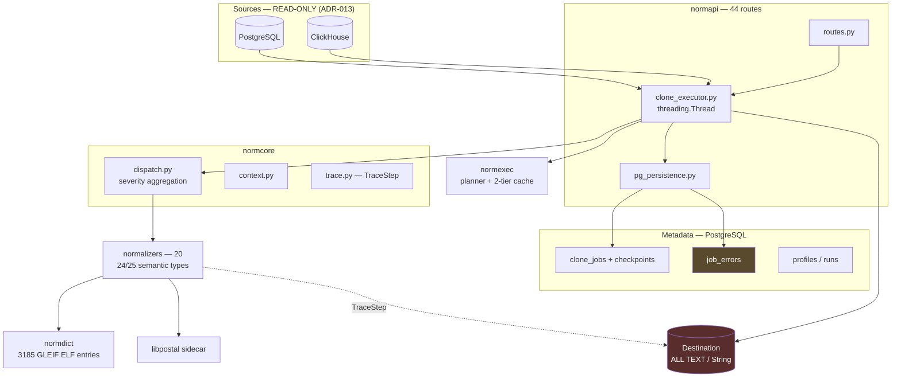
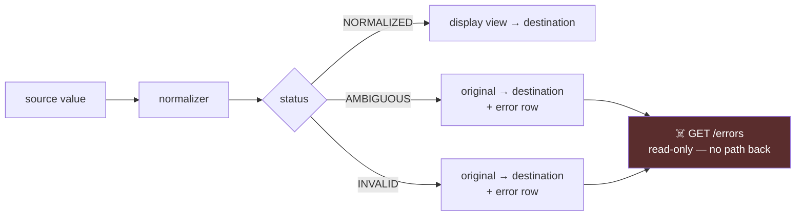
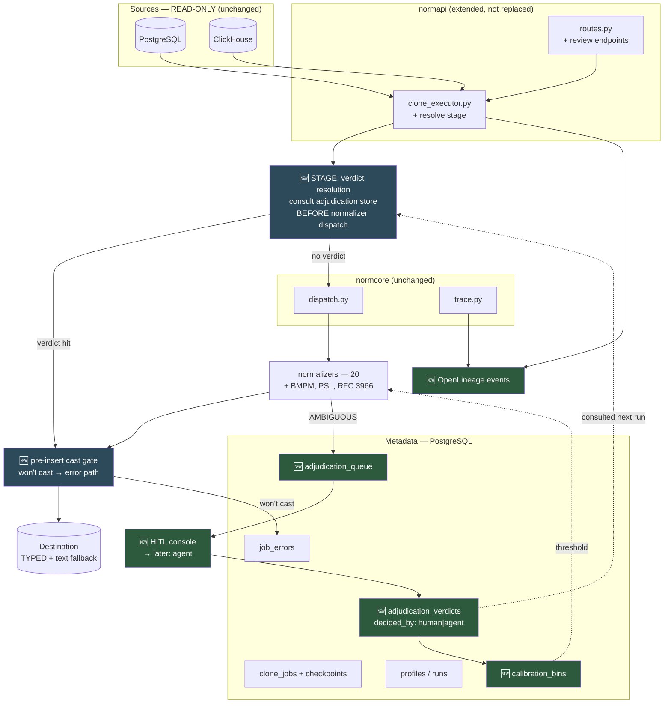
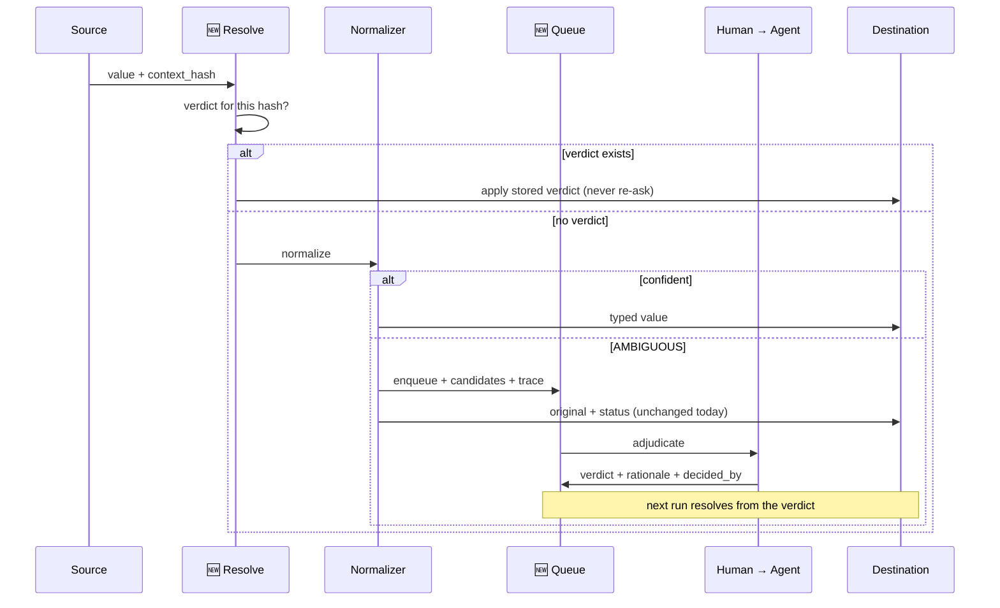

# Normalization Engine — Improvement Report

**Date:** 2026-09-30
**Author:** Hermes (code-graph audit + nine-track verified research sweep)
**Status:** Proposal — no code changed
**Implementation status (2026-10-06):** Part 1 D1-D12 implemented on branch `feat/defects-fixes` from
[`docs/plans/DEFECTS_IMPLEMENTATION_PLAN.md`](plans/DEFECTS_IMPLEMENTATION_PLAN.md); per-item verdicts in
[`plans/defects/HANDOFF.md`](plans/defects/HANDOFF.md), before/after numbers in
[`plans/defects/PHASE4_REPORT.md`](plans/defects/PHASE4_REPORT.md). Where this report and the code differed
(F1-F7: D5's cast gate already existed, D10's extension was kept in `display`, decision B's verdict key, the
`confidence=` counts, `ptype`'s availability), the plan's §8 "Pre-findings" records what the code says.
**Scope confirmed with project owner** (Q&A round, 2026-09-30)

---

## Table of contents

- [0. Confirmed constraints](#0-confirmed-constraints)
- [0.1 Correction to the earlier audit](#01-correction-to-the-earlier-audit)
- [Part 1 — Defects and fixes to apply now](#part-1--defects-and-fixes-to-apply-now)
- [Part 2 — Research, cited](#part-2--research-cited)
- [Part 3 — Architecture](#part-3--architecture)
- [Part 4 — Appendices](#part-4--appendices)
- [Recommended sequence](#recommended-sequence)

---

## 0. Confirmed constraints

These answers define the scope of every recommendation below. Where a
recommendation depends on one, it is cited by question number.

| # | Question | Answer |
|---|----------|--------|
| Q1 | Schema normalization in scope? | **No — value normalization only.** Relational schema normalization (FD/UCC/IND discovery, 1NF→BCNF) is deferred to a **separate future project**. Recorded in agent memory. |
| Q2 | Product or infrastructure? | **Internal infrastructure**, one pipeline. But the data is **not** domain-specific and has **no fixed schema** — general schemas, batch, high usage volume. |
| Q3 | General or tuned to known sources? | **Arbitrary / unknown databases.** |
| Q4 | Ever distributed externally? | **Never.** Completely internal; not a published product, no revenue. |
| Q5 | Sidecars acceptable? | **Yes** (already true: `services/libpostal/`). |
| Q6 | Runtime network access? | *Deferred to owner* — asked which data needs periodic download; answered in [Appendix F](#f-periodic-data-refresh-answer-to-q6). |
| Q7 | Scale? | **>1B rows.** |
| Q8 | Dominant value domains? | *Deferred to agent* — prioritization by effect on result; **all 12 defects must be fixed**, sequenced. |
| Q9 | Languages / scripts? | **Multi-script** — Cyrillic, Arabic, CJK, Persian. |
| Q10 | Source databases? | **PostgreSQL + ClickHouse**, permanently. |
| Q11 | ER engine downstream? | **Not Splink.** Still being researched. |
| Q12 | Other consumers? | **ER/matching only** — but output **must carry appropriate types**. |
| Q13 | Audit traceability? | **Hard requirement.** |
| Q14 | What happens to `AMBIGUOUS`? | **HITL** — a human reviews and decides how it should be normalized. |
| Q15 | Human available? | **Human now (test + near term), agent later.** Design for the migration. |
| Q16 | Cost of wrong value vs. abstention? | **A wrong value is catastrophic** — abstain freely. |
| Q17 | Gold corpus? | **Small / partial.** |
| Q18 | How is correctness known today? | **Golden tests pass** (some). |
| Q19 | External benchmarks acceptable? | **Yes** — BART error injection, Raha datasets. |
| Q20 | Throughput requirement? | **Hard SLA.** |
| Q21 | Destination schema yours to change? | **Yes, fully.** |
| Q22 | LLM in the pipeline? | Per Q14 — decision happens at the review queue, never inline. |
| Q23 | Priority order | **Correctness depth → Auditability/provenance → Automation → Throughput.** |
| Q24 | Budget | **One person, ongoing.** |
| Q25 | Deliverable | **ADRs first, then a sequenced roadmap.** |

---

## 0.1 Correction to the earlier audit

An earlier pass reported twelve gaps. **Every one was re-verified against
source before this report was written, and four were wrong.** They were
wrong in a specific, instructive way: the audit searched for the library it
expected to find, found nothing, and concluded "absent" — instead of
reading how the problem had actually been solved.

| Earlier claim | Verified reality | Evidence |
|---|---|---|
| "`company.py` does not consume GLEIF ELF at runtime" | **False.** `company.py:90` loads `legal-entity-suffixes.common`; the 2026.09 dictionary carries **3,185 entries**, `source` field reads *"GLEIF ISO 20275 Entity Legal Forms code list v1.6 (2026-02-19), ACTV entries only, merged with the M3 curated seed"* | `data/dictionaries/legal-entity-suffixes.common/2026.09.json` |
| "`country_codes.py` skips historic countries, no CLDR aliases" | **False.** It uses CLDR `territoryAlias` explicitly, and deliberately accepts **only single-successor** aliases — `SU` → 15 states is correctly refused rather than guessed | `country_codes.py:23-24, 81-86` |
| "No cross-field / multi-pass reconciliation" | **False.** `cross_table_entity_key` propagates a resolved country signal across tables into later rows' context | `clone_executor.py:1203, 1833, 2024` |
| "Destination collapses to TEXT (oversight)" | **Mischaracterized.** It is a documented decision with a written unblock condition | `postgres_destination.py:25-44` |

The audit also reported resumability as unclear. It exists: chunk-level
checkpoints persisted in `normalization_clone_jobs`, resume-by-skip from the
last committed offset (`clone_executor.py:1882-1888`).

**Consequence for the reader:** the engine is in materially better shape
than the first report implied, and every remaining claim in this document
carries a `file:line` so it can be checked independently rather than
trusted.

---

# Part 1 — Defects and fixes to apply now

Twelve defects, ordered by **effect on result** (Q8), weighted by the
priority order in Q23. Severity reflects impact under the confirmed
constraints — notably Q16 (a wrong value is catastrophic) and Q9
(multi-script data).

---

## D1 — `AMBIGUOUS` has no exit path 🔴 CRITICAL

**Verified state.** `AMBIGUOUS` is produced in at least three normalizers:
`phone.py:209`, `date.py:575`, `money.py:183`. `NEEDS_REVIEW` is declared at
`enums.py:23` and appears in the severity ordering at `dispatch.py:309` —
**and nowhere else in the codebase.** Errors are exposed read-only through
`GET /runs/{run_id}/errors` (`routes.py:399`) and
`GET /clone-jobs/{job_id}/errors` (`routes.py:1082`). There is no queue, no
decision record, and no mechanism by which a human verdict can re-enter the
pipeline.

**Why this is first.** Q16 says a wrong value is catastrophic and Q14 says a
human must decide. The engine already does the hard and correct thing — it
refuses to guess. Then the refusal evaporates: downstream, an abstention is
indistinguishable from a failure, and the human who was supposed to decide
has no interface through which to do so. Every other improvement is worth
less until the abstention path terminates somewhere useful.

**Fix.** A review-queue store plus a verdict path. A human supplies the
correct normalized value; the verdict is stored keyed by
`(context_hash, profile_version, env_id)` and consulted on subsequent runs,
so the same ambiguity is never asked twice. This is not a novel design:
Fellegi & Sunter's 1969 foundational record-linkage paper specifies exactly
three outcomes — link, non-link, and **clerical review** — and the third was
load-bearing, not an afterthought.

**Designing for Q15 (agent migration).** The verdict record must carry
`decided_by` (`human:alice` / `agent:v3`), `decided_at`, `rationale`, and
`confidence` **from the first version**. Swapping a human decider for an
agent then becomes a different value in a column rather than a schema
migration and a backfill.

---

## D2 — `confidence` is decorative 🔴 CRITICAL

**Verified state.** Across `packages/normalizers/src/normalizers/*.py` there
are 61 `confidence=` assignments. **28 are the literal `1.0`, 14 are the
literal `0.0`, 3 are the literal `0.5`.** The remainder are short
hand-written expressions such as `0.85 if via_non_iso_alias else 1.0`
(`country_codes.py`) and
`min(1.0 if idn_ok else 0.7, 0.8 if scheme_assumed else 1.0)` (`email.py`).
A search for `calibrat|isotonic|temperature_scal|conformal` across
`packages/` returns **zero hits**.

**Why.** Under Q16, the abstain-versus-emit threshold is the most
safety-critical parameter in the system — and it currently rests on numbers
a developer typed while writing each normalizer. The system cannot answer
the one question that matters: *when the engine reports 0.85, how often is
it actually right?* Until that has an answer, every threshold built on
`confidence` is arbitrary, and "abstain freely" cannot be tuned because
there is no dial with a known scale.

**Fix, in order.**

1. **Measure.** Bin predictions by stated confidence against the gold
   corpus and plot a reliability diagram. This alone will show whether the
   28 hard-coded `1.0`s are honest.
2. **Threshold.** Chow's rule converts the Q16 answer — the relative cost of
   a wrong value versus an abstention — into an actual optimal threshold.
   The cost ratio is a parameter to be stated, not a vibe to be felt.
3. **Guarantee.** Conformal prediction (MAPIE) upgrades the threshold to a
   distribution-free coverage guarantee: emit a candidate *set*, and abstain
   whenever the set holds more than one member.
4. **Report.** Risk–coverage curves, not accuracy. A system permitted to
   abstain is not honestly described by a single accuracy number.

**Blocked by D6** — calibration is impossible without labels.

---

## D3 — Provenance stops at the process boundary 🟠 HIGH

**Verified state.** Per-value provenance exists and is good: `TraceStep`
(`normcore/trace.py:18`) records each transformation. A search for
`openlineage|prov-o|prov_o|lineage` across `packages/` returns **zero
hits**.

**Why.** Q13 makes audit traceability a hard requirement. The engine can
currently answer *"how was this single value produced?"* but not *"which
source columns produced this destination column in run X?"* without
scanning rows. Those are different questions, and auditors ask the second
one.

**Fix.** Emit OpenLineage events at job boundaries. Its column-lineage facet
is precisely the missing question, Marquez provides a queryable lineage
graph with no bespoke work, and the format is an existing standard. There is
no reason to invent a provenance schema here.

---

## D4 — `type_detection` cannot see disguised missing data 🟠 HIGH

**Verified state.** `normanalysis/type_detection.py` combines keyword tables
with optional value-shape sniffing, and it is careful work: `_discriminates`
(`type_detection.py:290-291`) refuses to treat a validator's assent as
evidence unless that validator can demonstrably say *no*, and there are two
documented negative controls (`type_detection.py:58-68`) to stop a
permissive validator rubber-stamping a guess. The limitation is structural,
not sloppy — it classifies **columns**, never **cells**.

**Why.** Q3 (arbitrary schemas) and Q7 (>1B rows) together mean manual
per-column configuration cannot scale. A column that is 97% dates and 3%
`"N/A"`, `-999`, and `"unknown"` has, today, no way to say so: it is one
type for the whole column, and the disguised nulls are silently
mis-normalized or silently failed.

**Fix.** Add `ptype`, which models disguised missing data explicitly as a
first-class outcome and reports **which cells** are non-conforming. It
complements the existing keyword layer rather than replacing it — the
negative-control design is worth keeping — and `MissingKind` already exists
to receive the output.

---

## D5 — Destination columns are all TEXT 🟠 HIGH

**Verified state.** All 24 handled semantic types map to `TEXT`
(PostgreSQL) / `String` (ClickHouse). This is **decision #8**, documented in
`postgres_destination.py:25-44`, and the reasoning is sound: a value that
normalizes to `INVALID` (the comment's example is `"d1989-12-11"`) cannot be
inserted into a `DATE` column, and the failed insert kills the whole chunk
transaction. The comment also records its own unblock condition — *"revisit
only if the executor gains real pre-insert type validation/casting."*

**Why it must move now.** Q12 requires appropriate types on the output and
Q21 confirms the destination schema is yours to change. The existing
decision is not wrong; it says *do the casting work first*. That work is now
in scope.

**Fix.** A pre-insert cast gate. A value that will not cast is routed down
the same error path as a normalization failure — and, with D1 in place, into
the review queue — instead of being handed to the database to reject and
take the transaction down with it. Once no un-castable value can reach an
`INSERT`, typed columns become safe.

**Sequencing.** This unblocks only after D1. Typing the destination without
somewhere for un-castable values to go simply reintroduces the chunk-kill
bug that decision #8 was written to prevent.

---

## D6 — The gold corpus measures regression, not accuracy 🟠 HIGH

**Verified state.** 875 test functions in total; **46 of them golden**,
across 7 files in `tests/golden/`. They are hand-written assertions citing
`Source.txt` section numbers — for example, that in `10-12 Baker St.` the
house-number range must survive and must never become `1012`. These are
genuinely good regression tests. There are **no data corpus files**:
`find tests -name '*.json' -o -name '*.csv' -o -name '*.yaml'` returns
nothing.

**Why.** Q17 reports a small/partial corpus and Q18 reports that correctness
is known because golden tests pass. Golden tests prove behaviour did not
*change*. They cannot measure whether behaviour is *right*, they cannot
produce an accuracy number, and they cannot calibrate D2.

**Fix.**

- **BART** injects controlled errors into a copy of your own data with known
  ground truth — it *manufactures* the corpus that is missing, rather than
  requiring anyone to hand-label at >1B-row scale.
- **Raha's six datasets** provide an external regression suite (Q19 = yes).
- **Measure the corpus's own ambiguity rate** with Krippendorff's α or
  Cohen's κ. Where annotators genuinely disagree, `AMBIGUOUS` is the
  *correct* gold label, not a miss — and a corpus that does not know its own
  ambiguity rate will punish the engine for being right.

---

## D7 — The stdnum registry covers four countries 🟡 MEDIUM

**Verified state.** `_STDNUM_REGISTRY` (`identifier.py:68-73`) contains
exactly four entries: `US: us_ein`, `GB: gb_vat`, `DE: de_vat`,
`FR: fr_siren`. python-stdnum ships 100+ country/domain modules. The
in-code comment (`identifier.py:63-67`) is explicit and honest: *"A small,
real, working subset — not the full stdnum catalog — extend as new countries
are actually needed, per the same evidence-driven policy as
normalizers/country_codes.py's alias table."*

**Why medium rather than high.** The evidence-driven policy is defensible
and consistent with the rest of the codebase. But Q3 (arbitrary databases)
means "as actually needed" arrives unpredictably, and an unrecognized
country silently receives weaker validation rather than an explicit signal.

**Fix.** Generate the registry from python-stdnum's machine-readable formats
index rather than curating it by hand. Separately — and this is the larger
win — encode the tri-state outcome: `valid` / `invalid` / **`unverifiable`**.
A VIES outage does not make a VAT number invalid. Collapsing "we checked and
it is wrong" into the same state as "we could not check" is data corruption
under Q16.

---

## D8 — `TAX_ID` and `CODE` share one normalizer 🟡 MEDIUM

**Verified state.** `identifier.py:92-94` —
`supported_types = {IDENTIFIER, TAX_ID, CODE}`. All three semantic types
receive identical treatment: Unicode digit folding, uppercasing, separator
handling.

**Why.** A tax ID has a jurisdiction and a check digit and can be *verified*.
A generic code has neither and can only be *canonicalized*. Treating them
identically means either the tax ID is under-validated or the generic code
is over-constrained — and the current shared path does the former.

---

## D9 — `url.py` has no Public Suffix List 🟡 MEDIUM

**Verified state.** Imports are `urlsplit` / `urlunsplit` from
`urllib.parse`, plus `idna`. No `tldextract`, no `publicsuffix`, no
`urlcanon`.

**Why.** Without the PSL the registrable domain cannot be computed. It is
not "the last two labels" — `a.co.uk` and `a.uk` have different shapes, and
thousands of suffixes break the naive rule. Under Q11 (ER downstream,
engine undecided) the registrable domain is the single most useful URL
blocking key, and the `structured` view does not currently contain it.

---

## D10 — `phone.py` cannot round-trip extensions 🟡 MEDIUM

**Verified state.** `phonenumbers` is imported and E.164 is stored. No
RFC 3966, no `tel:` handling.

**Why.** E.164 has no representation for an extension. Any number carrying
one therefore loses it silently — a Q16-class defect, since the emitted
value is confidently wrong rather than flagged.

**Fix.** Adopt the RFC 3966 `tel:` URI as the canonical form. Read
libphonenumber's `FALSEHOODS.md` and `FAQ.md` before finalizing the column
design — notably, store E.164 **together with the region**, because E.164
alone is not sufficient to re-render or re-parse correctly.

---

## D11 — Phonetics are Anglo-centric 🟡 MEDIUM — *raised in priority by Q9*

**Verified state.** `jellyfish` is imported (Soundex, Metaphone, NYSIIS,
Jaro-Winkler). No Double Metaphone, no Beider-Morse.

**Why this moved up.** Q9 confirms multi-script data — Cyrillic, Arabic,
CJK, Persian. Soundex is an algorithm designed for Anglo-American surnames;
applied to transliterated Persian or Arabic names it produces something
close to noise, and it does so *confidently*. Beider-Morse exists
specifically for language-aware, multi-script name matching. Under Q9 this
is a top-tier correctness defect for this data, not a refinement.

**Licence constraint.** `abydos` has the broadest algorithm coverage but is
GPL-3.0. Q4 (internal-only) makes this legally moot, **but the project's own
`scripts/license_policy.toml` denies GPL and CI enforces it** — the gate
will reject it regardless. Use `phonetics` or `Metaphone` (both permissive),
or port the Beider-Morse rule files from Apache Commons Codec (Apache-2.0).

---

## D12 — `NEEDS_REVIEW` has no defined semantics 🟢 LOW

**Verified state.** Declared at `enums.py:23`; positioned in the severity
ordering between `PARTIAL` and `AMBIGUOUS` (`dispatch.py:309`). No
normalizer emits it.

**Fix.** Either give it a precise meaning under D1 — the natural one being
*"the engine produced a value but a human must confirm it,"* as distinct
from `AMBIGUOUS` meaning *"the engine refused to choose"* — or delete it. A
status that nothing can ever produce is a lie in the type system.

---

## Verified as already sound — do not touch

These were checked and found correct. They are listed so that later work
does not "fix" them.

- **Read-only source enforcement at the interface level** (ADR-013): the
  `SourceConnector` protocol has no write method at all. Read-only is
  structural, not a convention.
- **The seven-view value model** — original / repaired / display /
  comparison / search / ascii / structured, plus status, confidence, flags,
  trace, lossiness, `profile_version`, `env_id`, `semantic_type`,
  `context_hash`. This is richer than most commercial offerings surveyed.
- **EDTF is already wired in** — `date.py:34` imports both `edtf.natlang`
  and `edtf.parser`; `date.py:237-257` documents precision handling.
- **Chunk-level resumability** — checkpoints persisted, resume by skipping
  to the last committed offset (`clone_executor.py:1882-1888`).
- **The multi-script text stack** — `PyICU`, `ftfy`, `charset-normalizer`,
  `anyascii`, `regex`. Correct choices for Q9.
- **The licence policy gate** — `scripts/license_policy.toml` with a
  three-tier model (`allowed`, `allowed_unmodified_dynamic_only` for LGPL,
  `denied`), enforced by `scripts/check_licenses.py` in CI.
- **15 honest `ponytail:` markers**, each naming its own ceiling and upgrade
  path.
- **17 existing ADRs** — the decision history is already documented.

---

# Part 2 — Research, cited

The full sweep is 1,130 unique verified URLs across nine tracks in
[`docs/research/resources/`](research/resources/). Cited below are only the
sources that bear directly on a decision in this report.

## Abstention and calibration (D1, D2)

| Source | URL | Relevance |
|---|---|---|
| Chow (1970), *On Optimum Recognition Error and Reject Tradeoff* | `https://dl.acm.org/doi/10.1109/TIT.1970.1054406` (bot-walled to scripted clients) | The original abstention threshold; converts a cost ratio into an optimal reject rule |
| Hendrickx et al., *Machine Learning with a Reject Option: A Survey* | `https://arxiv.org/abs/2107.11277` | Current taxonomy of reject options |
| El-Yaniv & Wiener, *Foundations of the Theory of Noise-free Selective Classification* | `https://jmlr.org/papers/v11/el-yaniv10a.html` | Risk–coverage as the honest report format |
| Angelopoulos & Bates, *A Gentle Introduction to Conformal Prediction* | `https://arxiv.org/abs/2107.07511` | Distribution-free guarantees without retraining |
| MAPIE | `https://github.com/scikit-learn-contrib/MAPIE` | Practical conformal implementation |
| Guo et al., *On Calibration of Modern Neural Networks* | `https://arxiv.org/abs/1706.04599` | Why raw confidence scores need calibrating |
| Ovadia et al., *Can You Trust Your Model's Uncertainty?* | `https://arxiv.org/abs/1906.02530` | Calibration drifts under dataset shift — recalibrate **per source** |
| Fellegi & Sunter (1969) | `https://nhis.ipums.org/nhis/resources/Fellegi69.pdf` | Three outcomes: link / non-link / clerical review |

## Missing-data semantics (D1, D4, D12)

| Source | URL | Relevance |
|---|---|---|
| Codd, *Missing Information (Applicable and Inapplicable)* | `https://sigmodrecord.org/publications/sigmodRecord/8612/pdfs/16301.16303.pdf` | The canonical distinction `MissingKind` encodes |
| HL7 FHIR `dataAbsentReason` | `https://hl7.org/fhir/extensions/StructureDefinition-data-absent-reason.html` | A battle-tested vocabulary overlapping `MissingKind` — align rather than invent |
| Stata extended missing values | `https://www.stata.com/manuals/dmissingvalues.pdf` | 27 distinguishable missing codes in a production system |

## Human-in-the-loop and the agent migration (D1, Q15)

| Source | URL | Relevance |
|---|---|---|
| Label Studio | `https://github.com/HumanSignal/label-studio` | Ready-made adjudication UI |
| Argilla | `https://github.com/argilla-io/argilla` | Feedback collection, LLM-era workflows |
| modAL | `https://github.com/modAL-python/modAL` | Turns the abstention queue into an active-learning pool — abstained cases are the most informative to label |
| Mozannar & Sontag, *Learning to Defer to an Expert* | `https://arxiv.org/abs/2006.01862` | Formal theory for the human → agent transition in Q15 |

## Provenance and lineage (D3)

| Source | URL | Relevance |
|---|---|---|
| OpenLineage specification | `https://github.com/OpenLineage/OpenLineage/blob/main/spec/OpenLineage.md` | The event model to emit |
| Column-lineage facet | `https://openlineage.io/docs/spec/facets/dataset-facets/column_lineage_facet/` | Exactly the "which source columns produced this column" question |
| Marquez | `https://github.com/MarquezProject/marquez` | Reference OpenLineage store with a queryable graph |
| W3C PROV-O | `https://www.w3.org/TR/prov-o/` | Formal provenance ontology if the audit requirement hardens |
| Cheney et al., *Provenance in Databases: Why, How, and Where* | `https://homepages.inf.ed.ac.uk/jcheney/publications/provdbsurvey.pdf` | Vocabulary — `TraceStep` is why-provenance; D3 adds where-provenance |

## Column type detection (D4)

| Source | URL | Relevance |
|---|---|---|
| Ceritli et al., *ptype: Probabilistic Type Inference* | `https://arxiv.org/abs/1911.10081` | Models disguised missing data explicitly; flags non-conforming **cells** |
| ptype implementation | `https://github.com/alan-turing-institute/ptype` | Reference code |
| ptype-cat | `https://arxiv.org/abs/2111.11956` | Extension to categorical columns |
| Sato | `https://github.com/megagonlabs/sato` | Table-context semantic typing |
| Auto-Type (SIGMOD 2018) | *in `_raw-data-quality-er.md` §7* | Synthesizes type-detection logic by mining open-source validators |

## Typed storage (D5)

| Source | URL | Relevance |
|---|---|---|
| Arrow Columnar Format | `https://arrow.apache.org/docs/format/Columnar.html` | Validity bitmaps — how an abstained value coexists with a strongly-typed column |
| Open Data Contract Standard | `https://github.com/bitol-io/open-data-contract-standard` | Destination schema as a versioned contract |

## Evaluation and ground truth (D6)

| Source | URL | Relevance |
|---|---|---|
| **BART** error generator | `https://github.com/dbunibas/BART` | **Highest-leverage item in the entire sweep** — controlled error injection into your own data with known ground truth |
| Raha / Baran | `https://github.com/BigDaMa/raha` | Six benchmark datasets; external regression suite |
| Mahdavi & Abedjan, *Baran* (VLDB 2020) | `https://www.vldb.org/pvldb/vol13/p1948-mahdavi.pdf` | The most on-point paper for value-level correction |
| Christen & Hand, *A Review of the F-Measure* | `https://users.cecs.anu.edu.au/~Peter.Christen/publications/christen2023fmeasure.pdf` | Why F-measure misleads in linkage evaluation |
| Artstein & Poesio, *Inter-Coder Agreement* | `https://aclanthology.org/J08-4004/` | κ / α — measuring the corpus's own ambiguity rate |
| mutmut | `https://github.com/boxed/mutmut` | Proves the golden corpus actually detects rule changes |

## Identifiers (D7, D8)

| Source | URL | Relevance |
|---|---|---|
| python-stdnum formats index | `https://arthurdejong.org/python-stdnum/formats` | Machine-readable — generate the registry instead of curating |
| `stdnum.iso7064` | *within python-stdnum* | ISO/IEC 7064 check-digit algorithms |
| GLEIF ELF code list | `https://www.gleif.org/en/about-lei/code-lists/iso-20275-entity-legal-forms-code-list` | **Already consumed** — v1.6, 3,185 entries |
| EU VIES | `https://ec.europa.eu/taxation_customs/vies/` | Design for `MS_UNAVAILABLE` → `unverifiable`, never `invalid` |

## URL (D9)

| Source | URL | Relevance |
|---|---|---|
| WHATWG URL Standard | `https://url.spec.whatwg.org/` | Decide WHATWG vs RFC 3986 explicitly — they differ materially |
| Public Suffix List | `https://publicsuffix.org/list/` | MPL-2.0; required for registrable domain |
| tldextract | `https://github.com/john-kurkowski/tldextract` | Pin the PSL snapshot for reproducibility |

## Phone (D10)

| Source | URL | Relevance |
|---|---|---|
| RFC 3966 | `https://www.rfc-editor.org/rfc/rfc3966` | `tel:` URI — the canonical form that survives extensions |
| libphonenumber `FALSEHOODS.md` | `https://github.com/google/libphonenumber/blob/master/FALSEHOODS.md` | Read before designing the column |

## Names, multi-script (D11, Q9)

| Source | URL | Relevance |
|---|---|---|
| Beider-Morse Phonetic Matching | `https://stevemorse.org/phonetics/bmpm.htm` | Language-aware multi-script name matching |
| Apache Commons Codec `BeiderMorseEncoder` | `https://commons.apache.org/proper/commons-codec/` | Apache-2.0 rule files, portable |
| `phonetics` / `Metaphone` | `https://pypi.org/project/phonetics/` | Permissive Double Metaphone |
| **`abydos` — GPL-3.0** | `https://github.com/chrislit/abydos` | Widest coverage; **blocked by this project's own licence policy** |
| rigour / fingerprints (OpenSanctions) | `https://github.com/opensanctions/rigour` | MIT; best-in-class org-name fingerprint for blocking |
| OpenSanctions, *Name Matching in Sanctions Screening* | `https://www.opensanctions.org/articles/2025-06-24-name-matching/` | Practitioner account of multi-script name matching |
| Cohen, Ravikumar & Fienberg | `https://www.cs.cmu.edu/~wcohen/postscript/ijcai-ws-2003.pdf` | Empirical comparison of string metrics |
| iuliia | `https://github.com/nalgeon/iuliia` | 20 Russian→Latin transliteration schemes |
| uroman | `https://github.com/isi-nlp/uroman` | Apache-2.0 universal romanizer |

## Throughput — deferred under Q23

Arrow · Polars categoricals with `StringCache` · `pyahocorasick` ·
`marisa-trie` · BurntSushi FSTs · PyO3 · RE2. Full entries in
[`_raw-pipeline-engineering.md`](research/resources/_raw-pipeline-engineering.md)
§§ on performance. Deferred because Q23 ranks throughput last and the SLA
(Q20) has not yet been measured against.

## Deferred to the future schema project (Q1)

Desbordante · Papenbrock & Naumann, *Data-driven Schema Normalization*
(EDBT 2017) · HyFD · Pyro. Full entries in
[`_raw-schema-normal-forms.md`](research/resources/_raw-schema-normal-forms.md).

---

# Part 3 — Architecture

## 3.1 Current architecture (verified)

**Red** — everything collapses to TEXT (D5). **Amber** — errors are
read-only; no verdict can return (D1).

## 3.2 Current value flow — where abstention dies

## 3.3 Target architecture — two additions, not a rewrite

There are **exactly two structural changes**: one new storage area
(adjudication) and one new pipeline stage (verdict resolution). Every
existing component keeps its current shape and responsibilities.

## 3.4 The abstention lifecycle — the core new behaviour

**Key property.** On the first run, the destination write path for an
ambiguous value is *unchanged*. Nothing regresses, nothing breaks. The queue
is purely additive; the benefit arrives on the second run and compounds
thereafter.

## 3.5 Storage additions

Three tables in the **existing** metadata PostgreSQL database, alongside
`normalization_clone_jobs` — same store, same transactional semantics, no
new infrastructure to operate (Q24: one person).

| Store | Holds | Keyed by | Why it is separate |
|---|---|---|---|
| `adjudication_queue` | Pending ambiguous values, candidate normalizations, trace | `context_hash` | A work list that drains to empty. Deduplicating by hash means one million identical ambiguous values become **one** question. |
| `adjudication_verdicts` | Human/agent decisions; permanent | `(context_hash, profile_version, env_id)` | The permanent record. Keying on profile and environment means a rule change correctly invalidates stale verdicts instead of silently reapplying them. |
| `calibration_bins` | Predicted confidence vs observed correctness, per source | `(semantic_type, source_id, bin)` | Ovadia et al.: calibration drifts per source. A single global number would be measurably wrong. |

**Sizing under Q7 (>1B rows).** The queue is bounded by the number of
*distinct ambiguous contexts*, not by row count. That distinction is what
makes the design tractable rather than absurd: repeated dirty values —
which dominate real data — collapse to a single queue entry.

## 3.6 Decision register

For each decision: the reason, the architectural impact, and the
alternative deliberately deferred to keep the system simple.

| # | Decision | Reason | Architectural impact | Alternative deferred, and why |
|---|---|---|---|---|
| **A** | Adjudication store lives in the existing metadata PostgreSQL | Shares a transaction with checkpoint writes; zero new infrastructure (Q24: one operator) | Three new tables | A dedicated review service — no benefit at this team size, and a second thing to run |
| **B** | Verdicts keyed on `context_hash` + `profile_version` + `env_id` | Collapses >1B rows into distinct contexts; a rule change auto-invalidates affected verdicts | Reuses the hash that already exists | Per-row verdicts — does not scale and cannot be invalidated coherently |
| **C** | Resolve stage runs *before* normalizer dispatch | A human verdict is authoritative; re-normalizing a settled value risks overriding it | One new stage, no changes to `normcore` | Post-hoc patching of results — loses trace coherence and makes provenance lie |
| **D** | `decided_by` recorded from the first version | Q15 states agents come later; this makes the swap a column value, not a migration | One column | Adding it later — needs a migration plus a backfill of unattributable history |
| **E** | Calibration bucketed per `(semantic_type, source)` | Ovadia et al.: calibration drifts per feed | One table | A single global scalar — demonstrably wrong under dataset shift |
| **F** | OpenLineage rather than a bespoke provenance format | Q13 is a hard requirement; Marquez gives a queryable graph free | An emitter at the job boundary | A custom lineage schema — reinvention with no consumers |
| **G** | Typed destination columns only *after* the cast gate exists | Honours the unblock condition already written into decision #8 | Gate sits before every insert | Typing the destination immediately — reintroduces the chunk-kill bug decision #8 prevents |
| **H** | BART to manufacture the gold corpus | Q17 reports a partial corpus; BART generates ground truth from your own data | Test-side only; no production code | Hand-labelling at >1B-row scale — not possible for one person |
| **I** | Permissive phonetics libraries only | The project's own `license_policy.toml` denies GPL and CI enforces it | Library selection only | `abydos` — broadest coverage, but the CI gate rejects it |
| **J** | `ptype` alongside, not replacing, keyword detection | The existing negative controls (`_discriminates`) are good work worth keeping | An optional analysis stage | Full replacement — discards a working, well-reasoned component |
| **K** | No LLM on the hot path | Q22 defers to Q14: decisions happen at the review queue, by human or agent, never inline | None | An inline LLM normalizer — breaks every guarantee the engine provides |

## 3.7 Explicitly deferred

Each of these is a conscious "not now," recorded so the reasoning is not
relitigated:

- **Relational schema normalization** (Q1) — a separate future project.
- **Throughput work** — Polars, PyO3, FSTs (Q23 ranks throughput last;
  revisit once the SLA in Q20 is measured and actually missed).
- **ER-engine-specific output columns** — blocked on Q11.
- **Distributed execution** — ADR-016 chose single-node deliberately.
- **A real task queue** replacing `threading.Thread` — marked in
  `clone_executor.py:902`.
- **Pushdown filter on resume** — marked in `clone_executor.py:1885`;
  currently resume skips rows client-side.

---

# Part 4 — Appendices

## A. Verification method

Every claim in Part 1 carries a `file:line` obtained by direct read. Four
claims from the earlier audit were disproven by this process and are
corrected in [§0.1](#01-correction-to-the-earlier-audit).

Research URLs: 1,130 unique across nine tracks. A random sample of 60 was
independently re-fetched with a browser user-agent: **56 returned 2xx**; the
4 failures were HTTP 403 from `dl.acm.org` (×2), `iso.org`, and `unece.org`
— bot walls rather than dead links, already flagged as such inline.

## B. Measured inventory

| Metric | Value |
|---|---|
| Packages | 8 (`normcore`, `normalizers`, `normdict`, `normexec`, `normio`, `normanalysis`, `normapi`, `normcli`) |
| Registered normalizers | 20 |
| Semantic types covered | 24 of 25 (`UNKNOWN` correctly unhandled) |
| Test functions | 875 total |
| Golden tests | 46, across 7 files |
| Data corpus files | **0** |
| `ponytail:` debt markers | 15 |
| ADRs | 17 |
| API routes | 44 |
| Dictionary versions on disk | 5 |
| `confidence=` assignment sites | 61 — 28× literal `1.0`, 14× literal `0.0`, 3× literal `0.5` |
| `_STDNUM_REGISTRY` entries | 4 (US, GB, DE, FR) |
| GLEIF ELF dictionary entries | 3,185 (v1.6, ACTV only) |
| Calibration code | 0 occurrences |
| Lineage code | 0 occurrences |

## C. Licence position

Q4 confirms the engine is internal-only and never distributed, which makes
copyleft obligations largely moot **legally**. However
`scripts/license_policy.toml` denies GPL, tiers LGPL to
`allowed_unmodified_dynamic_only` (currently `pycountry`, `python-stdnum`,
`nameparser`), and `scripts/check_licenses.py` enforces this in CI.

**Recommendation: keep the policy unchanged.** It costs nothing — a
permissive substitute exists for every GPL library under consideration — and
it preserves the option to distribute later without an archaeology project.

The single item warranting a conscious decision is **libpostal's model
data**, which derives from OSM/OpenAddresses (ODbL) even though libpostal's
own code is MIT. Irrelevant while internal; blocking if the engine is ever
shipped.

## D. Security note from the research sweep

The host `wiesmann.codiferes.net` ("Falsehoods programmers believe about
geography") returned a **prompt-injection payload** in place of article
text during the sweep. It was excluded from all resource files. Do not point
an autonomous agent at that URL.

## E. Open question

**Q11 — the ER engine is undecided** (confirmed not Splink). The choice
determines what the normalizer must *materialize* for it: precomputed
phonetic keys, blocking keys, comparison-ready forms. D9 (registrable
domain) and D11 (phonetic encoders) each partly depend on the answer, since
both produce blocking keys whose required shape is consumer-specific.

## F. Periodic data refresh — answer to Q6

The question asked in return: *which data actually needs periodic
download?* The complete list for the current dependency set, with the
authoritative machine-readable feed for each:

| Data | Feed | Cadence | Consumed by |
|---|---|---|---|
| GLEIF ELF code list | `https://www.gleif.org/en/about-lei/code-lists/iso-20275-entity-legal-forms-code-list` | Quarterly | `legal-entity-suffixes.common` (**already wired**) |
| CLDR (territory aliases, locale data) | `https://cldr.unicode.org/` | ~2× per year | `country_codes.py`, `scripts/generate_cldr_names.py` |
| IANA language subtag registry | `https://www.iana.org/assignments/language-subtag-registry` | Continuous | `language.py` |
| ISO 4217 currency codes | SIX XML — `https://www.six-group.com/en/products-services/financial-information/data-standards.html` | On amendment | `money.py` |
| tzdata | `https://www.iana.org/time-zones` | ~4–6× per year | date/time handling |
| Public Suffix List | `https://publicsuffix.org/list/` | Continuous | D9, once adopted |
| libphonenumber metadata | via `phonenumbers` releases | ~monthly | `phone.py` |
| python-stdnum | PyPI releases | Periodic | `identifier.py` |
| Unicode UCD / ICU | via `PyICU` builds | Annual | text normalization |
| libpostal models | `https://github.com/openvenues/libpostal` | Rare | libpostal sidecar |

**Recommendation.** Refresh **offline, on a schedule, into versioned
dictionary snapshots** — exactly the pattern
`data/dictionaries/<name>/<version>.json` already implements. Never perform
live lookups on the hot path: they make runs unreproducible, they break the
`env_fingerprint` guarantee, and under Q16 an outage must produce
`unverifiable`, never a wrong answer.

## G. Research corpus index

| File | Entries | Domain |
|---|---|---|
| [`_raw-data-quality-er.md`](research/resources/_raw-data-quality-er.md) | 206 | Cleaning/DQ frameworks, ER engines, column-type detection, benchmarks |
| [`_raw-identifiers-codes.md`](research/resources/_raw-identifiers-codes.md) | 201 | stdnum, IBAN/BIC, LEI/ISIN/FIGI, VAT/EIN, phones, email RFCs, URLs/PSL, GS1, code lists, check digits |
| [`_raw-address-geo.md`](research/resources/_raw-address-geo.md) | 183 | libpostal, deepparse, formatting templates, geocoders, reference datasets, licences |
| [`_raw-names-companies.md`](research/resources/_raw-names-companies.md) | 150 | nameparser, cleanco/rigour, FollowTheMoney, phonetics, GLEIF, transliteration |
| [`_raw-pipeline-engineering.md`](research/resources/_raw-pipeline-engineering.md) | 110 | Rules DSLs, Arrow/Polars/DuckDB, resumability, OpenLineage/PROV-O, testing, performance |
| [`_raw-ambiguity-abstention.md`](research/resources/_raw-ambiguity-abstention.md) | 106 | Codd, FHIR, EDTF, probabilistic DBs, Chow, conformal prediction, calibration, HITL |
| [`_raw-unicode-text.md`](research/resources/_raw-unicode-text.md) | 91 | UAX/UTS annexes, UCD, ICU/CLDR, mojibake, transliteration, confusables, PRECIS |
| [`_raw-dates-money-units-locale.md`](research/resources/_raw-dates-money-units-locale.md) | 90 | CLDR/TR35, ISO 8601-2, RFC 9557, EDTF, tzdb, ISO 4217, pint/UCUM |
| [`_raw-schema-normal-forms.md`](research/resources/_raw-schema-normal-forms.md) | 87 | 1NF–6NF, FD/UCC/IND discovery, Desbordante — **deferred project** |
| **Total** | **1,130 unique URLs** | |

---

# Recommended sequence

Ordered by dependency and by the priority in Q23
(correctness → provenance → automation → throughput).

## Phase 1 — Make abstention real (correctness)

1. **D1** — adjudication queue + verdict store + resolve stage.
2. **D6** — BART-generated gold corpus with known ground truth.
3. **D2** — measure calibration, apply Chow's rule, then conformal sets.

These three unlock one another in exactly this order: D2 cannot be done
without D6's labels, and D6 is far more valuable once D1 gives ambiguous
cases somewhere to be recorded.

## Phase 2 — Provenance and types

4. **D3** — OpenLineage emission at job boundaries.
5. **D5** — pre-insert cast gate, then typed destination columns
   (unblocked by D1).
6. **D11** — multi-script phonetics (high priority under Q9).

## Phase 3 — Automation and depth

7. **D4** — ptype for cell-level disguised-missing detection.
8. **D7 / D8** — generated stdnum registry, tri-state validation, split
   `TAX_ID` from `CODE`.
9. **D9 / D10** — Public Suffix List, RFC 3966.
10. **D12** — give `NEEDS_REVIEW` a meaning or delete it.

## Phase 4 — Throughput

Only after the SLA in Q20 is measured against real volume and actually
missed. The research is catalogued and ready; spending effort here first
would optimize a system whose correctness is not yet measurable.

---

## Next deliverable

Per Q25 (**ADRs first, then the roadmap**), the three ADRs to draft are:

- **ADR-018 — Abstention and adjudication policy** (D1, D12; decisions A–D, K)
- **ADR-019 — Confidence calibration** (D2; decision E)
- **ADR-020 — Typed destination with pre-insert casting** (D5; decision G)

Each records the decision, the reason, the architectural impact, and the
alternatives deferred — matching the format of ADR-001 through ADR-017.
